# AuctionServer — architecture

> English version. Polish 1:1 counterpart: [../pl/ARCHITECTURE.md](../pl/ARCHITECTURE.md)

AuctionServer is a .NET 10 modular monolith for a gamified auction house: seven modules (Identity, Wallets, Auctions, Inventory, Warehouses, Banking, Pawnshop) run in one ASP.NET Core process, share one PostgreSQL database and talk to each other only through integration events carried by a transactional outbox and consumed through an inbox. This page covers the system context, the module layering, request handling, cross-module messaging, the three auction flows, the warehouse-war flow, the bank-loan flow and the pawnshop flow, the data model, the CI pipeline, the design patterns in use and the known limitations. Module-level detail lives in the [backend chapters](backend/README.md).

## System context

The diagram shows the single process that exists today, the PostgreSQL database behind it and, with dashed borders, the parts that are planned but not yet in the repository.

<picture>
  <source media="(prefers-color-scheme: dark)" srcset="../diagrams/architecture-01-system-context.dark.svg">
  
</picture>

Today the whole system is one ASP.NET Core host, [`AuctionServer.Api`](../../Backend/src/AuctionServer.Api/Program.cs), listening on `http://localhost:5244` in development ([`launchSettings.json`](../../Backend/src/AuctionServer.Api/Properties/launchSettings.json)). Clients call minimal-API endpoints with JSON; the repository contains no frontend, no gateway, no message broker and no bot code. The planned target, described in the deleted `AGENTS.md` and in the previous README, puts an Angular frontend and Python AI bots behind an API gateway and moves integration events to RabbitMQ; the `IIntegrationEventPublisher` seam is the place where that transport would plug in.

| Component | Status | Documented in |
|---|---|---|
| `AuctionServer.Api` host with the seven modules | exists | [backend/README.md](backend/README.md) |
| PostgreSQL, one database, 26 tables | exists (started by hand, by Compose or by Testcontainers) | [Data model](#data-model) |
| Docker Compose (API image plus PostgreSQL) | exists | [backend/README.md](backend/README.md) |
| GitLab CI and GitHub Actions pipelines | exist | [Build and CI](#build-and-ci) |
| Angular frontend | planned | [frontend.md](frontend.md) |
| API gateway, RabbitMQ | planned | [infrastructure.md](infrastructure.md) |
| AI bots (Python) | planned | [bots.md](bots.md) |

## Modules and layering

The diagram shows the project references: the host references the seven modules, every module references only `AuctionServer.Shared.Integration`, and no module references another module.

<picture>
  <source media="(prefers-color-scheme: dark)" srcset="../diagrams/architecture-02-module-layering.dark.svg">
  
</picture>

Each module is one `.csproj` split into `Presentation/` (minimal-API endpoints and request records), `Application/` (MediatR commands, queries and validators, event handlers, repository interfaces), `Domain/` (entities, enums, exceptions) and `Infrastructure/` (DbContext, repositories, EF configurations, outbox, inbox, background services, migrations). The module project files declare a single `ProjectReference`, to [`AuctionServer.Shared.Integration`](../../Backend/src/AuctionServer.Shared.Integration/AuctionServer.Shared.Integration.csproj), which holds the thirty-two event records, `AppException`, `IIntegrationEventPublisher`, `IntegrationEventTypes` and `ValidationBehaviour`. The host wires a module with one extension method per module (`AddAuctionModule`, `AddWalletsModule`, `AddIdentityModule`, `AddInventoryModule`, `AddWarehousesModule`, `AddBankingModule`, `AddPawnshopModule`) and maps its endpoints with `Map*Endpoints`; both calls sit in [`Program.cs`](../../Backend/src/AuctionServer.Api/Program.cs).

| Module | Route prefix | DbContext | Tables | Background services | Tests |
|---|---|---|---|---|---|
| [Identity](backend/identity.md) | `/api/users` | `IdentityDbContext` | `Users`, `IdentityOutboxMessages` | `OutboxProcessor` | `AuctionServer.Modules.Identity.Tests` |
| [Wallets](backend/wallets.md) | `/api/wallets` | `WalletDbContext` | `Wallets`, `WalletsFundsLocks`, `WalletsTransfers`, `WalletsOutboxMessages`, `WalletsProcessedMessages` | `OutboxProcessor` | `AuctionServer.Modules.Wallets.Tests` |
| [Auctions](backend/auctions.md) | `/api/auctions` | `AuctionDbContext` | `Auctions`, `AuctionsBids`, `OutboxMessages`, `AuctionsProcessedMessages` | `OutboxProcessor`, `AuctionCloser` | `AuctionServer.Modules.Auctions.Tests` |
| [Inventory](backend/inventory.md) | `/api/inventory` | `InventoryDbContext` | `InventoryItems`, `InventoryOutboxMessages`, `InventoryProcessedMessages` | `OutboxProcessor` | `AuctionServer.Modules.Inventory.Tests` |
| [Warehouses](backend/warehouses.md) | `/api/warehouses` | `WarehouseDbContext` | `WarehousesWars`, `WarehousesParticipants`, `WarehousesStockItems`, `WarehousesOutboxMessages`, `WarehousesProcessedMessages` | `OutboxProcessor`, `WarehouseKeeper` | `AuctionServer.Modules.Warehouses.Tests` |
| [Banking](backend/banking.md) | `/api/bank` | `BankingDbContext` | `BankingLoans`, `BankingOutboxMessages`, `BankingProcessedMessages` | `OutboxProcessor`, `BankKeeper` | `AuctionServer.Modules.Banking.Tests` |
| [Pawnshop](backend/pawnshop.md) | `/api/pawnshop` | `PawnshopDbContext` | `PawnshopShops`, `PawnshopStockItems`, `PawnshopOutboxMessages`, `PawnshopProcessedMessages` | `OutboxProcessor`, `PawnshopKeeper` | `AuctionServer.Modules.Pawnshop.Tests` |

The module rules are enforced by convention, not by tooling: no cross-module project reference, no cross-module database query, and `Domain/` and `Application/` free of ASP.NET Core types. The last rule holds for ASP.NET Core itself, but `Application/` handlers do reference their own module's `Infrastructure.Outbox` and `Infrastructure.Inbox` types to build outbox and inbox rows, and `LoginCommandHandler` reads `IConfiguration` directly.

## Request handling

Every request passes through four middlewares registered in [`Program.cs`](../../Backend/src/AuctionServer.Api/Program.cs): `UseExceptionHandler` (backed by [`GlobalExceptionHandler`](../../Backend/src/AuctionServer.Api/Infrastructure/GlobalExceptionHandler.cs)), `UseCors` (origins from `Cors:AllowedOrigins`, by default `http://localhost:4200`), `UseAuthentication` and `UseAuthorization`. Outside the business endpoints the host serves the OpenAPI document at `/openapi/v1.json` and `/health`, which runs a `SELECT 1` against the database through [`DatabaseHealthCheck`](../../Backend/src/AuctionServer.Api/Infrastructure/Health/DatabaseHealthCheck.cs). Endpoints read the caller's id from the `ClaimTypes.NameIdentifier` claim, build a MediatR command or query and call `ISender.Send`; they contain no business logic and no try/catch. The request pipeline diagram and the authentication details are in [backend/README.md](backend/README.md).

- **Validation.** [`ValidationBehaviour<,>`](../../Backend/src/AuctionServer.Shared.Integration/Validators/ValidationBehaviour.cs) is registered as a MediatR open behavior for every module assembly; it runs all FluentValidation validators of the request and throws `RequestValidationException` (400) with the messages joined by `; `.
- **Errors.** `AppException` carries its own HTTP status, so the handler returns that status with `{ "error": "<message>" }`; `DbUpdateConcurrencyException` becomes 409 `Data corrupted, try again`; anything else is logged and returned as 500 `Unhandled error occurred`.
- **Authentication.** JWT bearer is the default scheme; a second scheme named `ApiKey` reads the `X-Api-Key` header. Two policies exist: `Bot` (`RequireRole("Bot")`) and `BotProvisioning` (the `ApiKey` scheme plus an authenticated user).
- **JSON.** The host keeps the ASP.NET Core web defaults, so response property names are camelCase (`publicAuctionId`, `error`) and request bodies are matched without regard to case; enums are serialized as strings (`JsonStringEnumConverter`), so `Status` and `Rarity` values appear by name.

## Cross-module communication

Modules never call each other. A module that needs another module to react writes an integration event into its own outbox table in the same `SaveChangesAsync` as the state change; a background poller publishes it later, and the consuming module records the event id in its inbox table so that a redelivery changes nothing. The mechanics, the outbox columns and the retry policy are described in [backend/messaging.md](backend/messaging.md); the path of one event is:

1. The producer adds an `OutboxMessage` row (`Id` equal to the event's `EventId`, `Type` equal to the event class name, `Content` with the JSON payload) to the same transaction as its entity change.
2. The module's `OutboxProcessor` (a `BackgroundService`, one copy per module) polls every 3 s for up to 20 rows that are unprocessed, not dead and due, ordered by `CreatedOn`.
3. It calls [`IIntegrationEventPublisher.PublishAsync`](../../Backend/src/AuctionServer.Shared.Integration/Messaging/IIntegrationEventPublisher.cs); the only implementation, [`InProcessEventPublisher`](../../Backend/src/AuctionServer.Api/Infrastructure/Messaging/InProcessEventPublisher.cs), deserializes the payload through [`IntegrationEventTypes`](../../Backend/src/AuctionServer.Shared.Integration/Messaging/IntegrationEventTypes.cs) and publishes it with MediatR `IPublisher`.
4. MediatR runs the matching `INotificationHandler`s one after another, in the order the module assemblies are registered in `Program.cs` (Auctions, Wallets, Identity, Inventory, Warehouses, Banking, Pawnshop).
5. A consumer first asks `WasEventProcessedAsync(EventId)`, then applies the domain change and saves it together with a `ProcessedMessage` row (and a reply outbox row, when it replies) in one `SaveChangesAsync`; a primary-key violation on the inbox row surfaces as `EventAlreadyProcessedException`, which the handler swallows.
6. Any other exception propagates back to the `OutboxProcessor`, which records it on the row and schedules a retry; after the fifth failure the row is marked dead.

| Event | Payload (besides `EventId`) | Producer | Consumers | Inbox |
|---|---|---|---|---|
| `UserRegisteredEvent` | `PublicUserId`, `Email` | Identity `RegisterCommandHandler`, `RegisterBotCommandHandler` | Wallets `UserRegisteredEventHandler` | no; a duplicate hits the wallet primary key and `WalletAlreadyExistException` is swallowed |
| `ItemLockRequestedEvent` | `PublicAuctionId`, `PublicItemId`, `SellerUserId` | Auctions `CreateAuctionCommandHandler` | Inventory `ItemLockRequestedEventHandler` | yes |
| `ItemLockedEvent` | `PublicAuctionId`, `PublicItemId`, `ItemName`, `ItemRarity`, `OfficialPrice` | Inventory `ItemLockRequestedEventHandler` | Auctions `ItemLockedEventHandler` | yes |
| `ItemLockRejectedEvent` | `PublicAuctionId`, `PublicItemId`, `Reason` | Inventory `ItemLockRequestedEventHandler` | Auctions `ItemLockRejectedEventHandler` | yes |
| `AuctionCancelledEvent` | `PublicAuctionId`, `PublicItemId`, `Reason` | Auctions `AuctionCloser` | Inventory `AuctionCancelledEventHandler` | yes |
| `FundsLockRequestedEvent` | `PublicAuctionId`, `BidderUserId`, `Amount` | Auctions `PlaceBidCommandHandler` | Wallets `FundsLockRequestedEventHandler` | yes |
| `FundsLockedEvent` | `PublicAuctionId`, `BidderUserId`, `Amount` | Wallets `FundsLockRequestedEventHandler` | Auctions `FundsLockedEventHandler` | yes |
| `FundsLockRejectedEvent` | `PublicAuctionId`, `BidderUserId`, `Reason` | Wallets `FundsLockRequestedEventHandler` | Auctions `FundsLockRejectedEventHandler` | yes |
| `FundsUnlockRequestedEvent` | `PublicAuctionId`, `BidderUserId`; warehouse refunds put the warehouse id in `PublicAuctionId` | Auctions `FundsLockedEventHandler`; Warehouses `LeaveWarehouseWarCommandHandler`, `WarehouseEntryLockedEventHandler`, `WarehouseKeeper` | Wallets `FundsUnlockRequestedEventHandler` | yes |
| `AuctionActivatedEvent` | auction and seller ids, item snapshot, `CurrentPrice`, `EndsOn` | Auctions `ItemLockedEventHandler` | none | — |
| `BidPlacedEvent` | `PublicAuctionId`, `NewWinningUserId`, `PreviousWinningUserId?`, `NewPrice`, `PreviousPrice?` | Auctions `FundsLockedEventHandler` | Wallets `BidPlacedEventHandler` | yes |
| `AuctionFinishedEvent` | `PublicAuctionId`, `SellerUserId`, `WinnerUserId?`, `FinalPrice?` | Auctions `AuctionCloser` | Wallets `AuctionFinishedEventHandler`, Inventory `AuctionFinishedEventHandler` | yes, in both |
| `AuctionSettledEvent` | `PublicAuctionId`, `SellerUserId`, `WinnerUserId`, `FinalPrice` | Wallets `AuctionFinishedEventHandler` | Inventory `AuctionSettledEventHandler` | yes |
| `ItemSoldToShopEvent` | `PublicItemId`, `OwnerUserId`, `Price` | Inventory `SellItemToShopCommandHandler` | Wallets `ItemSoldToShopEventHandler` | yes |
| `WarehouseStockRequestedEvent` | `PublicWarehouseId`, `Rarities` | Warehouses `WarehouseKeeper` | Inventory `WarehouseStockRequestedEventHandler` | yes |
| `WarehouseStockedEvent` | `PublicWarehouseId`, `Stock` | Inventory `WarehouseStockRequestedEventHandler` | Warehouses `WarehouseStockedEventHandler` | yes |
| `WarehouseEntryLockRequestedEvent` | `PublicWarehouseId`, `UserId`, `Amount` | Warehouses `JoinWarehouseWarCommandHandler` | Wallets `WarehouseEntryLockRequestedEventHandler` | yes |
| `WarehouseEntryLockedEvent` | `PublicWarehouseId`, `UserId` | Wallets `WarehouseEntryLockRequestedEventHandler` | Warehouses `WarehouseEntryLockedEventHandler` | yes |
| `WarehouseEntryLockRejectedEvent` | `PublicWarehouseId`, `UserId`, `Reason` | Wallets `WarehouseEntryLockRequestedEventHandler` | Warehouses `WarehouseEntryLockRejectedEventHandler` | yes |
| `WarehouseWonEvent` | `PublicWarehouseId`, `WinnerUserId`, `FinalPrice`, `Stock` | Warehouses `WarehouseKeeper` | Wallets `WarehouseWonEventHandler`, Inventory `WarehouseWonEventHandler` | yes, in both |
| `LoanRequestedEvent` | `PublicLoanId`, `UserId`, `Principal`, `RequiredTurnover` | Banking `CreateLoanCommandHandler` | Wallets `LoanRequestedEventHandler` | yes |
| `LoanApprovedEvent` | `PublicLoanId`, `UserId` | Wallets `LoanRequestedEventHandler` | Banking `LoanApprovedEventHandler` | yes |
| `LoanRejectedEvent` | `PublicLoanId`, `UserId`, `Reason` | Wallets `LoanRequestedEventHandler` | Banking `LoanRejectedEventHandler` | yes |
| `LoanRepaymentRequestedEvent` | `PublicLoanId`, `UserId`, `Amount` | Banking `BankKeeper`, `RepayLoanCommandHandler` | Wallets `LoanRepaymentRequestedEventHandler` | yes |
| `LoanRepaymentCollectedEvent` | `PublicLoanId`, `UserId`, `AmountCollected` | Wallets `LoanRepaymentRequestedEventHandler` | Banking `LoanRepaymentCollectedEventHandler` | yes |
| `PawnshopPaymentRequestedEvent` | `PublicPawnshopId`, `PaymentId`, `UserId`, `Amount`, `RequiredTurnover` | Pawnshop `OpenPawnshopCommandHandler`, `BuyBotCommandHandler` | Wallets `PawnshopPaymentRequestedEventHandler` | yes |
| `PawnshopPaymentCompletedEvent` | `PublicPawnshopId`, `PaymentId`, `UserId` | Wallets `PawnshopPaymentRequestedEventHandler` | Pawnshop `PawnshopPaymentCompletedEventHandler` | yes |
| `PawnshopPaymentRejectedEvent` | `PublicPawnshopId`, `PaymentId`, `UserId`, `Reason` | Wallets `PawnshopPaymentRequestedEventHandler` | Pawnshop `PawnshopPaymentRejectedEventHandler` | yes |
| `PawnshopStockRequestedEvent` | `PublicPawnshopId`, `Rarities` | Pawnshop `PawnshopKeeper` | Inventory `PawnshopStockRequestedEventHandler` | yes |
| `PawnshopStockedEvent` | `PublicPawnshopId`, `RequestId`, `Stock` | Inventory `PawnshopStockRequestedEventHandler` | Pawnshop `PawnshopStockedEventHandler` | yes |
| `PawnshopPayoutEvent` | `PublicPawnshopId`, `UserId`, `Amount` | Pawnshop `PawnshopKeeper` | Wallets `PawnshopPayoutEventHandler` | yes |
| `PawnshopItemWithdrawnEvent` | `PublicPawnshopId`, `PublicStockItemId`, `UserId`, `Name`, `Rarity`, `Price` | Pawnshop `WithdrawStockItemCommandHandler` | Inventory `PawnshopItemWithdrawnEventHandler` | yes |

The records live in [`Shared.Integration/Events/`](../../Backend/src/AuctionServer.Shared.Integration/Events), grouped by subject into `Auctions/`, `Banking/`, `Funds/`, `Items/`, `Pawnshop/`, `Users/` and `Warehouses/`, and the handlers in each module's `Application/Handlers/` folder. Adding an event means adding a record and registering it in `IntegrationEventTypes`; an unregistered type makes `Deserialize` throw `NotSupportedException`, so the outbox row fails and eventually dead-letters.

## Auction flows

### Creating an auction (item-lock saga)

The sequence below shows how a new auction is stored as `Pending`, how Inventory locks the item and how Auctions activates or cancels the auction when the reply arrives.

<picture>
  <source media="(prefers-color-scheme: dark)" srcset="../diagrams/architecture-03-auction-creation-saga.dark.svg">
  
</picture>

1. The client calls `POST /api/auctions` with `{ itemId, startingPrice, endsOn }` and a JWT; [`AuctionEndpoints`](../../Backend/src/AuctionServer.Modules.Auctions/Presentation/AuctionEndpoints.cs) takes the seller id from the token and sends `CreateAuctionCommand`.
2. `CreateAuctionCommandValidator` requires a positive `StartingPrice` and an `EndsOn` between now and 30 days ahead; `Auction.Create` additionally requires `EndsOn` at least one minute in the future and creates the auction with `Status = Pending` and `CurrentPrice = StartingPrice` ([`Auction.cs`](../../Backend/src/AuctionServer.Modules.Auctions/Domain/Entities/Auction.cs)).
3. [`AuctionRepository.CreateAuctionAsync`](../../Backend/src/AuctionServer.Modules.Auctions/Infrastructure/Persistence/AuctionRepository.cs) inserts the `Auctions` row and an `OutboxMessages` row carrying `ItemLockRequestedEvent` in one `SaveChangesAsync`; a unique violation on the filtered `ItemId` index (one open auction per item) becomes `AuctionAlreadyExistException` (409).
4. The endpoint returns `201 Created` with `{ publicAuctionId }` before Inventory has seen the request.
5. The Auctions `OutboxProcessor` publishes the event; Inventory's [`ItemLockRequestedEventHandler`](../../Backend/src/AuctionServer.Modules.Inventory/Application/Handlers/ItemLockRequestedEventHandler.cs) checks its inbox, loads the item with `GetUserItemAsync(SellerUserId, PublicItemId)` and calls `Item.LockForAuction(PublicAuctionId)`. It replies with `ItemLockedEvent` (name, rarity, official price) or, when the item does not belong to the seller (`UserOrItemDoesntExistException`) or is not `Available` (`ItemNotAvailableException`), with `ItemLockRejectedEvent` carrying the exception message as `Reason`; the item update, the inbox row and the reply are one `SaveChangesAsync`.
6. The Inventory `OutboxProcessor` publishes the reply; [`ItemLockedEventHandler`](../../Backend/src/AuctionServer.Modules.Auctions/Application/Handlers/ItemLockedEventHandler.cs) calls `Auction.Activate(itemName, itemRarity, officialPrice)`, which copies the item snapshot onto the auction and switches it to `Active`, and writes `AuctionActivatedEvent` to the outbox; [`ItemLockRejectedEventHandler`](../../Backend/src/AuctionServer.Modules.Auctions/Application/Handlers/ItemLockRejectedEventHandler.cs) calls `Auction.Cancel(reason)`.
7. While the auction is `Pending`, a bid fails with 400 `Auction is not active, current status: Pending`; `GET /api/auctions` lists only `Active` auctions, and `GET /api/auctions/{id}` returns any status together with `CancellationReason`. An auction stuck in `Pending` for over 10 minutes (`CreatedOn` plus `PendingActivationTimeout`) is cancelled by `AuctionCloser` with reason `Activation timed out`, and `AuctionCancelledEvent` lets Inventory unlock an already locked item. When nothing is locked for the auction, the handler only records the inbox row.
8. `AuctionActivatedEvent` is registered and published, but no module handles it.

### Bidding and locking funds

The sequence below shows the funds-reservation saga: a bid becomes a pending bid, Wallets locks the money, and only the confirmation promotes the leader.

<picture>
  <source media="(prefers-color-scheme: dark)" srcset="../diagrams/architecture-04-bid-and-funds-lock.dark.svg">
  
</picture>

1. The client calls `POST /api/auctions/{id}/bid` with `{ amount }`; `PlaceBidCommandValidator` only requires non-empty ids and a positive amount.
2. [`PlaceBidCommandHandler`](../../Backend/src/AuctionServer.Modules.Auctions/Application/Commands/PlaceBid/PlaceBidCommandHandler.cs) loads the tracked auction (404 `AuctionNotFoundException` when missing) and calls `Auction.RequestBid`, which checks in this order: not `Pending` (400 `AuctionNotActiveException`), `Active` and not past `EndsOn` (400 `AuctionClosedException`), amount above `CurrentPrice` (400 `InvalidBidException`), bidder is not the seller (400 `CannotBidOwnItemException`), bidder is not already the winner (400 `AlreadyHighestBidderException`), no other bid in flight (409 `BidInProgressException`). The bid is stored as `PendingBidderId`/`PendingBidAmount`, `EndsOn` is extended by `AntiSnipingWindow` (30 s) when less than the window remains, and `SaveChangesWithOutboxAsync` writes the auction and a `FundsLockRequestedEvent` row in one transaction; the endpoint returns 200 with an empty body while the leader is still unchanged.
3. Wallets' [`FundsLockRequestedEventHandler`](../../Backend/src/AuctionServer.Modules.Wallets/Application/Handlers/FundsLockRequestedEventHandler.cs) checks its inbox, loads the bidder's wallet (a missing wallet dead-letters) and calls `Wallet.LockFunds(PublicAuctionId, Amount)`, which adds an `Active` row to the per-bid `FundsLock` ledger and moves the amount from available to locked; it replies with `FundsLockedEvent`, or with `FundsLockRejectedEvent` when the funds are insufficient or an active lock for that auction already exists. The reply and the inbox row are saved together.
4. Auctions' [`FundsLockedEventHandler`](../../Backend/src/AuctionServer.Modules.Auctions/Application/Handlers/FundsLockedEventHandler.cs) confirms the bid on an `Active` auction: `ConfirmPendingBid` promotes the pending bid to `CurrentWinningUserId`/`CurrentPrice` and the handler appends a row to the `AuctionsBids` history and emits `BidPlacedEvent` carrying the previous leader and price, all in one `SaveChangesAsync`. When the auction is no longer `Active`, it calls `RejectPendingBid` and emits `FundsUnlockRequestedEvent` instead. [`FundsLockRejectedEventHandler`](../../Backend/src/AuctionServer.Modules.Auctions/Application/Handlers/FundsLockRejectedEventHandler.cs) clears the pending bid; a rejected bidder sees no state change.
5. Wallets' [`BidPlacedEventHandler`](../../Backend/src/AuctionServer.Modules.Wallets/Application/Handlers/BidPlacedEventHandler.cs) releases the previous leader's lock for that auction (`ReleaseLock`; the amount comes from the ledger, not from the event); [`FundsUnlockRequestedEventHandler`](../../Backend/src/AuctionServer.Modules.Wallets/Application/Handlers/FundsUnlockRequestedEventHandler.cs) releases a lock confirmed too late and treats a missing lock as a valid outcome. All money saves use `CancellationToken.None`.
6. A bid therefore becomes visible after two outbox polls (~3-9 s); until the saga settles, another bidder gets 409 `BidInProgressException`, and concurrent writes on one auction are serialized by the `Version` concurrency token (409).

### Closing and settlement

The sequence below shows the background closer ending an auction and the settlement chain that pays the seller and transfers the item.

<picture>
  <source media="(prefers-color-scheme: dark)" srcset="../diagrams/architecture-05-close-and-settlement.dark.svg">
  
</picture>

1. [`AuctionCloser`](../../Backend/src/AuctionServer.Modules.Auctions/Infrastructure/Background/AuctionCloser.cs) runs every 3 s, loads up to 20 auctions with `Status = Active` and `EndsOn` in the past, calls `CloseAuction()` on each and adds an `AuctionFinishedEvent` row (`WinnerUserId` from `CurrentWinningUserId`, `FinalPrice` from `CurrentPrice`, both null without a bid); the batch is saved in one `SaveChangesAsync`, and a failure (for example a `Version` conflict with a bid) fails the whole cycle, is logged as `Auction closing cycle failed` and is retried on the next tick.
2. The Auctions `OutboxProcessor` publishes the event; because of the registration order the Wallets handler runs before the Inventory handler.
3. Wallets' [`AuctionFinishedEventHandler`](../../Backend/src/AuctionServer.Modules.Wallets/Application/Handlers/AuctionFinishedEventHandler.cs) returns immediately without a winner; otherwise it checks the inbox, consumes the winner's funds lock for that auction (`winner.ConsumeLock(PublicAuctionId)`, 404 `LockNotFoundException` when no active lock exists) and credits the seller with the consumed amount (`seller.AddFunds`), and saves both wallets, the inbox row and an `AuctionSettledEvent` outbox row in one `SaveChangesAsync`.
4. Inventory's [`AuctionFinishedEventHandler`](../../Backend/src/AuctionServer.Modules.Inventory/Application/Handlers/AuctionFinishedEventHandler.cs) acts only without a winner: it finds the item by `LockedForAuctionId` and calls `Item.UnlockItem()`, which returns the item to `Available`.
5. The Wallets `OutboxProcessor` publishes `AuctionSettledEvent`; Inventory's [`AuctionSettledEventHandler`](../../Backend/src/AuctionServer.Modules.Inventory/Application/Handlers/AuctionSettledEventHandler.cs) finds the locked item and calls `Item.TransferTo(WinnerUserId)`, which changes the owner, clears the lock and sets `Available`.
6. The 404 and 409 exceptions inside these handlers are deliberately not caught: the message is retried and, after five failures, parked as dead with its error history instead of being skipped silently.

### Warehouse wars (stocking, entry lock, fast bidding, settlement)

The sequence below shows the life of one warehouse war: the keeper stocks it through an Inventory quote, players stake their entry fee through Wallets, the raise windows run locally, and the settlement pays, refunds and mints.

<picture>
  <source media="(prefers-color-scheme: dark)" srcset="../diagrams/architecture-08-warehouse-war.dark.svg">
  
</picture>

1. [`WarehouseKeeper`](../../Backend/src/AuctionServer.Modules.Warehouses/Infrastructure/Background/WarehouseKeeper.cs) (a 1 s loop) keeps `Warehouses:PoolSize` wars alive: it creates a `Stocking` war from a random tier and asks Inventory for a quote with `WarehouseStockRequestedEvent` carrying rolled rarities. Inventory prices them on transient `Item.Create` results (nothing is saved) and replies with the manifest; `WarehouseStockedEventHandler` stores it in `WarehousesStockItems`, rolls the deliberately misleading public estimate through [`EstimateGenerator`](../../Backend/src/AuctionServer.Modules.Warehouses/Application/Estimates/EstimateGenerator.cs) and opens the lobby.
2. `POST /api/warehouses/{id}/join` adds a `PendingLock` participant and emits `WarehouseEntryLockRequestedEvent`; Wallets locks the tier's entry fee with the generic `FundsLock` ledger and replies. The confirmation activates the participant: at `MinPlayers` active the countdown starts, at `MaxPlayers` bidding starts immediately. A rejection frees the seat; a lock that arrives after the war moved on is refunded (`FundsUnlockRequestedEvent`), so no fee can stay stranded.
3. When the countdown elapses the keeper calls `StartBidding`; raises (`POST /bids`) are local aggregate calls guarded by status, window, participant state, leadership, the tier's increment set and the `EntryFee` budget, racing on the `Version` token. Every raise resets the `RaiseWindow`.
4. When the window expires the keeper settles: with a leader it emits `WarehouseWonEvent` (winner, final price, manifest) plus refunds for the losers; without one it cancels and refunds everybody. Wallets consumes the winner's lock with `Wallet.SpendLock` (the price leaves the economy, the change returns), then Inventory mints the manifest with `Item.CreateWithPrice`; after `Settled` the GET detail reveals the manifest. Full detail in [backend/warehouses.md](backend/warehouses.md).

### Bank loans (turnover gate, maturity collection, overdue retries)

The state diagram shows the life of one loan; the two sagas behind it (grant and collection) are both request/reply pairs with Wallets.

<picture>
  <source media="(prefers-color-scheme: dark)" srcset="../diagrams/architecture-09-loan-lifecycle.dark.svg">
  
</picture>

1. `POST /api/bank/loans` snapshots the configured offer into a `PendingApproval` loan (a filtered unique index allows one open loan per player) and emits `LoanRequestedEvent`. Wallets checks the lifetime-turnover gate and credits the principal in one entity call (`Wallet.DisburseLoan`; the disbursement itself counts toward turnover), replying with `LoanApprovedEvent` or `LoanRejectedEvent`; approval sets `DueOn = now + Term`, rejection frees the slot immediately. The client sees 201 at once and the outcome in `GET /api/bank/loans` after ~6-9 s.
2. [`BankKeeper`](../../Backend/src/AuctionServer.Modules.Banking/Infrastructure/Background/BankKeeper.cs) (a 5 s loop) requests collection for `Active` loans past `DueOn` (and `POST /api/bank/loans/{id}/repayments` lets the player do it early); `Loan.RequestCollection` moves the loan to `CollectionPending` and emits `LoanRepaymentRequestedEvent` with `Amount = Outstanding`. Wallets answers with whatever `Wallet.CollectUpTo` could take from `AvailableFunds` (locked funds are untouchable, zero is legal).
3. `Loan.ApplyCollection` settles the reply: full coverage destroys the money and ends in `Repaid`; a partial collection requested before `DueOn` returns to `Active` without penalty; a partial collection at or past `DueOn` moves to `Overdue` and charges the one-time penalty on the remainder. The keeper retries `Overdue` loans every `CollectionRetryInterval`, rejects stale approvals and aborts stuck collections after their timeouts (both validated at or above the 10-minute dead-letter horizon). Full detail in [backend/banking.md](backend/banking.md).

### Pawnshop (premises, bot, spawn, withdrawal or automatic sale)

The state diagram shows the two state machines of the module, the pawnshop and the stock item. The premises and bot payments are request/reply pairs with Wallets, and every spawn is a request/reply pair with Inventory.

<picture>
  <source media="(prefers-color-scheme: dark)" srcset="../diagrams/architecture-10-pawnshop-lifecycle.dark.svg">
  
</picture>

1. `POST /api/pawnshop` stores a `PendingPayment` pawnshop (a filtered unique index allows one live pawnshop per player) and emits `PawnshopPaymentRequestedEvent` with the premises price and the turnover threshold. Wallets checks the gate and debits in one entity call (`Wallet.PayForPawnshop`, which never touches turnover) and replies with `PawnshopPaymentCompletedEvent` or `PawnshopPaymentRejectedEvent`. Completion makes the pawnshop `Active`, rejection frees the slot at once. `POST /api/pawnshop/bot` accepts only a tier strictly higher than the installed bot (409 otherwise) and runs the same payment with a threshold of 0 for a snapshot of that tier, and completion installs the bot.
2. [`PawnshopKeeper`](../../Backend/src/AuctionServer.Modules.Pawnshop/Infrastructure/Background/PawnshopKeeper.cs) (a 5 s loop) requests a spawn when `NextSpawnOn` has passed, with `PawnshopStockRequestedEvent` carrying the bot's rarity. Inventory prices the goods on a transient `Item.Create` result and saves nothing. It replies with `PawnshopStockedEvent`, which echoes the request id, and the pawnshop stores the goods as `InStock` items with `SellAfter = now + StockSellDelay` and the payout rate frozen per item.
3. Within the window `POST /api/pawnshop/stock/{id}/withdraw` marks the item `Withdrawn` and emits `PawnshopItemWithdrawnEvent`, and Inventory mints an `Available` item at the full stock price. At `SellAfter` the keeper sells the due items and emits one `PawnshopPayoutEvent` per pawnshop, and Wallets credits the sum with `AddFunds`, so payouts count toward turnover.
4. The same keeper expires payments and unanswered spawn requests after `PaymentTimeout` and `StockRequestTimeout` (both validated at or above the 10-minute dead-letter horizon). A reply that no longer matches the pending id throws and dead-letters instead of being skipped. Full detail in [backend/pawnshop.md](backend/pawnshop.md).

## Data model

The diagram shows the twenty-six tables grouped by owning module; the prefix in each entity name is the module, and every relationship is dotted because no foreign key crosses a module boundary.

<picture>
  <source media="(prefers-color-scheme: dark)" srcset="../diagrams/architecture-06-data-model.dark.svg">
  
</picture>

All seven `DbContext`s point at the same database and share the default `__EFMigrationsHistory` table (no context overrides the history table), so isolation rests on discipline and on distinct table names. Identifiers cross module boundaries as copied Guids: `Wallets.UserId` and `Auctions.SellerUserId` hold `Users.PublicUserId`, `Auctions.ItemId` holds `InventoryItems.PublicItemId`, and `InventoryItems.LockedForAuctionId` holds `Auctions.PublicAuctionId`. Column types come from the EF model snapshots in each module's migrations folder.

| Table | Module | Purpose |
|---|---|---|
| `Users` | Identity | accounts; unique `Email`, soft delete through a global query filter on `IsDeleted`, `UserRoles` stored as an integer |
| `IdentityOutboxMessages` | Identity | outbox for `UserRegisteredEvent` |
| `Wallets` | Wallets | one row per user keyed by `PublicUserId`; `AvailableFunds`, `LockedFunds`, `LifetimeTurnover` (economy credits only, gates the bank offers and the pawnshop premises), `Version` |
| `WalletsFundsLocks` | Wallets | per-bid funds-lock ledger owned by the `Wallet` aggregate; unique (`WalletUserId`, `PublicAuctionId`) while `Status = 0` |
| `WalletsTransfers` | Wallets | append-only player-to-player transfer history, one row per transfer, written with the two balance changes |
| `WalletsOutboxMessages`, `WalletsProcessedMessages` | Wallets | outbox for the saga replies and `AuctionSettledEvent`, inbox |
| `Auctions` | Auctions | auctions with the item snapshot; unique `PublicAuctionId`, unique `ItemId` while `Status IN (0, 1)`, `Version` |
| `AuctionsBids` | Auctions | append-only bid history, one row per confirmed bid, written together with the confirmation |
| `OutboxMessages` | Auctions | outbox; the only table without a module prefix |
| `AuctionsProcessedMessages` | Auctions | inbox |
| `InventoryItems` | Inventory | items; unique `PublicItemId`, unique nullable `LockedForAuctionId`, `Version` |
| `InventoryOutboxMessages`, `InventoryProcessedMessages` | Inventory | outbox, inbox |
| `WarehousesWars` | Warehouses | warehouse wars; unique `PublicWarehouseId`, the hidden `TotalValue`, the public estimates, `EntryFee`, `CurrentPrice`, the timers, `Version` |
| `WarehousesParticipants` | Warehouses | lobby lineup owned by the `WarehouseWar` aggregate; unique (`WarehouseWarId`, `UserId`), `State` (`PendingLock`/`Active`) |
| `WarehousesStockItems` | Warehouses | the hidden manifest, one row per item quoted by Inventory, revealed only after settlement |
| `WarehousesOutboxMessages`, `WarehousesProcessedMessages` | Warehouses | outbox, inbox |
| `BankingLoans` | Banking | loans with the offer snapshot and the frozen `TotalDue`; unique `PublicLoanId`, unique `UserId` while `Status IN (0, 1, 2, 3)`, `Version` |
| `BankingOutboxMessages`, `BankingProcessedMessages` | Banking | outbox, inbox |
| `PawnshopShops` | Pawnshop | pawnshops with the installed and pending bot snapshots and the spawn schedule, with a unique `PublicPawnshopId`, a unique `UserId` while `Status IN (0, 1)` and a `Version` token |
| `PawnshopStockItems` | Pawnshop | goods spawned by the bots with the frozen price and payout rate, with a unique `PublicStockItemId`, a `Status` (`InStock`/`Withdrawn`/`Sold`), `SellAfter` and a `Version` token |
| `PawnshopOutboxMessages`, `PawnshopProcessedMessages` | Pawnshop | outbox, inbox |

Every outbox table has the same nine columns (`Id`, `Type`, `Content`, `CreatedOn`, `ProcessedOn`, `AttemptCount`, `Errors`, `IsDead`, `NextAttemptOn`) and every inbox table has `EventId` and `ProcessedOn`; see [backend/messaging.md](backend/messaging.md).

## Build and CI

The diagram shows the GitLab pipeline defined in [`.gitlab-ci.yml`](../../.gitlab-ci.yml).

<picture>
  <source media="(prefers-color-scheme: dark)" srcset="../diagrams/architecture-07-ci-pipeline.dark.svg">
  
</picture>

- Every job runs in the `mcr.microsoft.com/dotnet/sdk:10.0` image with a `docker:dind` service; `DOCKER_HOST=tcp://docker:2375` and `TESTCONTAINERS_HOST_OVERRIDE=docker` let Testcontainers start PostgreSQL inside the runner.
- Stage `build` runs `dotnet build Backend/AuctionServer.slnx`.
- Stage `test` has two jobs: `unit-tests` runs `AuctionServer.Modules.Auctions.Tests` with `--filter "FullyQualifiedName!~IntegrationTests"`, and `integration-tests` runs the Auctions integration tests followed by the whole Wallets, Identity, Inventory, Warehouses, Banking and Pawnshop test projects.
- There is no deploy stage, no artifacts and no caching; the application image exists only for local use ([`Backend/Dockerfile`](../../Backend/Dockerfile), built by the root [`compose.yaml`](../../compose.yaml)), the pipeline does not build or push it.
- [`.github/workflows/ci.yml`](../../.github/workflows/ci.yml) mirrors the same three jobs on GitHub Actions, triggered by pushes and pull requests to `main`; the test jobs depend on `build` through `needs`, and `ubuntu-latest` has Docker preinstalled, so the dind service and the Testcontainers override stay GitLab-only.

## Design patterns in use

- **Modular monolith.** One deployable, seven modules with private tables and private `DbContext`s, a single shared contracts project.
- **CQRS in Auctions, CQS elsewhere.** Auctions writes through EF Core and reads through Dapper over `ISqlConnectionFactory` ([`GetActiveAuctionsQueryHandler`](../../Backend/src/AuctionServer.Modules.Auctions/Application/Queries/GetActiveAuctions/GetActiveAuctionsQueryHandler.cs)); Wallets, Inventory, Warehouses, Banking and Pawnshop read through EF Core with `AsNoTracking`.
- **Transactional outbox.** Seven copies of `OutboxMessage` and `OutboxProcessor`, one per module; the event row commits with the state change.
- **Inbox (idempotent consumer).** `ProcessedMessages` tables in Wallets, Auctions, Inventory, Warehouses, Banking and Pawnshop, checked before the change and inserted with it.
- **Saga by choreography.** Auction creation, auction settlement, the warehouse stock quote, the warehouse entry lock, the warehouse settlement, the loan grant, the loan collection, the pawnshop payment and the pawnshop spawn quote are chains of events across modules with no orchestrator; each hop is a local transaction.
- **Optimistic concurrency.** `Version` is a Guid concurrency token on `Auction`, `Wallet`, `Item`, `WarehouseWar`, `Loan`, `Shop` and `StockItem`, regenerated inside every mutating method; conflicts surface as 409 or as a retried background cycle.
- **Global error contract.** Domain exceptions derive from `AppException(message, statusCode)` and are mapped by one `IExceptionHandler`.
- **Validation pipeline.** FluentValidation validators next to their commands, executed by a MediatR behavior.
- **Filtered unique indexes.** One open auction per item (`"Status" IN (0, 1)`), one item per auction lock (`LockedForAuctionId`, nulls distinct), one open loan per player (`UserId` filtered on `"Status" IN (0, 1, 2, 3)`) and one live pawnshop per player (`UserId` filtered on `"Status" IN (0, 1)`); Wallets also declares a unique index on `UserId` filtered on `"IsSuspendedWallet" = false`, which adds no constraint because `UserId` is already the primary key.
- **Surrogate key plus public id.** `AuctionId`/`PublicAuctionId`, `Id`/`PublicUserId`, `Id`/`PublicItemId`; only the Guids leave the module.
- **Composition by extension methods.** `Add<Module>Module` and `Map<Module>Endpoints` are the only entry points the host knows.
- **Polling background services.** `OutboxProcessor` (seven copies) and `AuctionCloser` are `BackgroundService`s with a fixed 3 s delay between cycles; `WarehouseKeeper` runs on a 1 s delay because the raise windows are measured in seconds, `BankKeeper` and `PawnshopKeeper` on a 5 s delay against minute-scale loan terms and spawn intervals.

## Known limitations

1. The Auctions outbox table is named `OutboxMessages` without a module prefix; the other six outbox tables are prefixed ([`AuctionDbContext`](../../Backend/src/AuctionServer.Modules.Auctions/Infrastructure/Persistence/AuctionDbContext.cs) has no `ToTable` for it).
2. No automated test crosses a module boundary; event handlers are tested by direct invocation. The two `WebApplicationFactory` fixtures ([`CustomAPI`](../../Backend/tests/AuctionServer.Modules.Wallets.Tests/IntegrationTests/CustomAPI.cs) in Wallets, `CustomApi` in Identity) migrate only their own module's context, so the other `OutboxProcessor`s, `AuctionCloser` and the three keepers log an error during those tests.
3. `Role.Admin` is defined in [`Role.cs`](../../Backend/src/AuctionServer.Modules.Identity/Domain/Entities/Role.cs) but never assigned or checked.
4. [`Backend/.env.example`](../../Backend/.env.example) (`DB_USER`, `DB_PASSWORD`) has no reader; configuration comes from user secrets or `__` environment variables.
5. Auctions migrations live in two folders ([`Migrations/`](../../Backend/src/AuctionServer.Modules.Auctions/Migrations) with the initial migration and the snapshot, [`Infrastructure/Migrations/`](../../Backend/src/AuctionServer.Modules.Auctions/Infrastructure/Migrations) with the later ones), so `dotnet ef migrations add` must pass `--output-dir Infrastructure/Migrations`.
6. `AuctionActivatedEvent` is produced and registered but has no handler.
7. `Jwt:Key` and `Bots:ApiKey` are not validated at startup. Without `Jwt:Key` the bearer options cannot be built ([`Program.cs`](../../Backend/src/AuctionServer.Api/Program.cs)), so every request, anonymous ones included, answers 500 `Unhandled error occurred`; a key shorter than 32 characters only breaks login, which answers 500 `Server configuration error` once the credentials are valid; a missing API key makes `POST /api/users/bots` answer 401.
8. [`SellItemToShopCommandHandler`](../../Backend/src/AuctionServer.Modules.Inventory/Application/Command/SellItemToShop/SellItemToShopCommandHandler.cs) uses different Guids for the outbox row `Id` and the event `EventId`; every other producer uses one Guid for both.
9. The `unit-tests` CI job covers only the offline tests of `Auctions.Tests`; the offline tests of the other six projects run only inside `integration-tests`, which needs Docker.
10. The warehouse-war economy has a faucet next to its sink: the winner's final price vanishes, but the minted items can be sold to the shop at `OfficialPrice`, so when typical final prices stay below typical manifest values the wars create money. The deceptive estimates and the tier configuration are the tuning levers; watch it once bots play.
11. The pawnshop is a faucet that crafting amplifies. An item withdrawn within the window keeps its full price, and `Item.Craft` turns three items of one rarity into one item of the next rarity with a fresh price roll, so each step multiplies value by about 3.3. The owner accepted this on 2026-10-15, and the same faucet already exists for items won in warehouse wars. The numbers are in [backend/pawnshop.md](backend/pawnshop.md#decisions).
12. Resolved pawnshop stock is never deleted. A Pawn Clerk adds about 2 880 rows a day to `PawnshopStockItems`, `GET /api/pawnshop` caps the resolved history at 20 and no retention sweep exists.
13. Outbox throughput caps the bot population. Each `OutboxProcessor` delivers at most 20 rows per 3 s poll and a Pawn Clerk writes about 240 Pawnshop outbox rows an hour, so about 100 Pawn Clerks saturate the Pawnshop outbox.

## Related documents

- [README.md](README.md) - documentation index and reading order.
- [backend/README.md](backend/README.md) - projects, running, configuration, request pipeline, error contract, tests.
- [backend/messaging.md](backend/messaging.md) - outbox, inbox, retry policy, event catalog.
- [backend/auctions.md](backend/auctions.md), [backend/wallets.md](backend/wallets.md), [backend/inventory.md](backend/inventory.md), [backend/identity.md](backend/identity.md), [backend/warehouses.md](backend/warehouses.md), [backend/banking.md](backend/banking.md), [backend/pawnshop.md](backend/pawnshop.md) - module chapters.
- [VISION.md](VISION.md) - target system and planned work.
- [adr/](adr) - architecture decision records.
