# AuctionServer — vision

> English version. Polish 1:1 counterpart: [../pl/VISION.md](../pl/VISION.md)

This document states what AuctionServer is meant to become, defines the vocabulary used across the documentation and separates what exists today from what is planned. It is the entry point for anyone deciding what to build next.

## 1. What is AuctionServer

AuctionServer is a gamified auction house: registered users receive a wallet with virtual money, collect items of four rarity tiers, craft and sell them, and trade them through timed auctions with anti-sniping, automatic closing and exactly-once settlement. It is a portfolio and learning project: the goal is not the number of features but a backend whose module boundaries, event-driven integration and correctness guarantees (idempotency, optimistic concurrency, atomic writes) hold up under inspection.

## 2. Glossary

| Term | Meaning |
|---|---|
| auction | a timed listing of one item by its owner; statuses `Pending`, `Active`, `Closed`, `Cancelled` |
| bid | an offer above the current price by a user who is neither the seller nor the current leader; today a bid is accepted before the bidder's funds are checked |
| anti-sniping window | the last 30 s of an auction; a bid inside it extends `EndsOn` by 30 s |
| available funds, locked funds | the two balances of a wallet; a leading bid moves money from available to locked, settlement spends the locked part |
| official price | the item's price rolled from its rarity at creation; paid by the shop and shown on the auction |
| rarity tier | `Common`, `Rare`, `Epic`, `Legendary`; each tier has its own price range |
| crafting | consuming three items of one tier to create one item of the next tier |
| official shop | the built-in buyer that pays the official price for any available item |
| bot | an account with `Role.Bot`: provisioned with an API key, 24-hour tokens, allowed to mint items and add funds |
| integration event | a record in `Shared.Integration/Events/` that one module publishes and others consume |
| outbox, inbox | the per-module tables that make publishing atomic with the state change and consumption idempotent |
| dead letter | an outbox row that failed five times and is no longer retried |
| saga | a chain of events across modules with no central coordinator, each step a local transaction |
| item snapshot | the name, rarity and official price copied onto an auction when it is activated |

## 3. Actors

- **Player** (`Role.User`): registers, logs in for a 15-minute token, lists items, bids, crafts and sells to the shop.
- **Bot** (`Role.Bot`): a provisioned account with a 24-hour token that can additionally call `POST /api/wallets/funds` and `POST /api/inventory/items`; intended for the planned AI market bots.
- **Bot provisioner**: whoever holds `Bots:ApiKey`; creates bot accounts through `POST /api/users/bots` and has no user record.
- `Role.Admin` exists in the enum but is never assigned or checked.

## 4. Target system

The original target comes from the project's design note (`AGENTS.md`, deleted on 2026-08-15) and the previous README; on 2026-10-22 the owner extended it with the server-infrastructure plan. The diagram below shows the full picture, including the parts deliberately parked at the back of the head. A solid border runs today, a dashed border is the target.

<picture>
  <source media="(prefers-color-scheme: dark)" srcset="../diagrams/vision-01-target-architecture.dark.svg">
  
</picture>

- an **Angular frontend** as the user interface;
- an **nginx API gateway** as the single published address and entry point for the frontend and the bots, carrying TLS, IP rate limits, body caps and compression, while per-user limits and CORS stay in the backend;
- the **backend API**, the modular monolith that exists today, kept as one deployable and instrumented with OpenTelemetry;
- a **data plane** reachable only inside the Compose network: PostgreSQL behind PgBouncer (transaction pooling, migrations bypass the pooler, cron `pg_dump` backups), Redis as the distributed level of the hot-auction-read cache, SeaweedFS for avatars and OpenBao for secrets;
- **RabbitMQ** as the transport for integration events leaving the monolith, plugged into the `IIntegrationEventPublisher` seam, with retry tiers, a dead queue and a sequential host-side consumer;
- **AI bots** written in Python that listen to market events on their own RabbitMQ queue and act through the gateway;
- an **observability stack** (OTel Collector, Prometheus, Tempo, Grafana) fed over OTLP, with k6 load tests as the measurement tool for every performance change;
- at the back of the head and deliberately not planned yet: **Kubernetes** (Deployments with HPA, an Ingress, Postgres and RabbitMQ operators) and an optional **Keycloak/OIDC** issuer replacing the hand-rolled JWT.

## 5. What exists today

- Identity: registration, login, JWT with a role claim, bot provisioning with an API key, soft-deleted users, BCrypt.
- Wallets: automatic wallet with configured starting funds, bot-only top-up, lock, unlock and spend of funds, player-to-player transfers with an append-only history, settlement with an inbox and an outbox.
- Auctions: creation as `Pending` until Inventory locks the item, listing, detail and bid history through Dapper, bidding with anti-sniping, background closing, outbox with retry and dead letters, inbox.
- Inventory: items with rarity-based prices, crafting, selling to the shop, a configurable starter pack on registration, locking and transferring items for auctions, inbox and outbox.
- Warehouses: warehouse wars stocked by a background pool, hidden manifests priced by Inventory, deliberately misleading estimates, an entry fee locked through Wallets that is also the bid budget, 5-10 s raise windows with fixed increments, settlement that mints the manifest for the winner and removes the final price from the economy, inbox and outbox.
- Banking: fixed loan offers gated by the lifetime wallet turnover, asynchronous grant and collection sagas with Wallets, a single repayment at maturity pulled by a keeper, partial collection with a one-time penalty and automatic retries, early manual repayment, inbox and outbox.
- Pawnshop: premises gated by the lifetime wallet turnover, a configured bot ladder with one bot slot, goods spawned by the bot and priced by Inventory, a withdrawal window followed by an automatic sale for a fixed share of the price, payment and payout events exchanged with Wallets, inbox and outbox.
- Casino: chips exchanged 1:1 with the wallet through a purchase saga and cash-out events, european roulette and blackjack played synchronously on the chip balance with the house edge guaranteed by domain constants, a keeper that expires stale purchases and auto-stands abandoned hands, cash-outs excluded from the lifetime turnover, inbox and outbox.
- Cross-cutting: FluentValidation pipeline, global error contract, optimistic concurrency, GitLab CI with Testcontainers.

## 6. Planned next

On 2026-10-14 the owner prioritized and shipped the first batch: Docker Compose, the bid history endpoint and the frontend prerequisites (CORS, OpenAPI, `/health`, wallet authorization).

Later the same day the owner decided to keep growing the backend with gameplay features before starting the Angular frontend, in the order below. The order puts the two small features first and keeps the three money-moving features (4-6) together, because each of them creates or destroys money and the game economy needs its sources and sinks designed as one piece.

1. **Starter item pack** granted on registration, defined in configuration (small, shipped 2026-10-14).
2. **Player-to-player money transfers** with an append-only transfer history (small, shipped 2026-10-14).
3. **Mystery warehouse auctions**: a warehouse with random content, shown before bidding only as a deliberately misleading value range, so warehouses are not a guaranteed profit (large, shipped 2026-10-15 as the Warehouses module).
4. **Bank** granting loans with interest (medium, shipped 2026-10-15 as the Banking module: turnover-gated offers, maturity collection by `BankKeeper`, overdue penalties and retries; disbursement creates money, collection destroys principal, interest and penalty).
5. **Pawnshop** where a player hires well-trained bots for passive income (medium, shipped 2026-10-15 as the Pawnshop module with premises gated by the lifetime turnover, a one-bot upgrade ladder and timed stock that the owner can withdraw or that sells automatically for a fixed share of its price, and payouts create money while one-time purchases destroy it).
6. **Casino** with simple playful games such as roulette and blackjack (medium, shipped 2026-10-17 as the Casino module: wallet money exchanged 1:1 for chips, european roulette and blackjack with the house edge measured by simulation, cash-outs excluded from the turnover so the casino cannot feed the bank and pawnshop gates; the first continuous money sink, balancing items 4 and 5).
7. **User profiles**: friends, avatar, linked real-world social accounts and a private-profile option that hides everything except the profile picture (medium, touches personal data, so privacy is part of the design from the start; shipped 2026-10-22 as the Profiles module with turnover-driven player levels paying configured-free rewards, avatars in SeaweedFS, per-platform social links, friends with warehouse-war invites and cash gifts through the open transfers endpoint; the private-profile option followed the same day, hiding everything except the username and the avatar from strangers while the owner and accepted friends keep the full view).

Still planned after these:

- RabbitMQ as the event transport behind `IIntegrationEventPublisher`.
- Angular frontend, AI market bots and the API gateway.

## 7. Ground rules

- One module is one project with `Presentation/`, `Application/`, `Domain/` and `Infrastructure/`; `Domain/` and `Application/` stay free of ASP.NET Core types.
- No cross-module project references and no cross-module database queries; modules communicate only through integration events in `Shared.Integration`.
- Every module owns its `DbContext`, its tables and its migrations; the shared database does not mean shared tables.
- Every state change that another module must learn about goes through the outbox in the same transaction; every consumer is idempotent.
- Money and state races are resolved by optimistic concurrency, never by silent last-write-wins.

## Related documents

- [ARCHITECTURE.md](ARCHITECTURE.md) - how the existing part is built.
- [STATE.md](STATE.md) - where the project stands right now.
- [DECISIONS.md](DECISIONS.md) and [adr/](adr) - why it is built this way.
- [frontend.md](frontend.md), [bots.md](bots.md), [infrastructure.md](infrastructure.md) - the planned modules.
