# Inventory module

> English version. Polish 1:1 counterpart: [../../pl/backend/inventory.md](../../pl/backend/inventory.md)

`AuctionServer.Modules.Inventory` owns the items players collect: it mints items with a rarity-based price, crafts three items of one tier into one of the next, sells items to the official shop, grants a configurable starter pack to every new player, and locks, unlocks and transfers items on behalf of the auction saga. It exposes four endpoints under `/api/inventory`, all of which require a JWT.

## Overview

| Area | Files |
|---|---|
| Endpoints | [`Presentation/InventoryEndpoints.cs`](../../../Backend/src/AuctionServer.Modules.Inventory/Presentation/InventoryEndpoints.cs), request records `CraftItemRequest`, `GrantItemRequest` |
| Commands | `Application/Command/CraftItem/`, `Application/Command/GrantItem/`, `Application/Command/SellItemToShop/` (command, handler, validator each) |
| Queries | `Application/Queries/GetUserItemsQuery/` (query, handler, `UserItemsDto`) |
| Event handlers | `Application/Handlers/ItemLockRequestedEventHandler.cs`, `AuctionFinishedEventHandler.cs`, `AuctionCancelledEventHandler.cs`, `AuctionSettledEventHandler.cs`, `UserRegisteredEventHandler.cs`, `WarehouseStockRequestedEventHandler.cs`, `WarehouseWonEventHandler.cs` |
| Domain | [`Domain/Entities/Item.cs`](../../../Backend/src/AuctionServer.Modules.Inventory/Domain/Entities/Item.cs), `Domain/Enums/ItemRarity.cs`, `Domain/Enums/ItemStatus.cs`, [`Domain/Exceptions/InventoryException.cs`](../../../Backend/src/AuctionServer.Modules.Inventory/Domain/Exceptions/InventoryException.cs) |
| Infrastructure | `Persistence/` (`InventoryDbContext`, `ItemRepository`, `Migrations/`), `Configuration/`, `Outbox/`, `Inbox/`, `Background/OutboxProcessor.cs` |

[`InventoryModuleExtension.AddInventoryModule`](../../../Backend/src/AuctionServer.Modules.Inventory/InventoryModuleExtension.cs) registers `InventoryDbContext` with Npgsql, `IItemRepository` as scoped, the `OutboxProcessor` hosted service and an `InventoryOptions` singleton carrying the starter items passed from `Program.cs` (an entry with an empty name is rejected at startup); `MapInventoryEndpoints` maps the group with `RequireAuthorization()` on the group itself.

## Running

```bash
# from Backend/
dotnet ef migrations add <Name> --project src/AuctionServer.Modules.Inventory --startup-project src/AuctionServer.Api --context InventoryDbContext --output-dir Infrastructure/Persistence/Migrations
dotnet ef database update --project src/AuctionServer.Modules.Inventory --startup-project src/AuctionServer.Api --context InventoryDbContext
dotnet test tests/AuctionServer.Modules.Inventory.Tests
```

Migrations live in [`Infrastructure/Persistence/Migrations/`](../../../Backend/src/AuctionServer.Modules.Inventory/Infrastructure/Persistence/Migrations): `20260826153902_Initial_Inventory`, `20260829121224_Add_Item_LockedForAuctionId` and `20260829174118_Add_Inventory_Inbox`.

## Configuration

The module has one configuration key: `Inventory:StarterItems`, a list of `{ Name, Rarity }` entries granted to every new player on registration (the default in `appsettings.json` is three `Common` items; an empty list disables the pack). The remaining rules are constants in [`Item.cs`](../../../Backend/src/AuctionServer.Modules.Inventory/Domain/Entities/Item.cs). `OfficialPrice` is rolled once at creation with `Random.Shared.Next` (upper bound exclusive): `Item.Create` rolls it and delegates to `Item.CreateWithPrice`, the factory that takes an explicit price (used by the warehouse mint) and rejects a non-positive one with `InvalidItemPriceException`. Crafting needs exactly `CraftIngredientsCount = 3` ingredients, and a crafted item is named `Crafted {rarity} Item`.

| Rarity | Value | Rolled official price |
|---|---|---|
| `Common` | 0 | 10 to 99 |
| `Rare` | 1 | 100 to 999 |
| `Epic` | 2 | 1 000 to 9 999 |
| `Legendary` | 3 | 10 000 to 99 999 |

## Data model

The diagram shows the four statuses of an item and the methods that move between them.

<picture>
  <source media="(prefers-color-scheme: dark)" srcset="../../diagrams/backend-inventory-01-item-status-lifecycle.dark.svg">
  
</picture>

`LockForAuction`, `SellToOfficialShop` and the private `Consume` call `EnsureAvailable` first and throw `ItemNotAvailableException` (400, with the current status in the message) otherwise; `UnlockItem` and `TransferTo` require `LockedForAuction` and throw `ItemNotLockedException`. Every mutating method regenerates `Version`. `SoldToShop` and `Consumed` are terminal, and `GetUserItemsReadOnlyAsync` filters both out of `GET /api/inventory`.

| Column | Type | Notes |
|---|---|---|
| `Id` | `integer` | primary key, identity column |
| `PublicItemId` | `uuid` | unique; generated by `Guid.NewGuid()` in the entity; the id used in routes and events |
| `OwnerUserId` | `uuid` | the Identity `PublicUserId`; changed only by `TransferTo` |
| `Name` | `text` | free text from `GrantItemRequest` or the generated crafted name |
| `Rarity` | `integer` | `ItemRarity`, see the table above |
| `Status` | `integer` | `Available = 0`, `LockedForAuction = 1`, `SoldToShop = 2`, `Consumed = 3` |
| `OfficialPrice` | `numeric(18,2)` | rolled at creation; paid out by the shop and copied onto the auction |
| `LockedForAuctionId` | `uuid`, nullable, unique | the `PublicAuctionId` holding the lock; nulls do not collide, so only one item per auction |
| `Version` | `uuid` | concurrency token |

The module also owns `InventoryOutboxMessages` and `InventoryProcessedMessages`, described in [messaging.md](messaging.md). In [`ItemRepository`](../../../Backend/src/AuctionServer.Modules.Inventory/Infrastructure/Persistence/ItemRepository.cs), `GetUserItemAsync` and `GetItemLockedForAuctionAsync` throw `UserOrItemDoesntExistException` (404) when nothing matches, `GetUserSelectedItemsAsync` throws the same when fewer items than ids are found, `AddItemAsync` maps a unique violation to `ItemAlreadyExistInInventoryException` (409), and `AddItemsWithInboxAsync` saves the starter items together with the inbox row in one transaction and maps a unique violation to `EventAlreadyProcessedException`; `AddItemsAsync` and `SaveAsync` exist on the interface but have no callers.

## API

| Method and route | Auth | Request | Response | Handler |
|---|---|---|---|---|
| `GET /api/inventory` | JWT | — | 200 with a list of `UserItemsDto` (`publicItemId`, `name`, `rarity`, `status`, `officialPrice` in JSON), without `SoldToShop` and `Consumed` items | `GetUserItemsQueryHandler` |
| `POST /api/inventory/craft` | JWT | `{ ingredientsIds: [three ids] }` | 201 `{ publicItemId }` with `Location: /api/inventory/{id}` | `CraftItemCommandHandler` |
| `POST /api/inventory/{id}/sell` | JWT | — | 200 with an empty body | `SellItemToShopCommandHandler` |
| `POST /api/inventory/items` | JWT with the `Bot` policy | `{ name, rarity }` | 201 `{ publicItemId }` with `Location: /api/inventory/{id}` | `GrantItemCommandHandler` |

Validation runs before the handlers: `CraftItemCommandValidator` requires exactly three distinct, non-empty ids (`Crafting requires exactly 3 ingredients`, `Ingredients must be distinct`), `GrantItemCommandValidator` requires a `Name` of at most 100 characters and a `Rarity` inside the enum, and `SellItemToShopCommandValidator` requires non-empty ids. Crafting loads the three items with `GetUserSelectedItemsAsync`, lets `Item.Craft` check owner, rarity and the `Legendary` ban, consumes the ingredients and saves them together with the new item in one `SaveChangesAsync` (`AddItemAsync` with `CancellationToken.None`). Selling calls `SellToOfficialShop` and writes an `ItemSoldToShopEvent` outbox row for `OfficialPrice`, which Wallets credits to the owner.

| Exception | Status | Message |
|---|---|---|
| `ItemNotAvailableException` | 400 | `Item is not available, current status: {status}` |
| `ItemNotLockedException` | 400 | `This item is not locked` |
| `InvalidItemPriceException` | 400 | `Item price must be greater than zero` |
| `NotEnoughIngredientsToCraftException` | 400 | `Crafting requires exactly 3 ingredients` |
| `IngredientsOwnerMismatchException` | 400 | `All ingredients must belong to the same owner` |
| `IngredientsRarityMismatchException` | 400 | `All ingredients must share the same rarity` |
| `CannotCraftFromLegendaryException` | 400 | `Legendary items cannot be used as crafting ingredients` |
| `UserOrItemDoesntExistException` | 404 | `User or item with provided id doesn't exist` |
| `ItemAlreadyExistInInventoryException` | 409 | `You already own provided item` |
| `EventAlreadyProcessedException` | 409 | `Event was already processed`; raised by the repository and caught by the event handlers |

## Events

| Direction | Event | Where |
|---|---|---|
| consumed | `ItemLockRequestedEvent` | `ItemLockRequestedEventHandler`: `GetUserItemAsync` plus `LockForAuction`, replies with `ItemLockedEvent` or, on `UserOrItemDoesntExistException` / `ItemNotAvailableException`, with `ItemLockRejectedEvent` carrying the message as `Reason` |
| consumed | `AuctionFinishedEvent` | `AuctionFinishedEventHandler`: only when `WinnerUserId` is null, `GetItemLockedForAuctionAsync` plus `UnlockItem` |
| consumed | `AuctionCancelledEvent` | `AuctionCancelledEventHandler`: `FindItemLockedForAuctionAsync` plus `UnlockItem`; a missing lock is a valid outcome |
| consumed | `AuctionSettledEvent` | `AuctionSettledEventHandler`: `GetItemLockedForAuctionAsync` plus `TransferTo(WinnerUserId)` |
| consumed | `UserRegisteredEvent` | `UserRegisteredEventHandler`: one `Item.Create` per `Inventory:StarterItems` entry, saved atomically with the inbox row |
| consumed | `WarehouseStockRequestedEvent` | `WarehouseStockRequestedEventHandler`: quotes one transient `Item.Create` per requested rarity (nothing is saved; the call only borrows the hidden price roll) and replies with `WarehouseStockedEvent` carrying the priced manifest |
| consumed | `WarehouseWonEvent` | `WarehouseWonEventHandler`: one `Item.CreateWithPrice` per manifest entry for the winner, at the prices rolled during quoting, saved with `AddItemsWithInboxAsync` |
| published | `ItemLockedEvent`, `ItemLockRejectedEvent` | replies written in the same `SaveChangesAsync` as the lock and the inbox row |
| published | `WarehouseStockedEvent` | the quote reply, written in the same `SaveChangesAsync` as the inbox row |
| published | `ItemSoldToShopEvent` | `SellItemToShopCommandHandler`; the outbox row `Id` and the event `EventId` are two different Guids |

All five consumers use the inbox table `InventoryProcessedMessages`; in the auction consumers an unknown item or auction is a 404 that propagates to the producer's outbox and is retried.

## Decisions

- The official price is rolled from the rarity tier at creation, so the shop payout and the auction snapshot are fixed properties of the item rather than a lookup.
- Crafting consumes three `Available` items of one rarity owned by the caller and creates one item of the next tier; `Legendary` cannot be an ingredient, which caps the ladder.
- An item changes owner only in `TransferTo`, triggered by `AuctionSettledEvent`, so the item moves after Wallets has moved the money.
- The lock is recorded on the item (`LockedForAuctionId`, unique), which lets the consumers find the item for an auction without any Auctions data and prevents two items from being locked for one auction.
- The starter pack consumes `UserRegisteredEvent`, mirroring how Wallets creates the wallet; unlike a wallet, items have no natural unique key, so idempotency comes from the inbox row saved in the same transaction as the items.

## Related documents

- [README.md](README.md) - backend overview, running, configuration, tests.
- [messaging.md](messaging.md) - outbox, inbox, retry policy.
- [auctions.md](auctions.md) - the other side of the item-lock saga.
- [wallets.md](wallets.md) - the shop payout and settlement.
- [../ARCHITECTURE.md](../ARCHITECTURE.md) - the auction flows end to end.
