# Messaging: shared projects, outbox and inbox

> English version. Polish 1:1 counterpart: [../../pl/backend/messaging.md](../../pl/backend/messaging.md)

`AuctionServer.Shared.Integration` holds the contracts every module references, and the outbox and inbox tables are the only way modules influence each other. Since 2026-11-01 the outbox implementation lives once in a second shared project, `AuctionServer.Shared.Infrastructure`, referenced by the eight publishing modules, and the same project also holds the delivery pipeline that carries every published event to its recipients. This chapter describes both shared projects, the outbox row and its processor, the delivery store and its dispatcher, the retry and dead-letter policy, the inbox pattern on the consuming side, the publisher seam that a message broker would replace, and the catalog of the thirty-eight integration events.

## Overview

[`AuctionServer.Shared.Integration`](../../../Backend/src/AuctionServer.Shared.Integration/AuctionServer.Shared.Integration.csproj) targets `net10.0`, depends only on `MediatR` and `FluentValidation`, and contains five folders:

| Folder | Contents |
|---|---|
| `Events/` | thirty-eight `record` types implementing MediatR `INotification`, plus the `WarehouseStockItem` and `PawnshopStockItem` payload records, grouped by subject into `Auctions/`, `Banking/`, `Casino/`, `Funds/`, `Items/`, `Pawnshop/`, `Players/`, `Users/` and `Warehouses/`; every event record starts with `Guid EventId` |
| `Exceptions/` | `AppException(message, statusCode)`, the abstract base of every domain exception, and `RequestValidationException` (400) |
| `Messaging/` | `IIntegrationEventPublisher` (the publisher seam) and `IntegrationEventTypes` (the name-to-type registry used to deserialize outbox rows) |
| `Observability/` | `OutboxMetrics` (the `AuctionServer.Outbox` meter: processed, failed and dead counters plus the publish-lag histogram, per module name) and `DeliveryMetrics` (the `AuctionServer.Delivery` meter: the same counters and lag histogram, per recipient name) |
| `Validators/` | `ValidationBehaviour<,>`, the MediatR pipeline behavior that runs FluentValidation validators before a handler |

Modules depend on this project for the event contracts and the exception base; the host additionally implements `IIntegrationEventPublisher` in [`InProcessEventPublisher`](../../../Backend/src/AuctionServer.Api/Infrastructure/Messaging/InProcessEventPublisher.cs).

[`AuctionServer.Shared.Infrastructure`](../../../Backend/src/AuctionServer.Shared.Infrastructure/AuctionServer.Shared.Infrastructure.csproj) is the second shared project: it depends on EF Core with the Npgsql provider and on `Shared.Integration`, and holds two folders. `Outbox/` is the producer side — the `OutboxMessage` entity, `OutboxMessageModel.Configure(builder, tableName)` for the per-module mapping, the generic `OutboxProcessor<TContext>`, the `OutboxCourier` claim and cleanup queries and the `AddOutboxProcessor<TContext>(moduleName)` registration extension. `Delivery/` is the consumer side — the `DeliveryMessage` entity with `DeliveryDbContext` and its own migrations, the `IIntegrationEventDispatcher` seam with its `DeliveryDispatcher` implementation, the `DeliveryRecipient` and `DeliveryRecipientRegistry` types behind the host's explicit recipient map, the `DeliveryCourier` queries and the `DeliveryProcessor` registered through `AddDeliveryProcessor()`. The eight publishing modules reference the project as shared implementation; it is not a contact surface, so modules still communicate only through the events in `Shared.Integration`, and `Delivery/` is used by the host alone.

## Outbox

The diagram shows one event travelling from the producing module's transaction to the consuming module's transaction.

<picture>
  <source media="(prefers-color-scheme: dark)" srcset="../../diagrams/backend-messaging-01-outbox-to-inbox.dark.svg">
  
</picture>

All eight publishing modules share one [`OutboxMessage`](../../../Backend/src/AuctionServer.Shared.Infrastructure/Outbox/OutboxMessage.cs) entity and one generic [`OutboxProcessor<TContext>`](../../../Backend/src/AuctionServer.Shared.Infrastructure/Outbox/OutboxProcessor.cs) from `Shared.Infrastructure`; each module maps the entity onto its own table through `OutboxMessageModel.Configure(builder, tableName)` in its `OutboxMessageConfiguration` and runs its own processor instance. The tables are `OutboxMessages` (Auctions), `WalletsOutboxMessages`, `InventoryOutboxMessages`, `IdentityOutboxMessages`, `WarehousesOutboxMessages`, `BankingOutboxMessages`, `PawnshopOutboxMessages` and `CasinoOutboxMessages`. Profiles publishes nothing, does not reference `Shared.Infrastructure` and runs no `OutboxProcessor`; a future publisher in that module would add the reference and register its own instance.

| Column | Type | Meaning |
|---|---|---|
| `Id` | `uuid` | primary key; producers set it to the event's `EventId` (one exception, see the catalog) |
| `Type` | `text` | the event class name (`nameof(...)`), the key into `IntegrationEventTypes` |
| `Content` | `text` | the event serialized with `System.Text.Json` |
| `CreatedOn` | `timestamptz` | set to `DateTime.UtcNow` when the row is created; the poll order |
| `ProcessedOn` | `timestamptz`, nullable | set by `MarkAsProcessed` after a successful publish |
| `AttemptCount` | `integer` | starts at 1; incremented by `FailedAttempt` |
| `Errors` | `text[]` | one exception message per failed attempt, never trimmed |
| `IsDead` | `boolean` | set by `MarkMessageAsDead`; dead rows are excluded from the poll |
| `NextAttemptOn` | `timestamptz`, nullable | the earliest time of the next attempt, computed by `FailedAttempt` |
| `LeasedUntil` | `timestamptz`, nullable | the courier's 30 s claim; a leased row is skipped by every other claim until the lease expires |

Each table also carries the partial index `IX_{table}_Pending` on `CreatedOn`, filtered on `"ProcessedOn" IS NULL AND NOT "IsDead"`, so the claim query scans only undelivered rows no matter how large the table grows.

A producer never publishes directly: it adds the row to the module `DbContext` and saves it together with the entity change (`CreateAuctionAsync`, `SaveChangesWithOutboxAsync`, `AddUserWithOutboxAsync` and the inbox-and-outbox variants listed below), so either both commit or neither does.

`OutboxProcessor<TContext>` is a `BackgroundService` registered by every publishing module's `Add<Module>Module` call through `AddOutboxProcessor<TContext>(moduleName)` (all modules except Profiles). Its loop runs `ProcessPendingMessagesAsync`, logs `Outbox processing cycle failed` on any exception and waits 3 s (`Task.Delay(3000)`) before the next cycle. One cycle opens a DI scope, resolves the module `DbContext` and claims up to 20 rows through `OutboxCourier.ClaimAsync`: one `UPDATE` sets `LeasedUntil = now() + 30 s` on the ids picked by a subquery filtered on `ProcessedOn` null, `IsDead` false, `NextAttemptOn` null or past and `LeasedUntil` null or past, ordered by `CreatedOn`, with `LIMIT 20 FOR UPDATE SKIP LOCKED`, and returns the claimed rows. One statement is one implicit transaction, so the claim stays safe behind PgBouncer's transaction pooling (ADR-007), `SKIP LOCKED` keeps two concurrent instances from taking the same rows, and a crashed instance's claim simply expires with the lease. The claimed rows are handled one by one: `PublishAsync(Id, Type, Content)` through an `IIntegrationEventPublisher` resolved from a fresh scope created for that one message, then `MarkAsProcessed()`, or on exception `FailedAttempt(e.Message)`, `MarkMessageAsDead()` when `AttemptCount` exceeds 5 and the log entry `Failed to process outbox message {MessageId}`. Since the delivery split (ADR-011) a successful publish means only that the delivery store accepted the message, so a consumer handler can no longer fail a producer's row; what remains on this side of the seam is serialization problems and database errors. `SaveChangesAsync` runs after every message, so one poisoned row does not block the rows behind it. Once an hour the cycle also runs `OutboxCourier.CleanupAsync`, which deletes rows processed more than 7 days ago; pending and dead rows are never deleted.

## Delivery

Delivery is the consumer-side half of the split introduced on 2026-11-01 (ADR-011). The host's [`IntegrationEventRecipients`](../../../Backend/src/AuctionServer.Api/Infrastructure/Messaging/IntegrationEventRecipients.cs) map lists, for every event type, the recipients and their order; the registry is strict, so an event type without an entry throws `NotSupportedException` instead of silently reaching nobody. [`DeliveryDispatcher.AcceptAsync`](../../../Backend/src/AuctionServer.Shared.Infrastructure/Delivery/DeliveryDispatcher.cs) resolves the recipients and stores one `DeliveryMessage` row per recipient in the shared `DeliveryMessages` table; the composite primary key `(MessageId, Recipient)` makes a repeated hand-off insert nothing, and an event with no recipients (today only `AuctionActivatedEvent`) is accepted without a write.

The row mirrors the outbox columns (`Type`, `Content`, `CreatedOn`, `ProcessedOn`, `AttemptCount`, `Errors`, `IsDead`, `NextAttemptOn`, `LeasedUntil`) plus `Recipient` and `Position`, the recipient's index in the map, and carries the partial index `IX_DeliveryMessages_Pending` on `(CreatedOn, Position)` with the same filter as the outbox index. [`DeliveryProcessor`](../../../Backend/src/AuctionServer.Shared.Infrastructure/Delivery/DeliveryProcessor.cs) is one sequential `BackgroundService` in the host: every 3 s it claims up to 20 due rows through `DeliveryCourier.ClaimAsync` (the same leased `FOR UPDATE SKIP LOCKED` statement as the outbox claim, ordered by `CreatedOn, Position`), deserializes the event through `IntegrationEventTypes` and invokes that one recipient's handler, resolved from a fresh DI scope. Success is `MarkAsProcessed`; an exception is `FailedAttempt` on that recipient's row alone, with the same backoff and dead-letter policy as the outbox, so one recipient's failure neither stops the other recipients of the same message nor touches the producer. The processor records `DeliveryMetrics` per recipient and runs the hourly 7-day cleanup on its own table. The behavior is pinned by [`AuctionServer.Shared.Infrastructure.Tests`](../../../Backend/tests/AuctionServer.Shared.Infrastructure.Tests): map order, isolation of a failing recipient, a per-recipient dead letter, idempotent accept, lease exclusivity and cleanup.

## Retry and dead letters

The diagram shows the states of one outbox row; a delivery row walks the same states, with the recipient's handler call in place of the hand-off.

<picture>
  <source media="(prefers-color-scheme: dark)" srcset="../../diagrams/backend-messaging-02-outbox-message-lifecycle.dark.svg">
  
</picture>

`FailedAttempt` first increments `AttemptCount` and then sets `NextAttemptOn = now + 2^AttemptCount × 5 s`, so the delays grow from 20 s; the processor marks the row dead when `AttemptCount` is greater than 5, which happens on the fifth failure. The policy is identical for an outbox row (a failed hand-off) and a delivery row (a failed handler).

| Failed attempt | `AttemptCount` after the failure | Wait before the next attempt |
|---|---|---|
| 1st | 2 | 20 s |
| 2nd | 3 | 40 s |
| 3rd | 4 | 80 s |
| 4th | 5 | 160 s |
| 5th | 6 | none, the row is marked dead |

A dead row keeps its full `Errors` history, and nothing in the code base replays it; reviving one means resetting `IsDead` by hand. The eight outbox tables and `DeliveryMessages` can be inspected with a plain query, for example:

```sql
SELECT "MessageId", "Recipient", "Type", "AttemptCount", "Errors" FROM "DeliveryMessages" WHERE "IsDead";
```

## Inbox

A consuming module keeps a `ProcessedMessages` table with a single meaningful column, `EventId` (the primary key), plus `ProcessedOn`. The entity lives once in [`Shared.Infrastructure/Inbox/ProcessedMessage.cs`](../../../Backend/src/AuctionServer.Shared.Infrastructure/Inbox/ProcessedMessage.cs); each module maps it onto its own table through `ProcessedMessageModel.Configure`, keeping `AuctionsProcessedMessages`, `WalletsProcessedMessages`, `InventoryProcessedMessages`, `WarehousesProcessedMessages`, `BankingProcessedMessages`, `PawnshopProcessedMessages`, `CasinoProcessedMessages` and `ProfilesProcessedMessages`. Identity consumes no events and has no inbox.

A handler no longer runs the read-exactly-once ritual itself. It hands the event id and a change delegate to its repository's `ApplyOnceAsync`, a one-line forward to the shared [`InboxOperation`](../../../Backend/src/AuctionServer.Shared.Infrastructure/Inbox/InboxOperation.cs) extension on the module's `DbContext` ([ADR-012](../adr/012-apply-once-inbox.md)). The operation:

1. Returns early when `EventId` is already recorded; this read uses the caller's token.
2. Runs the delegate, which loads aggregates, applies domain changes and may return one reply `OutboxMessage`.
3. Adds the `ProcessedMessage` row plus the optional reply and saves everything in one `SaveChangesAsync(CancellationToken.None)`, so a cancelled request cannot interrupt a money or state change half-way.
4. Swallows a unique violation only when `PostgresException.ConstraintName` equals the inbox primary key taken from the EF model: that is a concurrent duplicate, and the losing transaction rolls back whole. Every other database error propagates, and the delivery row retries.

| Handler | Module | Reply |
|---|---|---|
| `UserRegisteredEventHandler` | Wallets | none; no inbox, a duplicate throws `WalletAlreadyExistException`, which the handler swallows |
| `BidPlacedEventHandler` | Wallets | none |
| `FundsLockRequestedEventHandler` | Wallets | `FundsLockedEvent` or `FundsLockRejectedEvent` |
| `FundsUnlockRequestedEventHandler` | Wallets | none; a missing lock is a valid outcome |
| `AuctionFinishedEventHandler` | Wallets | `AuctionSettledEvent` |
| `ItemSoldToShopEventHandler` | Wallets | none |
| `WarehouseEntryLockRequestedEventHandler` | Wallets | `WarehouseEntryLockedEvent` or `WarehouseEntryLockRejectedEvent` |
| `WarehouseWonEventHandler` | Wallets | `WarehouseSettledEvent`, echoing the manifest for Inventory |
| `ItemLockedEventHandler` | Auctions | `AuctionActivatedEvent` |
| `ItemLockRejectedEventHandler` | Auctions | none |
| `FundsLockedEventHandler` | Auctions | `BidPlacedEvent`, or `FundsUnlockRequestedEvent` when the auction is no longer `Active` or the reply's `RequestId` does not match the pending bid |
| `FundsLockRejectedEventHandler` | Auctions | none |
| `UserRegisteredEventHandler` | Inventory | none; the starter pack |
| `ItemLockRequestedEventHandler` | Inventory | `ItemLockedEvent` or `ItemLockRejectedEvent` |
| `AuctionFinishedEventHandler` | Inventory | none |
| `AuctionSettledEventHandler` | Inventory | none |
| `AuctionCancelledEventHandler` | Inventory | none; a missing lock is a valid outcome |
| `WarehouseStockRequestedEventHandler` | Inventory | `WarehouseStockedEvent` |
| `WarehouseSettledEventHandler` | Inventory | none; mints the manifest |
| `WarehouseStockedEventHandler` | Warehouses | none |
| `WarehouseEntryLockedEventHandler` | Warehouses | `FundsUnlockRequestedEvent` for an orphaned lock or a mismatched `RequestId` |
| `WarehouseEntryLockRejectedEventHandler` | Warehouses | none; a missing participant or a mismatched `RequestId` is a valid outcome |
| `LoanRequestedEventHandler` | Wallets | `LoanApprovedEvent` or `LoanRejectedEvent` |
| `LoanRepaymentRequestedEventHandler` | Wallets | `LoanRepaymentCollectedEvent`, always, even for a zero collection |
| `LoanApprovedEventHandler` | Banking | none |
| `LoanRejectedEventHandler` | Banking | none |
| `LoanRepaymentCollectedEventHandler` | Banking | none |
| `PawnshopPaymentRequestedEventHandler` | Wallets | `PawnshopPaymentCompletedEvent` or `PawnshopPaymentRejectedEvent` |
| `PawnshopPayoutEventHandler` | Wallets | none |
| `PawnshopStockRequestedEventHandler` | Inventory | `PawnshopStockedEvent` |
| `PawnshopItemWithdrawnEventHandler` | Inventory | none, it mints the withdrawn item |
| `PawnshopPaymentCompletedEventHandler` | Pawnshop | none |
| `PawnshopPaymentRejectedEventHandler` | Pawnshop | none |
| `PawnshopStockedEventHandler` | Pawnshop | none |
| `CasinoChipPurchaseRequestedEventHandler` | Wallets | `CasinoChipPurchaseCompletedEvent` or `CasinoChipPurchaseRejectedEvent` |
| `CasinoCashOutEventHandler` | Wallets | none |
| `CasinoChipPurchaseCompletedEventHandler` | Casino | none |
| `CasinoChipPurchaseRejectedEventHandler` | Casino | none; on an `Expired` purchase the reject is a silent no-op |
| `UserRegisteredEventHandler` | Profiles | none; the profile with the username snapshot |
| `PlayerLevelledUpEventHandler` | Profiles | none; applies the absolute level monotonically |

The inbox duplicate is the only database error the operation swallows. The Wallets request/reply handlers still catch the domain rules they answer for inside their delegates, turning them into rejection replies instead of retries (`InsufficientFundsException` and `LockAlreadyExistsException` in the funds and entry-fee locks), and `FundsUnlockRequestedEventHandler` swallows `LockNotFoundException`, because a missing lock is a valid refund outcome. Everything else propagates: a missing aggregate (`AuctionNotFoundException`, `UserWithThisIdDontHaveWallet`, `UserOrItemDoesntExistException`), an unanswered domain rule (`ItemNotLockedException`, `InvalidAuctionStateTransitionException`, `InvalidLoanStateTransitionException`, `InvalidShopStateTransitionException`, `InvalidPurchaseStateTransitionException`), a `DbUpdateConcurrencyException` and any unique violation of another index all reach the `DeliveryProcessor`, where they count as a failed attempt of that one recipient's delivery row. Before ADR-012 a repository treated every unique violation during the inbox save as a duplicate read, so a real conflict, such as a second active funds lock for the same auction, could be swallowed with the message marked delivered; now it dead-letters with its reason recorded. The intent is visible failure: a message that cannot be applied ends up dead with its reason recorded instead of being skipped.

## Publisher seam

[`IIntegrationEventPublisher`](../../../Backend/src/AuctionServer.Shared.Integration/Messaging/IIntegrationEventPublisher.cs) has one method, `PublishAsync(Guid messageId, string type, string content, CancellationToken token)`, and since the delivery split it means exactly "hand the message over for delivery". The host registers `InProcessEventPublisher` as a scoped service and resolves the interface to the `InstrumentedEventPublisher` decorator, which measures the hand-off on the `AuctionServer.Messaging` meter and delegates to it ([`Program.cs`](../../../Backend/src/AuctionServer.Api/Program.cs)); the in-process transport passes the call straight to `IIntegrationEventDispatcher.AcceptAsync`. Deserialization through [`IntegrationEventTypes`](../../../Backend/src/AuctionServer.Shared.Integration/Messaging/IntegrationEventTypes.cs) and the handler calls happen later, in the `DeliveryProcessor` described above; `Deserialize` throws `NotSupportedException` for a type that is not in the registry and `JsonException` for an empty payload, and both land in `Errors` of the delivery row. MediatR's `IPublisher` is no longer on the publish path; `INotificationHandler<T>` stays in the modules as the handler convention the recipient map points at.

Replacing the in-process bus with a broker means one new `IIntegrationEventPublisher` implementation that sends `Type` and `Content` to the broker, plus a host-side consumer that calls the same `AcceptAsync` for incoming messages; the modules, their outboxes, the delivery pipeline and the inboxes stay as they are. Adding an event means adding a record to the right subject folder under `Events/`, one line to the `IntegrationEventTypes` registry and one entry in the recipient map; the producer stores `nameof(TheEvent)` in `Type`, so the folder and namespace never reach the database.

## Event catalog

| Event | Payload (besides `EventId`) | Producer | Consumers | Outbox `Id` equals `EventId` |
|---|---|---|---|---|
| `UserRegisteredEvent` | `PublicUserId`, `Email`, `Username?` (a defaulted parameter, so payloads from before the field deserialize to null) | Identity `RegisterCommandHandler`, `RegisterBotCommandHandler` | Wallets, Inventory and Profiles `UserRegisteredEventHandler` | yes |
| `ItemLockRequestedEvent` | `PublicAuctionId`, `PublicItemId`, `SellerUserId` | Auctions `CreateAuctionCommandHandler` | Inventory `ItemLockRequestedEventHandler` | yes |
| `ItemLockedEvent` | `PublicAuctionId`, `PublicItemId`, `ItemName`, `ItemRarity`, `OfficialPrice` | Inventory `ItemLockRequestedEventHandler` | Auctions `ItemLockedEventHandler` | yes |
| `ItemLockRejectedEvent` | `PublicAuctionId`, `PublicItemId`, `Reason` | Inventory `ItemLockRequestedEventHandler` | Auctions `ItemLockRejectedEventHandler` | yes |
| `AuctionActivatedEvent` | `PublicAuctionId`, `SellerUserId`, `PublicItemId`, `ItemName`, `ItemRarity`, `ItemOfficialPrice`, `CurrentPrice`, `EndsOn` | Auctions `ItemLockedEventHandler` | none | yes |
| `BidPlacedEvent` | `PublicAuctionId`, `NewWinningUserId`, `PreviousWinningUserId?`, `NewPrice`, `PreviousPrice?` | Auctions `FundsLockedEventHandler` (the bid confirmation) | Wallets `BidPlacedEventHandler` | yes |
| `AuctionFinishedEvent` | `PublicAuctionId`, `SellerUserId`, `WinnerUserId?`, `FinalPrice?` | Auctions `AuctionCloser` | Wallets and Inventory `AuctionFinishedEventHandler` | yes |
| `AuctionCancelledEvent` | `PublicAuctionId`, `PublicItemId`, `Reason` | Auctions `AuctionCloser` | Inventory `AuctionCancelledEventHandler` | yes |
| `AuctionSettledEvent` | `PublicAuctionId`, `SellerUserId`, `WinnerUserId`, `FinalPrice` | Wallets `AuctionFinishedEventHandler` | Inventory `AuctionSettledEventHandler` | yes |
| `ItemSoldToShopEvent` | `PublicItemId`, `OwnerUserId`, `Price` | Inventory `SellItemToShopCommandHandler` | Wallets `ItemSoldToShopEventHandler` | no, two separate `Guid.NewGuid()` calls |
| `FundsLockRequestedEvent` | `PublicAuctionId`, `BidderUserId`, `Amount` | Auctions `PlaceBidCommandHandler` | Wallets `FundsLockRequestedEventHandler` | yes |
| `FundsLockedEvent` | `PublicAuctionId`, `BidderUserId`, `Amount`, `RequestId` (the request's `EventId`, defaulted) | Wallets `FundsLockRequestedEventHandler` | Auctions `FundsLockedEventHandler` | yes |
| `FundsLockRejectedEvent` | `PublicAuctionId`, `BidderUserId`, `Reason`, `RequestId` (the request's `EventId`, defaulted) | Wallets `FundsLockRequestedEventHandler` | Auctions `FundsLockRejectedEventHandler` | yes |
| `FundsUnlockRequestedEvent` | `PublicAuctionId`, `BidderUserId`; for warehouse refunds `PublicAuctionId` carries the warehouse id | Auctions `FundsLockedEventHandler`; Warehouses `LeaveWarehouseWarCommandHandler`, `WarehouseEntryLockedEventHandler` and `WarehouseKeeper` | Wallets `FundsUnlockRequestedEventHandler` | yes |
| `WarehouseStockRequestedEvent` | `PublicWarehouseId`, `Rarities` | Warehouses `WarehouseKeeper` | Inventory `WarehouseStockRequestedEventHandler` | yes |
| `WarehouseStockedEvent` | `PublicWarehouseId`, `Stock` (list of `WarehouseStockItem`) | Inventory `WarehouseStockRequestedEventHandler` | Warehouses `WarehouseStockedEventHandler` | yes |
| `WarehouseEntryLockRequestedEvent` | `PublicWarehouseId`, `UserId`, `Amount` | Warehouses `JoinWarehouseWarCommandHandler` | Wallets `WarehouseEntryLockRequestedEventHandler` | yes |
| `WarehouseEntryLockedEvent` | `PublicWarehouseId`, `UserId`, `RequestId` (the request's `EventId`, defaulted) | Wallets `WarehouseEntryLockRequestedEventHandler` | Warehouses `WarehouseEntryLockedEventHandler` | yes |
| `WarehouseEntryLockRejectedEvent` | `PublicWarehouseId`, `UserId`, `Reason`, `RequestId` (the request's `EventId`, defaulted) | Wallets `WarehouseEntryLockRequestedEventHandler` | Warehouses `WarehouseEntryLockRejectedEventHandler` | yes |
| `WarehouseWonEvent` | `PublicWarehouseId`, `WinnerUserId`, `FinalPrice`, `Stock` | Warehouses `WarehouseKeeper` | Wallets `WarehouseWonEventHandler` | yes |
| `WarehouseSettledEvent` | `PublicWarehouseId`, `WinnerUserId`, `Stock` | Wallets `WarehouseWonEventHandler` | Inventory `WarehouseSettledEventHandler` | yes |
| `LoanRequestedEvent` | `PublicLoanId`, `UserId`, `Principal`, `RequiredTurnover` | Banking `CreateLoanCommandHandler` | Wallets `LoanRequestedEventHandler` | yes |
| `LoanApprovedEvent` | `PublicLoanId`, `UserId` | Wallets `LoanRequestedEventHandler` | Banking `LoanApprovedEventHandler` | yes |
| `LoanRejectedEvent` | `PublicLoanId`, `UserId`, `Reason` | Wallets `LoanRequestedEventHandler` | Banking `LoanRejectedEventHandler` | yes |
| `LoanRepaymentRequestedEvent` | `PublicLoanId`, `UserId`, `Amount` | Banking `BankKeeper`, `RepayLoanCommandHandler` | Wallets `LoanRepaymentRequestedEventHandler` | yes |
| `LoanRepaymentCollectedEvent` | `PublicLoanId`, `UserId`, `AmountCollected` | Wallets `LoanRepaymentRequestedEventHandler` | Banking `LoanRepaymentCollectedEventHandler` | yes |
| `PawnshopPaymentRequestedEvent` | `PublicPawnshopId`, `PaymentId`, `UserId`, `Amount`, `RequiredTurnover` | Pawnshop `OpenPawnshopCommandHandler`, `BuyBotCommandHandler` | Wallets `PawnshopPaymentRequestedEventHandler` | yes |
| `PawnshopPaymentCompletedEvent` | `PublicPawnshopId`, `PaymentId`, `UserId` | Wallets `PawnshopPaymentRequestedEventHandler` | Pawnshop `PawnshopPaymentCompletedEventHandler` | yes |
| `PawnshopPaymentRejectedEvent` | `PublicPawnshopId`, `PaymentId`, `UserId`, `Reason` | Wallets `PawnshopPaymentRequestedEventHandler` | Pawnshop `PawnshopPaymentRejectedEventHandler` | yes |
| `PawnshopStockRequestedEvent` | `PublicPawnshopId`, `Rarities` | Pawnshop `PawnshopKeeper` | Inventory `PawnshopStockRequestedEventHandler` | yes |
| `PawnshopStockedEvent` | `PublicPawnshopId`, `RequestId`, `Stock` (list of `PawnshopStockItem`) | Inventory `PawnshopStockRequestedEventHandler` | Pawnshop `PawnshopStockedEventHandler` | yes |
| `PawnshopPayoutEvent` | `PublicPawnshopId`, `UserId`, `Amount` | Pawnshop `PawnshopKeeper` | Wallets `PawnshopPayoutEventHandler` | yes |
| `PawnshopItemWithdrawnEvent` | `PublicPawnshopId`, `PublicStockItemId`, `UserId`, `Name`, `Rarity`, `Price` | Pawnshop `WithdrawStockItemCommandHandler` | Inventory `PawnshopItemWithdrawnEventHandler` | yes |
| `CasinoChipPurchaseRequestedEvent` | `PublicPurchaseId`, `UserId`, `Amount` | Casino `PurchaseChipsCommandHandler` | Wallets `CasinoChipPurchaseRequestedEventHandler` | yes |
| `CasinoChipPurchaseCompletedEvent` | `PublicPurchaseId`, `UserId` | Wallets `CasinoChipPurchaseRequestedEventHandler` | Casino `CasinoChipPurchaseCompletedEventHandler` | yes |
| `CasinoChipPurchaseRejectedEvent` | `PublicPurchaseId`, `UserId`, `Reason` | Wallets `CasinoChipPurchaseRequestedEventHandler` | Casino `CasinoChipPurchaseRejectedEventHandler` | yes |
| `CasinoCashOutEvent` | `UserId`, `Amount` | Casino `CashOutChipsCommandHandler` | Wallets `CasinoCashOutEventHandler` | yes |
| `PlayerLevelledUpEvent` | `UserId`, `PreviousLevel`, `NewLevel`, `RewardAmount` | Wallets `WalletDbContext.SaveChangesAsync`, which drains the wallet's pending level-ups into outbox rows before the base save | Profiles `PlayerLevelledUpEventHandler` | yes |

## Decisions

- The outbox entity and its processor live once in `AuctionServer.Shared.Infrastructure`, with each publishing module mapping its own table and running its own instance, and since 2026-11-01 the inbox entity and its apply-once operation live there too, with each consuming module keeping its own table; `Shared.Integration` stays a contracts-only assembly with no EF Core dependency (see [ADR-002](../adr/002-transactional-outbox-and-inbox.md), [ADR-010](../adr/010-shared-outbox-infrastructure.md) and [ADR-012](../adr/012-apply-once-inbox.md)). Profiles consumes without publishing and carries only the inbox table.
- The bus is in-process and the publisher is a seam; since 2026-11-01 transport and delivery are separate roles, recipients and their order live in the host's explicit map, and retries with dead letters live per recipient in the delivery store, so swapping in a broker preserves behavior, not just compilation (see [ADR-003](../adr/003-in-process-event-bus-before-rabbitmq.md) and [ADR-011](../adr/011-delivery-dispatcher.md)).
- Handlers let unexpected exceptions escape on purpose, so a message that cannot be applied becomes a dead row with its error history rather than a silent skip.

## Related documents

- [README.md](README.md) - backend overview, running, configuration, tests.
- [../ARCHITECTURE.md](../ARCHITECTURE.md) - the three auction flows as sequence diagrams.
- [auctions.md](auctions.md), [wallets.md](wallets.md), [inventory.md](inventory.md), [identity.md](identity.md), [warehouses.md](warehouses.md), [banking.md](banking.md), [pawnshop.md](pawnshop.md), [casino.md](casino.md) - producers and consumers per module.
- [../adr/002-transactional-outbox-and-inbox.md](../adr/002-transactional-outbox-and-inbox.md), [../adr/003-in-process-event-bus-before-rabbitmq.md](../adr/003-in-process-event-bus-before-rabbitmq.md), [../adr/011-delivery-dispatcher.md](../adr/011-delivery-dispatcher.md), [../adr/012-apply-once-inbox.md](../adr/012-apply-once-inbox.md) - the messaging ADRs.
