# Bots

> English version. Polish 1:1 counterpart: [../pl/bots.md](../pl/bots.md)

`Bots/` is the Python market bot fleet: one asyncio process that logs in 100 bot accounts, listens to the market feed on RabbitMQ and acts through the gateway exactly like players do. Its purpose is to give every player a counterparty that almost always lets them profit, and the reasoning is in [ADR-018](adr/018-scripted-market-bots.md). Commands and invariants for developers are in `Bots/CLAUDE.md`.

## Status

Shipped on 2026-11-19. The fleet runs as the Compose service `bots` behind the `bots` profile, the package `auction_bots` under `Bots/src/` has 141 pytest tests (unit, a virtual-time simulator with five guarantee scenarios and one test against a real broker) and the CI job `bots` runs `ruff` and `pytest` on Python 3.14. The live probe `Bots/scripts/live_probe.py` verified the fleet against the Compose stack phase by phase: health and login, a player selling to the fleet, a player buying from the fleet, a warehouse war with the fleet, the request limits and, with `--resilience`, a broker and an api restart.

## How the fleet works

<picture>
  <source media="(prefers-color-scheme: dark)" srcset="../diagrams/bots-01-fleet-loop.dark.svg">
  
</picture>

1. **Startup.** `auction_bots.app.run` reads `Bots/bots.toml` plus the `BOTS_*` overrides and the two secret files, then provisions or logs in every bot in index order. An identity derives from the API key: the email is `bot-NNN-<fingerprint>@bots.auction.local`, the username is the persona's first name plus the index and three characters of the fingerprint, and the password is an HMAC of the key, so a rotated key creates a new fleet and the old accounts stay untouched. `POST /api/users/bots` with `X-Api-Key` creates the account, a 409 means it exists and the bot logs in instead. Logins pass a gate of 1.2 s so the gateway's login zone never answers 429. Every account the registry does not know counts as human.
2. **The feed.** `FeedConsumer` declares the durable queue `auctionserver.bots<fingerprint>` on the topic exchange `auctionserver.market`, bound with `#`, with a message TTL of 120 s, a queue expiry of 15 min and a prefetch of 50. The four public auction events become `MarketChange`s in one shared `MarketState`, deduplicated on `MessageId`. A finished or cancelled event drops the auction from the state at once. The state also resyncs through `GET /api/auctions?limit=100` every 60 s and prunes an auction the listing no longer returns 120 s after its end.
3. **Agents.** Each `BotAgent` subscribes to the state. A change wakes a reaction that sleeps the persona's reaction delay (2 to 25 s, one sleeper per auction) and then decides with `decide_bid`. A tick every 20 to 90 s, skipped with probability one minus the persona's activity, refreshes the wallet, tops it up and relists through `decide_listing`. The first tick of each agent is delayed by `startup_ramp_s` times its position in the fleet, so a restart spreads the listing load over ten minutes while every agent reacts to the market from the first second.
4. **Requests.** One `GatewayClient` serves the whole process through one `TokenBucket` of 45 requests per second with a burst of 60, below the gateway's 60 for one address. Bids, listings and shop sales also pass a saga bucket of 0.5 per second with a burst of 5, because each of them starts a saga that the single `DeliveryProcessor` has to carry. An `AuctionGate` keeps one fleet request in flight per auction and a quiet gap of 8 s after a confirmed bid. A 401 triggers one re-login, a 429 and a 409 are counted in the summary.
5. **The director** runs every 60 s and steers three knobs from the outcomes humans had with the fleet, see [The director](#the-director).
6. **Warehouse wars.** `WarehouseWatcher` lists the wars every 3 s with the first bot's token, fills lobbies through `decide_join`, polls the detail of every war with fleet members every 1 s and raises through `decide_raise`.
7. **Summary.** Every 60 s the log gets one `fleet summary` line with `logged_in`, `topups`, `paid_to_humans`, `received_from_humans`, `active_listings`, `pending_listings`, `bids_per_min`, `rate_limited`, `conflicts`, `saga_p50_s` and the knobs, and one `knobs` line from the director. `topups` sums the amounts the bots added to their wallets, `pending_listings` counts the fleet's own listings from the request until a tick finds them gone from `GET /api/auctions/mine`, `saga_p50_s` is the median over the last twenty sagas of each bot from the bid request to the market event that confirms it, and `paid_to_humans` and `received_from_humans` are rolling sums over the outcomes still in the ledger window, a won war counted as received although settlement burns that money. Logs are JSON lines, and a filter replaces the API key and the AMQP password with `***` wherever they would appear, while the derived bot passwords stay out of log calls altogether.

## The market feed

Since 2026-11-04 the host re-publishes the four public auction events on the durable topic exchange `auctionserver.market`, with the event type name as the routing key (`AuctionActivatedEvent`, `BidPlacedEvent`, `AuctionFinishedEvent`, `AuctionCancelledEvent`, the allowlist being the host's `MarketEvents` set, see [ADR-013](adr/013-rabbitmq-transport.md)). A message carries the event id in the AMQP `MessageId` property, the type name in `Type` and the raw event JSON as the body, the same shapes the handlers consume (see the [event catalog](backend/messaging.md#event-catalog)). The feed is consume-only and at-least-once, so the fleet keeps a window of recent ids and drops a duplicate. The broker listens on `rabbitmq:5672` inside the Compose `data` network with the user `auction` and the generated password from `Infrastructure/secrets/rabbitmq-password.secret`, which the `bots` service mounts as a file ([ADR-014](adr/014-openbao-secrets.md)). No AMQP port is published to the host, so the fleet joins the `data` network as a Compose service. The connection is aio-pika's robust connection. After a broker restart it reconnects on its own after 5 s and restores the channel, the queue and the consumer, so the log shows aio-pika's `Reconnecting after 5 seconds` line and no second `consuming` line, and on the live stack the broker accepted the fleet again 5 s after its restart. The fleet's own `feed connection lost` warning with a backoff from 1 s to 30 s covers only a connection that cannot be established. An activated auction reaches the fleet three outbox hops after the player's request (the item lock, its confirmation and the activation), each hop taking 1 to 3 s on the live stack.

## Personas

`sample_persona` draws one persona per index from a seeded generator, so the fleet is the same after every restart. The archetype decides how a bot values items, how much money it keeps and how it bids. The rest of the traits are drawn per bot from the `[persona]` ranges in `bots.toml`.

| Archetype | Share | Valuation multiplier | Bankroll | Bid step | Trait |
|---|---|---|---|---|---|
| Flipper | 30% | 0.55 to 0.95 | 2 000 to 20 000 | 3 to 8% | buys below value to resell |
| Hawker | 25% | 0.5 to 0.8 | 1 000 to 5 000 | 2 to 5% | mints two to six items per batch |
| Collector | 20% | 0.9 to 1.4 | 5 000 to 50 000 | 5 to 15% | pays 15% more for one or two favourite rarities and 10% more for taste words in a name, never for Legendary |
| Sniper | 15% | 0.7 to 1.1 | 2 000 to 30 000 | single bid | bids once, at its value, inside the final 40 s |
| Whale | 5% | 1.2 to 2.0 | 50 000 to 300 000 | 10 to 40% | activity 0.1 |
| Tourist | 5% | 0.4 to 0.8 | 300 to 2 000 | 1 to 5% | activity 0.3 |

Per bot: a reaction delay of 2 to 25 s, a tick of 20 to 90 s, an activity of 0.3 to 1.0 unless the archetype fixes it, one to four open bids at a time, one to six live listings, a yield bias of -0.1 to 0.2, and a first name and surname from the lists in `fleet/archetypes.py`. A private valuation of an item is the official price times a log-normal draw around the archetype's middle multiplier, with the Collector's bonuses on top.

## Mercy rules

The policies under `fleet/policies/` are pure functions: they decide from their arguments only, with no IO and no real clock, which is what the simulator and the unit tests rely on. `decide_bid` applies its rules in this order:

1. No official price in the view yet, the bot's own listing or the bot already leading: wait.
2. A human seller raises the bot's private value by `sell_bonus`.
3. A human leads inside the final 40 s: yield. A human leads earlier: yield with probability `yield_base + 0.3 * (human_bids - 1) + yield_bias`, clamped to 0 to 1, so at the starting knobs a third human bid on a fleet listing ends the fleet's interest for every persona whose bias is not below -0.05.
4. A Sniper waits for the final window and then bids once, at its value. Everyone else bids the current price plus a step drawn from the archetype's range.
5. A human listing at or below the official price, with no leader or with a human leader, is opened at the official price, or one above the current price when that already equals it, whenever the bot's wallet covers that floor, even when its own value is lower, so the seller nets at least official whichever side wins. A human listing above the official price gets a bid only from a bot whose value exceeds the start.
6. When a human leads outside that opening floor, or the seller is a bot, the bid is capped at `buy_cap` times the official price. The bid never exceeds the wallet and must beat the current price, otherwise the bot waits.

The knobs come from one number, the generosity `g`: `buy_cap = 0.95 - 0.45 g`, `sell_bonus = 1 + 0.6 g` and `yield_base = 0.3 + 0.5 g`. At the starting `g` of 0.3 a human pays at most 0.815 of the official price for a fleet item, and a bot values a human's item at 1.18 of its own private value.

Listings follow `decide_listing`: a bot keeps at most 20 items, sells an item to the shop after two failed listings or when it holds more than that, lists at 0.3 to 0.8 of the official price for 2 to 15 minutes, relists a once-failed item at 0.8 of its last start, and mints a batch (Common 60%, Rare 30%, Epic 9%, Legendary 1%) only when it has nothing left to list and holds fewer than 20 items. The number of listings per tick is the fleet's listing rate times the tick length divided by the fleet size, rounded by a coin flip, so the knob sets the fleet-wide rate.

Warehouse wars follow `decide_join` and `decide_raise`. A lobby with a human in it gets two bots at once and a third with probability 0.5, a lobby without humans gets bots only while no other bot-only war is live, and a bot joins only when its wallet covers the entry fee. When a human leads, a bot raises only while the price plus the increment stays under `buy_cap` of the warehouse's value, and yields with the same `p_yield` as in auctions, counted over the human's raises. The value is decoded from the estimate band: the three estimate variants (0.3 to 0.7, 0.8 to 1.2 and 1.3 to 2.5 of the hidden value) rarely overlap, and when they do the fleet takes the pessimistic `estimateMin / 1.3`. In a war with humans the fleet never raises over its own leader, so the price climbs only when a human pushes it. Bot against bot, the fleet raises to a target drawn once per war between 0.4 and 0.9 of the mid estimate and never above the entry fee, which the backend enforces as well.

## The director

`Director.step` runs every 60 s on the `OutcomeLedger`. An outcome is a human buying from the fleet (`human_bought`, margin `(official - final) / official`), a human selling to the fleet (`human_sold`, margin `(final - official) / official`) or a human winning a war against the fleet (`human_won_war`, official is the manifest's sum). `control_step` takes the median margin of the last 50 outcomes, needs at least 5 of them, compares it with the target of 0.15 and, outside a dead zone of 0.03, moves the generosity by half of the error, clamped to 0 to 1. `liveness_step` multiplies the listing rate by 1.25 below 20 active auctions in the market state and by 0.75 above 30, within 1 to 10 per minute, starting at 6. `saga_rate_step` halves the saga bucket's rate when the median bid-saga latency of the agents, measured from the request to the confirming event, exceeds 12 s and restores 0.5 per second when it drops under 9 s. The scenarios in `Bots/tests/sim/test_guarantees.py` prove in virtual time that a human buyer never pays above the cap, that a human seller never sells under the official price, that the director converges within twenty steps, that the peak traffic stays inside the gateway budget and that the fleet never bids on its own listings.

## Running the fleet

```bash
docker compose --profile bots up -d --build bots      # from the repository root, after gen-secrets.sh
docker compose logs -f bots                           # JSON lines, one fleet summary a minute
BOTS_FLEET_SIZE=10 docker compose --profile bots up -d bots
docker compose --profile bots stop bots
```

The service builds `Bots/Dockerfile` (`python:3.14-slim`, non-root user `bots`, `python -m auction_bots`), runs with `restart: unless-stopped`, one CPU, 256 MB, a read-only filesystem with a tmpfs on `/tmp`, on both the `edge` and the `data` network, and starts only after the gateway and the broker are healthy. It mounts `bots_api_key` (`Infrastructure/secrets/bots-api-key.secret`, the same value the api reads as `Bots:ApiKey`) and `rabbitmq_password`. `BOTS_FLEET_SIZE` defaults to 100. On a fresh database the summary reaches `logged_in: 100` after about four minutes, because every registration and login passes the login gate at one call per 1.2 s and a new fleet needs two hundred of them, while a restart with existing accounts needs only the hundred logins, about two minutes. Rotating the API key creates a fresh fleet of accounts on the next start, because the identities embed the key's fingerprint, and the previous accounts keep their wallets and items. Do not run the `bots` and `loadtest` profiles together: the fleet and the k6 scenarios share the gateway and its per-address budget, and the thresholds in [performance.md](performance.md) were measured without the fleet. The live probe runs from `Bots/` with the stack up: `.venv/bin/python scripts/live_probe.py --fleet-size 10 [--resilience]` prints one `PASS` or `FAIL` line per check and exits non-zero on any failure.

## Configuration

`Bots/bots.toml` is the single configuration file, overridden by `BOTS_FLEET_SIZE`, `BOTS_SEED`, `BOTS_GATEWAY_URL`, `BOTS_AMQP_HOST`, `BOTS_API_KEY_FILE` and `BOTS_AMQP_PASSWORD_FILE`, and `BOTS_CONFIG` points at another file.

| Section | Keys | Effect |
|---|---|---|
| `[fleet]` | `size`, `seed`, `startup_ramp_s` | fleet size, persona seed, spread of the first ticks |
| `[gateway]` | `url` | the gateway base URL |
| `[budget]` | `rate_per_s`, `burst`, `login_interval_s`, `saga_rate_per_s`, `saga_burst` | the request bucket, the login gate and the saga bucket |
| `[amqp]` | `host`, `port`, `user`, `vhost`, `exchange`, `queue_prefix`, `message_ttl_ms`, `queue_expires_ms`, `prefetch` | the broker connection and the fleet's queue |
| `[secrets]` | `api_key_file`, `amqp_password_file` | the two secret files |
| `[market]` | `resync_interval_s`, `prune_after_s` | the resync period and the pruning of finished auctions |
| `[money]` | `topup_fraction`, `topup_interval_s` | a top-up to the bankroll below that fraction of it, at most that often |
| `[listing]` | `active_listings_min`, `active_listings_max`, `listing_rate_start`, `listing_rate_min`, `listing_rate_max` | the liveness band and the listing-rate range |
| `[warehouses]` | `list_poll_s`, `detail_poll_s`, `bot_war_target_min`, `bot_war_target_max` | the two poll periods and the bot-war target range |
| `[director]` | `interval_s`, `window`, `min_outcomes`, `target_margin`, `gain`, `dead_zone`, `generosity_start`, `saga_slow_p50_s`, `saga_fast_p50_s` | the control law |
| `[persona]`, `[archetypes.*]` | the trait ranges, the shares and the per-archetype numbers of the table above | persona sampling |

The numbers inside the policies (the 40 s final window, the 8 s bid gap, the 70 s open-bid timeout, the listing prices and durations, the lobby rules, the estimate variants) are constants in their modules, so changing them is a code change and an image rebuild.

## Limits and known gaps

- The saga bucket, not the gateway, bounds the fleet: at 0.5 per second the whole fleet starts at most 30 bid, listing or shop sagas a minute, because every one of them queues in the single `DeliveryProcessor` next to the players' own sagas ([ARCHITECTURE.md](ARCHITECTURE.md#known-limitations)).
- The gateway sees the fleet as one address, so the 45 requests per second are shared by all bots, and a second fleet on the same host would compete for the same 60.
- `saga_rate_step` has no floor: while the median saga latency stays above 12 s the rate halves every minute and bids slow to a trickle until the latency recovers.
- The director moves only with at least five human outcomes in its window, so a quiet market keeps the starting knobs.
- A restart forgets the watcher's lobbies and open wars. The bots already seated keep their seats on the backend, and the watcher remembers a rejected join per war only for the life of the process.
- A bot token lives 24 hours and cannot be revoked, as before ([backend/identity.md](backend/identity.md)).
- The estimate band reveals the warehouse's hidden value to anyone who knows the three variants, a backend leak the fleet uses only to cap raises against humans.
- The live probe depends on the fleet size (`--fleet-size` picks the band the director must steer active listings toward), on the keeper's random tier roll for the war phase and on a one-second poll that can hide two raises in the same second.
- Bot money is minted. A bot below its bankroll tops up through `POST /api/wallets/funds`, so a fleet trading with itself is a net source of currency, 278 k in the ten minutes [performance.md](performance.md) measured, and nothing withdraws it.

## API

| Call | Used for |
|---|---|
| `POST /api/users/bots` with `X-Api-Key`, `POST /api/users/login` | provisioning and sessions, once per bot at startup and after a 401 |
| `GET /api/wallets/{id}`, `POST /api/wallets/funds` | the wallet before a bid and the top-up |
| `GET /api/inventory`, `POST /api/inventory/items`, `POST /api/inventory/{id}/sell` | the tick's relist, minting and shop sales |
| `GET /api/auctions?limit=100`, `GET /api/auctions/mine`, `POST /api/auctions`, `POST /api/auctions/{id}/bid` | the resync, the relist reconciliation, listings and bids |
| `GET /api/warehouses?limit=100`, `GET /api/warehouses/{id}`, `POST /api/warehouses/{id}/join`, `POST /api/warehouses/{id}/bids` | the watcher's lobbies and raises |

Request and response shapes are in the module chapters linked below, and `Bots/src/auction_bots/api/models.py` mirrors them as pydantic models with camelCase aliases.

## Decisions

- Bots are first-class accounts with a role rather than a separate authentication path, so every market action by a bot goes through the same validation and events as a player's.
- Provisioning is protected by an API key that only the operator holds, and a bot token cannot create other bots, which `BotProvisioningApiTests` pins down.
- One process for the whole fleet, one token bucket under the gateway limit and one saga bucket under the delivery ceiling, instead of one process per bot ([ADR-018](adr/018-scripted-market-bots.md)).
- Humans are recognised by exclusion: the fleet registry knows its own ids and treats every other account as a human, so the backend needs no flag.
- Policies are pure and tested in virtual time. The agent, the watcher and the director do the IO around them.
- Mutating requests are not queued, for bots or players. The outbox is the only asynchrony boundary, see [ADR-008](adr/008-synchronous-writes-outbox-boundary.md).

## Related documents

- [backend/identity.md](backend/identity.md) - provisioning, roles and token lifetimes.
- [backend/wallets.md](backend/wallets.md) and [backend/inventory.md](backend/inventory.md) - the bot-only endpoints.
- [backend/warehouses.md](backend/warehouses.md) - the wars the watcher joins.
- [infrastructure.md](infrastructure.md) - the broker and the gateway the bots depend on, with the broker section under [Message broker](infrastructure.md#message-broker).
- [operations.md](operations.md#running-the-bot-fleet) - the operator's view of the fleet.
