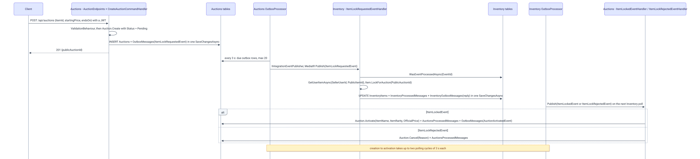
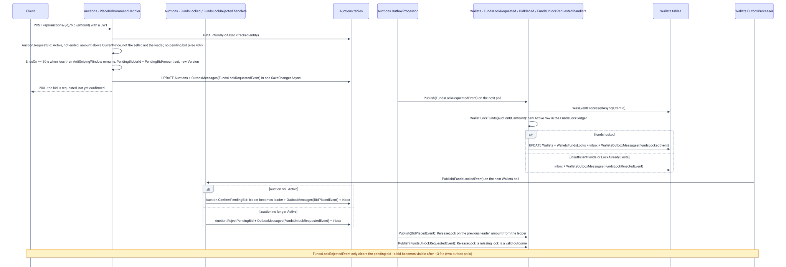
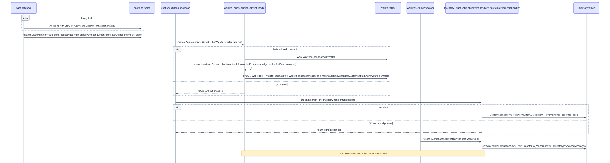
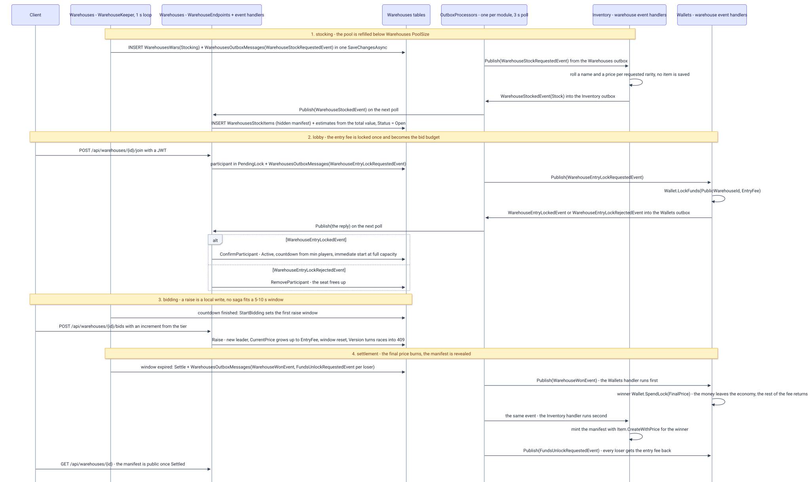

# AuctionServer — architektura

> Wersja polska. Angielski odpowiednik 1:1: [../en/ARCHITECTURE.md](../en/ARCHITECTURE.md)

AuctionServer to modular monolith w .NET 10 dla zgamifikowanego domu aukcyjnego: pięć modułów (Identity, Wallets, Auctions, Inventory, Warehouses) działa w jednym procesie ASP.NET Core, dzieli jedną bazę PostgreSQL i rozmawia ze sobą wyłącznie przez zdarzenia integracyjne przenoszone transakcyjnym outboxem i konsumowane przez inbox. Ta strona opisuje kontekst systemu, warstwy modułów, obsługę żądań, komunikację między modułami, trzy przepływy aukcji i przepływ wojny magazynowej, model danych, pipeline CI, stosowane wzorce projektowe i znane ograniczenia. Szczegóły poszczególnych modułów są w [rozdziałach backendu](backend/README.md).

## Kontekst systemu

Diagram pokazuje jedyny istniejący dziś proces, bazę PostgreSQL za nim oraz, z przerywaną obwódką, części planowane, których nie ma jeszcze w repozytorium.

<picture>
  <source media="(prefers-color-scheme: dark)" srcset="../diagrams/architecture-01-system-context.dark.svg">
  
</picture>

Dziś cały system to jeden host ASP.NET Core, [`AuctionServer.Api`](../../Backend/src/AuctionServer.Api/Program.cs), nasłuchujący w trybie deweloperskim na `http://localhost:5244` ([`launchSettings.json`](../../Backend/src/AuctionServer.Api/Properties/launchSettings.json)). Klienci wołają endpointy minimal API z JSON-em; repozytorium nie zawiera frontendu, gatewaya, brokera wiadomości ani kodu botów. Docelowy kształt, opisany w usuniętym `AGENTS.md` i w poprzednim README, stawia frontend Angulara i boty AI w Pythonie za API gatewayem i przenosi zdarzenia integracyjne do RabbitMQ; szew `IIntegrationEventPublisher` to miejsce, w które ten transport zostałby wpięty.

| Komponent | Status | Opisany w |
|---|---|---|
| Host `AuctionServer.Api` z pięcioma modułami | istnieje | [backend/README.md](backend/README.md) |
| PostgreSQL, jedna baza, 19 tabel | istnieje (uruchamiany ręcznie, przez Compose albo przez Testcontainers) | [Model danych](#model-danych) |
| Docker Compose (obraz API plus PostgreSQL) | istnieje | [backend/README.md](backend/README.md) |
| Pipeline GitLab CI | istnieje | [Build i CI](#build-i-ci) |
| Frontend Angular | planowany | [frontend.md](frontend.md) |
| API gateway, RabbitMQ | planowane | [infrastructure.md](infrastructure.md) |
| Boty AI (Python) | planowane | [bots.md](bots.md) |

## Moduły i warstwy

Diagram pokazuje referencje między projektami: host referencuje pięć modułów, każdy moduł referencuje wyłącznie `AuctionServer.Shared.Integration`, a żaden moduł nie referencuje innego modułu.

<picture>
  <source media="(prefers-color-scheme: dark)" srcset="../diagrams/architecture-02-module-layering.dark.svg">
  
</picture>

Każdy moduł to jeden `.csproj` podzielony na `Presentation/` (endpointy minimal API i rekordy żądań), `Application/` (komendy, zapytania i walidatory MediatR, handlery zdarzeń, interfejsy repozytoriów), `Domain/` (encje, enumy, wyjątki) oraz `Infrastructure/` (DbContext, repozytoria, konfiguracje EF, outbox, inbox, serwisy tła, migracje). Pliki projektów modułów deklarują jedną `ProjectReference`, do [`AuctionServer.Shared.Integration`](../../Backend/src/AuctionServer.Shared.Integration/AuctionServer.Shared.Integration.csproj), które zawiera dwadzieścia rekordów zdarzeń, `AppException`, `IIntegrationEventPublisher`, `IntegrationEventTypes` i `ValidationBehaviour`. Host podpina moduł jedną metodą rozszerzającą na moduł (`AddAuctionModule`, `AddWalletsModule`, `AddIdentityModule`, `AddInventoryModule`, `AddWarehousesModule`) i mapuje jego endpointy przez `Map*Endpoints`; oba wywołania są w [`Program.cs`](../../Backend/src/AuctionServer.Api/Program.cs).

| Moduł | Prefiks tras | DbContext | Tabele | Serwisy tła | Testy |
|---|---|---|---|---|---|
| [Identity](backend/identity.md) | `/api/users` | `IdentityDbContext` | `Users`, `IdentityOutboxMessages` | `OutboxProcessor` | `AuctionServer.Modules.Identity.Tests` |
| [Wallets](backend/wallets.md) | `/api/wallets` | `WalletDbContext` | `Wallets`, `WalletsFundsLocks`, `WalletsTransfers`, `WalletsOutboxMessages`, `WalletsProcessedMessages` | `OutboxProcessor` | `AuctionServer.Modules.Wallets.Tests` |
| [Auctions](backend/auctions.md) | `/api/auctions` | `AuctionDbContext` | `Auctions`, `AuctionsBids`, `OutboxMessages`, `AuctionsProcessedMessages` | `OutboxProcessor`, `AuctionCloser` | `AuctionServer.Modules.Auctions.Tests` |
| [Inventory](backend/inventory.md) | `/api/inventory` | `InventoryDbContext` | `InventoryItems`, `InventoryOutboxMessages`, `InventoryProcessedMessages` | `OutboxProcessor` | `AuctionServer.Modules.Inventory.Tests` |
| [Warehouses](backend/warehouses.md) | `/api/warehouses` | `WarehouseDbContext` | `WarehousesWars`, `WarehousesParticipants`, `WarehousesStockItems`, `WarehousesOutboxMessages`, `WarehousesProcessedMessages` | `OutboxProcessor`, `WarehouseKeeper` | `AuctionServer.Modules.Warehouses.Tests` |

Reguły modułów są egzekwowane konwencją, nie narzędziami: brak referencji projektowych między modułami, brak zapytań do bazy innego modułu oraz `Domain/` i `Application/` wolne od typów ASP.NET Core. Ostatnia reguła jest spełniona dla samego ASP.NET Core, ale handlery w `Application/` referencują typy `Infrastructure.Outbox` i `Infrastructure.Inbox` własnego modułu, żeby budować wiersze outboxa i inboxa, a `LoginCommandHandler` czyta `IConfiguration` bezpośrednio.

## Obsługa żądań

Każde żądanie przechodzi przez cztery middleware'y zarejestrowane w [`Program.cs`](../../Backend/src/AuctionServer.Api/Program.cs): `UseExceptionHandler` (oparty na [`GlobalExceptionHandler`](../../Backend/src/AuctionServer.Api/Infrastructure/GlobalExceptionHandler.cs)), `UseCors` (originy z `Cors:AllowedOrigins`, domyślnie `http://localhost:4200`), `UseAuthentication` i `UseAuthorization`. Poza endpointami biznesowymi host serwuje dokument OpenAPI pod `/openapi/v1.json` oraz `/health`, który wykonuje `SELECT 1` na bazie przez [`DatabaseHealthCheck`](../../Backend/src/AuctionServer.Api/Infrastructure/Health/DatabaseHealthCheck.cs). Endpointy odczytują id wołającego z claimu `ClaimTypes.NameIdentifier`, budują komendę lub zapytanie MediatR i wołają `ISender.Send`; nie zawierają logiki biznesowej ani try/catch. Diagram pipeline'u żądania i szczegóły uwierzytelniania są w [backend/README.md](backend/README.md).

- **Walidacja.** [`ValidationBehaviour<,>`](../../Backend/src/AuctionServer.Shared.Integration/Validators/ValidationBehaviour.cs) jest zarejestrowany jako otwarty behavior MediatR dla każdego assembly modułu; uruchamia wszystkie walidatory FluentValidation danego żądania i rzuca `RequestValidationException` (400) z komunikatami połączonymi przez `; `.
- **Błędy.** `AppException` niesie własny status HTTP, więc handler zwraca ten status z `{ "error": "<komunikat>" }`; `DbUpdateConcurrencyException` staje się 409 `Data corrupted, try again`; wszystko inne jest logowane i zwracane jako 500 `Unhandled error occurred`.
- **Uwierzytelnianie.** JWT bearer jest schematem domyślnym; drugi schemat o nazwie `ApiKey` czyta nagłówek `X-Api-Key`. Istnieją dwie polityki: `Bot` (`RequireRole("Bot")`) i `BotProvisioning` (schemat `ApiKey` plus uwierzytelniony użytkownik).
- **JSON.** Host zostaje przy domyślnych ustawieniach webowych ASP.NET Core, więc nazwy właściwości w odpowiedziach są w camelCase (`publicAuctionId`, `error`), a ciała żądań są dopasowywane bez względu na wielkość liter; enumy są serializowane jako stringi (`JsonStringEnumConverter`), więc wartości `Status` i `Rarity` pojawiają się po nazwie.

## Komunikacja między modułami

Moduły nigdy nie wołają się nawzajem. Moduł, który potrzebuje reakcji innego modułu, zapisuje zdarzenie integracyjne do własnej tabeli outboxa w tym samym `SaveChangesAsync` co zmianę stanu; poller w tle publikuje je później, a moduł konsumujący zapisuje id zdarzenia w swojej tabeli inboxa, dzięki czemu ponowne dostarczenie niczego nie zmienia. Mechanika, kolumny outboxa i polityka ponowień są opisane w [backend/messaging.md](backend/messaging.md); droga jednego zdarzenia wygląda tak:

1. Producent dodaje wiersz `OutboxMessage` (`Id` równe `EventId` zdarzenia, `Type` równe nazwie klasy zdarzenia, `Content` z ładunkiem JSON) do tej samej transakcji co zmiana encji.
2. `OutboxProcessor` modułu (`BackgroundService`, jedna kopia na moduł) odpytuje co 3 s o maksymalnie 20 wierszy nieprzetworzonych, niemartwych i wymagalnych, uporządkowanych po `CreatedOn`.
3. Woła [`IIntegrationEventPublisher.PublishAsync`](../../Backend/src/AuctionServer.Shared.Integration/Messaging/IIntegrationEventPublisher.cs); jedyna implementacja, [`InProcessEventPublisher`](../../Backend/src/AuctionServer.Api/Infrastructure/Messaging/InProcessEventPublisher.cs), deserializuje ładunek przez [`IntegrationEventTypes`](../../Backend/src/AuctionServer.Shared.Integration/Messaging/IntegrationEventTypes.cs) i publikuje go przez `IPublisher` MediatR.
4. MediatR uruchamia pasujące `INotificationHandler`y jeden po drugim, w kolejności rejestracji assembly modułów w `Program.cs` (Auctions, Wallets, Identity, Inventory, Warehouses).
5. Konsument najpierw pyta `WasEventProcessedAsync(EventId)`, potem wykonuje zmianę domenową i zapisuje ją razem z wierszem `ProcessedMessage` (i wierszem outboxa z odpowiedzią, gdy odpowiada) w jednym `SaveChangesAsync`; naruszenie klucza głównego na wierszu inboxa ujawnia się jako `EventAlreadyProcessedException`, który handler połyka.
6. Każdy inny wyjątek wraca do `OutboxProcessor`a, który zapisuje go w wierszu i planuje ponowienie; po piątej porażce wiersz jest oznaczany jako martwy.

| Zdarzenie | Ładunek (poza `EventId`) | Producent | Konsumenci | Inbox |
|---|---|---|---|---|
| `UserRegisteredEvent` | `PublicUserId`, `Email` | Identity `RegisterCommandHandler`, `RegisterBotCommandHandler` | Wallets `UserRegisteredEventHandler` | nie; duplikat trafia w klucz główny portfela, a `WalletAlreadyExistException` jest połykany |
| `ItemLockRequestedEvent` | `PublicAuctionId`, `PublicItemId`, `SellerUserId` | Auctions `CreateAuctionCommandHandler` | Inventory `ItemLockRequestedEventHandler` | tak |
| `ItemLockedEvent` | `PublicAuctionId`, `PublicItemId`, `ItemName`, `ItemRarity`, `OfficialPrice` | Inventory `ItemLockRequestedEventHandler` | Auctions `ItemLockedEventHandler` | tak |
| `ItemLockRejectedEvent` | `PublicAuctionId`, `PublicItemId`, `Reason` | Inventory `ItemLockRequestedEventHandler` | Auctions `ItemLockRejectedEventHandler` | tak |
| `AuctionCancelledEvent` | `PublicAuctionId`, `PublicItemId`, `Reason` | Auctions `AuctionCloser` | Inventory `AuctionCancelledEventHandler` | tak |
| `FundsLockRequestedEvent` | `PublicAuctionId`, `BidderUserId`, `Amount` | Auctions `PlaceBidCommandHandler` | Wallets `FundsLockRequestedEventHandler` | tak |
| `FundsLockedEvent` | `PublicAuctionId`, `BidderUserId`, `Amount` | Wallets `FundsLockRequestedEventHandler` | Auctions `FundsLockedEventHandler` | tak |
| `FundsLockRejectedEvent` | `PublicAuctionId`, `BidderUserId`, `Reason` | Wallets `FundsLockRequestedEventHandler` | Auctions `FundsLockRejectedEventHandler` | tak |
| `FundsUnlockRequestedEvent` | `PublicAuctionId`, `BidderUserId`; zwroty magazynowe wkładają id magazynu w `PublicAuctionId` | Auctions `FundsLockedEventHandler`; Warehouses `LeaveWarehouseWarCommandHandler`, `WarehouseEntryLockedEventHandler`, `WarehouseKeeper` | Wallets `FundsUnlockRequestedEventHandler` | tak |
| `AuctionActivatedEvent` | id aukcji i sprzedawcy, snapshot przedmiotu, `CurrentPrice`, `EndsOn` | Auctions `ItemLockedEventHandler` | brak | — |
| `BidPlacedEvent` | `PublicAuctionId`, `NewWinningUserId`, `PreviousWinningUserId?`, `NewPrice`, `PreviousPrice?` | Auctions `FundsLockedEventHandler` | Wallets `BidPlacedEventHandler` | tak |
| `AuctionFinishedEvent` | `PublicAuctionId`, `SellerUserId`, `WinnerUserId?`, `FinalPrice?` | Auctions `AuctionCloser` | Wallets `AuctionFinishedEventHandler`, Inventory `AuctionFinishedEventHandler` | tak, w obu |
| `AuctionSettledEvent` | `PublicAuctionId`, `SellerUserId`, `WinnerUserId`, `FinalPrice` | Wallets `AuctionFinishedEventHandler` | Inventory `AuctionSettledEventHandler` | tak |
| `ItemSoldToShopEvent` | `PublicItemId`, `OwnerUserId`, `Price` | Inventory `SellItemToShopCommandHandler` | Wallets `ItemSoldToShopEventHandler` | tak |
| `WarehouseStockRequestedEvent` | `PublicWarehouseId`, `Rarities` | Warehouses `WarehouseKeeper` | Inventory `WarehouseStockRequestedEventHandler` | tak |
| `WarehouseStockedEvent` | `PublicWarehouseId`, `Stock` | Inventory `WarehouseStockRequestedEventHandler` | Warehouses `WarehouseStockedEventHandler` | tak |
| `WarehouseEntryLockRequestedEvent` | `PublicWarehouseId`, `UserId`, `Amount` | Warehouses `JoinWarehouseWarCommandHandler` | Wallets `WarehouseEntryLockRequestedEventHandler` | tak |
| `WarehouseEntryLockedEvent` | `PublicWarehouseId`, `UserId` | Wallets `WarehouseEntryLockRequestedEventHandler` | Warehouses `WarehouseEntryLockedEventHandler` | tak |
| `WarehouseEntryLockRejectedEvent` | `PublicWarehouseId`, `UserId`, `Reason` | Wallets `WarehouseEntryLockRequestedEventHandler` | Warehouses `WarehouseEntryLockRejectedEventHandler` | tak |
| `WarehouseWonEvent` | `PublicWarehouseId`, `WinnerUserId`, `FinalPrice`, `Stock` | Warehouses `WarehouseKeeper` | Wallets `WarehouseWonEventHandler`, Inventory `WarehouseWonEventHandler` | tak, w obu |

Rekordy leżą w [`Shared.Integration/Events/`](../../Backend/src/AuctionServer.Shared.Integration/Events), a handlery w folderze `Application/Handlers/` każdego modułu. Dodanie zdarzenia oznacza dodanie rekordu i zarejestrowanie go w `IntegrationEventTypes`; niezarejestrowany typ sprawia, że `Deserialize` rzuca `NotSupportedException`, więc wiersz outboxa zawodzi i w końcu trafia do martwych.

## Przepływy aukcji

### Tworzenie aukcji (saga blokady przedmiotu)

Sekwencja poniżej pokazuje, jak nowa aukcja jest zapisywana jako `Pending`, jak Inventory blokuje przedmiot i jak Auctions aktywuje albo anuluje aukcję po nadejściu odpowiedzi.

<picture>
  <source media="(prefers-color-scheme: dark)" srcset="../diagrams/architecture-03-auction-creation-saga.dark.svg">
  
</picture>

1. Klient woła `POST /api/auctions` z `{ itemId, startingPrice, endsOn }` i JWT; [`AuctionEndpoints`](../../Backend/src/AuctionServer.Modules.Auctions/Presentation/AuctionEndpoints.cs) bierze id sprzedawcy z tokenu i wysyła `CreateAuctionCommand`.
2. `CreateAuctionCommandValidator` wymaga dodatniego `StartingPrice` i `EndsOn` między teraz a 30 dniami naprzód; `Auction.Create` dodatkowo wymaga `EndsOn` co najmniej minutę w przyszłości i tworzy aukcję ze `Status = Pending` i `CurrentPrice = StartingPrice` ([`Auction.cs`](../../Backend/src/AuctionServer.Modules.Auctions/Domain/Entities/Auction.cs)).
3. [`AuctionRepository.CreateAuctionAsync`](../../Backend/src/AuctionServer.Modules.Auctions/Infrastructure/Persistence/AuctionRepository.cs) wstawia wiersz `Auctions` i wiersz `OutboxMessages` niosący `ItemLockRequestedEvent` w jednym `SaveChangesAsync`; naruszenie unikalności na filtrowanym indeksie `ItemId` (jedna otwarta aukcja na przedmiot) staje się `AuctionAlreadyExistException` (409).
4. Endpoint zwraca `201 Created` z `{ publicAuctionId }`, zanim Inventory zobaczy żądanie.
5. `OutboxProcessor` Auctions publikuje zdarzenie; [`ItemLockRequestedEventHandler`](../../Backend/src/AuctionServer.Modules.Inventory/Application/Handlers/ItemLockRequestedEventHandler.cs) w Inventory sprawdza inbox, ładuje przedmiot przez `GetUserItemAsync(SellerUserId, PublicItemId)` i woła `Item.LockForAuction(PublicAuctionId)`. Odpowiada `ItemLockedEvent` (nazwa, rzadkość, cena oficjalna) albo, gdy przedmiot nie należy do sprzedawcy (`UserOrItemDoesntExistException`) lub nie jest `Available` (`ItemNotAvailableException`), `ItemLockRejectedEvent` z komunikatem wyjątku jako `Reason`; aktualizacja przedmiotu, wiersz inboxa i odpowiedź to jeden `SaveChangesAsync`.
6. `OutboxProcessor` Inventory publikuje odpowiedź; [`ItemLockedEventHandler`](../../Backend/src/AuctionServer.Modules.Auctions/Application/Handlers/ItemLockedEventHandler.cs) woła `Auction.Activate(itemName, itemRarity, officialPrice)`, które kopiuje snapshot przedmiotu na aukcję i przełącza ją w `Active`, oraz zapisuje `AuctionActivatedEvent` do outboxa; [`ItemLockRejectedEventHandler`](../../Backend/src/AuctionServer.Modules.Auctions/Application/Handlers/ItemLockRejectedEventHandler.cs) woła `Auction.Cancel(reason)`.
7. Dopóki aukcja jest `Pending`, oferta kończy się 400 `Auction is not active, current status: Pending`; `GET /api/auctions` listuje tylko aukcje `Active`, a `GET /api/auctions/{id}` zwraca dowolny status razem z `CancellationReason`. Aukcja tkwiąca w `Pending` ponad 10 minut (`CreatedOn` plus `PendingActivationTimeout`) jest anulowana przez `AuctionCloser` z powodem `Activation timed out`, a `AuctionCancelledEvent` pozwala Inventory odblokować już zablokowany przedmiot. Gdy nic nie jest zablokowane dla aukcji, handler zapisuje tylko wiersz inboxa.
8. `AuctionActivatedEvent` jest zarejestrowane i publikowane, ale żaden moduł go nie obsługuje.

### Licytacja i blokada środków

Sekwencja poniżej pokazuje sagę rezerwacji środków: oferta staje się ofertą oczekującą, Wallets blokuje pieniądze, a dopiero potwierdzenie awansuje lidera.

<picture>
  <source media="(prefers-color-scheme: dark)" srcset="../diagrams/architecture-04-bid-and-funds-lock.dark.svg">
  
</picture>

1. Klient woła `POST /api/auctions/{id}/bid` z `{ amount }`; `PlaceBidCommandValidator` wymaga tylko niepustych id i dodatniej kwoty.
2. [`PlaceBidCommandHandler`](../../Backend/src/AuctionServer.Modules.Auctions/Application/Commands/PlaceBid/PlaceBidCommandHandler.cs) ładuje śledzoną aukcję (404 `AuctionNotFoundException`, gdy jej nie ma) i woła `Auction.RequestBid`, które sprawdza w tej kolejności: nie `Pending` (400 `AuctionNotActiveException`), `Active` i przed `EndsOn` (400 `AuctionClosedException`), kwota wyższa niż `CurrentPrice` (400 `InvalidBidException`), licytujący nie jest sprzedawcą (400 `CannotBidOwnItemException`), licytujący nie jest już zwycięzcą (400 `AlreadyHighestBidderException`), brak innej oferty w locie (409 `BidInProgressException`). Oferta jest zapisywana jako `PendingBidderId`/`PendingBidAmount`, `EndsOn` jest wydłużane o `AntiSnipingWindow` (30 s), gdy zostało mniej niż okno, a `SaveChangesWithOutboxAsync` zapisuje aukcję i wiersz `FundsLockRequestedEvent` w jednej transakcji; endpoint zwraca 200 z pustym ciałem, a lider pozostaje niezmieniony.
3. [`FundsLockRequestedEventHandler`](../../Backend/src/AuctionServer.Modules.Wallets/Application/Handlers/FundsLockRequestedEventHandler.cs) w Wallets sprawdza inbox, ładuje portfel licytującego (brak portfela trafia do martwych) i woła `Wallet.LockFunds(PublicAuctionId, Amount)`, które dodaje wiersz `Active` do księgi blokad `FundsLock` per oferta i przenosi kwotę z dostępnych do zablokowanych; odpowiada `FundsLockedEvent` albo `FundsLockRejectedEvent`, gdy środków brakuje lub aktywna blokada dla tej aukcji już istnieje. Odpowiedź i wiersz inboxa są zapisywane razem.
4. [`FundsLockedEventHandler`](../../Backend/src/AuctionServer.Modules.Auctions/Application/Handlers/FundsLockedEventHandler.cs) w Auctions potwierdza ofertę na aukcji `Active`: `ConfirmPendingBid` awansuje ofertę oczekującą na `CurrentWinningUserId`/`CurrentPrice`, a handler dopisuje wiersz do historii `AuctionsBids` i emituje `BidPlacedEvent` z poprzednim liderem i ceną, wszystko w jednej `SaveChangesAsync`. Gdy aukcja nie jest już `Active`, woła `RejectPendingBid` i emituje zamiast tego `FundsUnlockRequestedEvent`. [`FundsLockRejectedEventHandler`](../../Backend/src/AuctionServer.Modules.Auctions/Application/Handlers/FundsLockRejectedEventHandler.cs) czyści ofertę oczekującą; odrzucony licytujący nie widzi zmiany stanu.
5. [`BidPlacedEventHandler`](../../Backend/src/AuctionServer.Modules.Wallets/Application/Handlers/BidPlacedEventHandler.cs) w Wallets zwalnia blokadę poprzedniego lidera dla tej aukcji (`ReleaseLock`; kwota pochodzi z księgi, nie ze zdarzenia); [`FundsUnlockRequestedEventHandler`](../../Backend/src/AuctionServer.Modules.Wallets/Application/Handlers/FundsUnlockRequestedEventHandler.cs) zwalnia blokadę potwierdzoną za późno i traktuje brak blokady jako poprawny wynik. Wszystkie zapisy pieniędzy używają `CancellationToken.None`.
6. Oferta staje się więc widoczna po dwóch odpytaniach outboxa (~3-9 s); do rozstrzygnięcia sagi kolejny licytujący dostaje 409 `BidInProgressException`, a równoległe zapisy na jednej aukcji szereguje token współbieżności `Version` (409).

### Zamknięcie i rozliczenie

Sekwencja poniżej pokazuje closer w tle kończący aukcję oraz łańcuch rozliczenia, który płaci sprzedawcy i przenosi przedmiot.

<picture>
  <source media="(prefers-color-scheme: dark)" srcset="../diagrams/architecture-05-close-and-settlement.dark.svg">
  
</picture>

1. [`AuctionCloser`](../../Backend/src/AuctionServer.Modules.Auctions/Infrastructure/Background/AuctionCloser.cs) działa co 3 s, ładuje do 20 aukcji ze `Status = Active` i `EndsOn` w przeszłości, woła `CloseAuction()` na każdej i dodaje wiersz `AuctionFinishedEvent` (`WinnerUserId` z `CurrentWinningUserId`, `FinalPrice` z `CurrentPrice`, oba null bez oferty); partia jest zapisywana w jednym `SaveChangesAsync`, a porażka (na przykład konflikt `Version` z ofertą) wywraca cały cykl, jest logowana jako `Auction closing cycle failed` i ponawiana w następnym takcie.
2. `OutboxProcessor` Auctions publikuje zdarzenie; z powodu kolejności rejestracji handler Wallets działa przed handlerem Inventory.
3. [`AuctionFinishedEventHandler`](../../Backend/src/AuctionServer.Modules.Wallets/Application/Handlers/AuctionFinishedEventHandler.cs) w Wallets kończy od razu bez zwycięzcy; w przeciwnym razie sprawdza inbox, konsumuje blokadę środków zwycięzcy dla tej aukcji (`winner.ConsumeLock(PublicAuctionId)`, 404 `LockNotFoundException`, gdy nie ma aktywnej blokady) i uznaje sprzedawcę skonsumowaną kwotą (`seller.AddFunds`) oraz zapisuje oba portfele, wiersz inboxa i wiersz outboxa `AuctionSettledEvent` w jednym `SaveChangesAsync`.
4. [`AuctionFinishedEventHandler`](../../Backend/src/AuctionServer.Modules.Inventory/Application/Handlers/AuctionFinishedEventHandler.cs) w Inventory działa tylko bez zwycięzcy: znajduje przedmiot po `LockedForAuctionId` i woła `Item.UnlockItem()`, które przywraca przedmiotowi `Available`.
5. `OutboxProcessor` Wallets publikuje `AuctionSettledEvent`; [`AuctionSettledEventHandler`](../../Backend/src/AuctionServer.Modules.Inventory/Application/Handlers/AuctionSettledEventHandler.cs) w Inventory znajduje zablokowany przedmiot i woła `Item.TransferTo(WinnerUserId)`, które zmienia właściciela, czyści blokadę i ustawia `Available`.
6. Wyjątki 404 i 409 wewnątrz tych handlerów celowo nie są łapane: wiadomość jest ponawiana, a po pięciu porażkach odkładana jako martwa z historią błędów, zamiast być po cichu pomijana.

## Model danych

### Wojna magazynowa (zaopatrzenie, blokada wpisowego, szybka licytacja, rozliczenie)

Sekwencja poniżej pokazuje życie jednej wojny magazynowej: keeper zaopatruje ją przez wycenę w Inventory, gracze stawiają wpisowe przez Wallets, okna podbić działają lokalnie, a rozliczenie płaci, zwraca i mintuje.

<picture>
  <source media="(prefers-color-scheme: dark)" srcset="../diagrams/architecture-08-warehouse-war.dark.svg">
  
</picture>

1. [`WarehouseKeeper`](../../Backend/src/AuctionServer.Modules.Warehouses/Infrastructure/Background/WarehouseKeeper.cs) (pętla 1 s) utrzymuje `Warehouses:PoolSize` wojen przy życiu: tworzy wojnę `Stocking` z losowego tieru i prosi Inventory o wycenę zdarzeniem `WarehouseStockRequestedEvent` z wylosowanymi rzadkościami. Inventory wycenia je na przejściowych wynikach `Item.Create` (nic nie jest zapisywane) i odpowiada manifestem; `WarehouseStockedEventHandler` zapisuje go w `WarehousesStockItems`, losuje celowo zwodnicze publiczne widełki przez [`EstimateGenerator`](../../Backend/src/AuctionServer.Modules.Warehouses/Application/Estimates/EstimateGenerator.cs) i otwiera lobby.
2. `POST /api/warehouses/{id}/join` dodaje uczestnika `PendingLock` i emituje `WarehouseEntryLockRequestedEvent`; Wallets blokuje wpisowe tieru generyczną księgą `FundsLock` i odpowiada. Potwierdzenie aktywuje uczestnika: przy `MinPlayers` aktywnych startuje odliczanie, przy `MaxPlayers` licytacja rusza natychmiast. Odmowa zwalnia miejsce; blokada, która dotrze po tym, jak wojna poszła dalej, jest zwracana (`FundsUnlockRequestedEvent`), więc żadne wpisowe nie może utknąć.
3. Gdy odliczanie minie, keeper woła `StartBidding`; podbicia (`POST /bids`) to lokalne wywołania agregatu strzeżone statusem, oknem, stanem uczestnika, przywództwem, zbiorem podbić tieru i budżetem `EntryFee`, ścigające się na tokenie `Version`. Każde podbicie resetuje `RaiseWindow`.
4. Gdy okno wygaśnie, keeper rozlicza: z liderem emituje `WarehouseWonEvent` (zwycięzca, cena końcowa, manifest) plus zwroty dla przegranych; bez lidera anuluje i zwraca wszystkim. Wallets konsumuje blokadę zwycięzcy przez `Wallet.SpendLock` (cena opuszcza obieg, reszta wraca), potem Inventory mintuje manifest przez `Item.CreateWithPrice`; po `Settled` GET szczegółów odsłania manifest. Pełny opis w [backend/warehouses.md](backend/warehouses.md).

Diagram pokazuje dziewiętnaście tabel pogrupowanych według modułu właściciela; prefiks w nazwie każdej encji to moduł, a każda relacja jest kropkowana, bo żaden klucz obcy nie przekracza granicy modułu.

<picture>
  <source media="(prefers-color-scheme: dark)" srcset="../diagrams/architecture-06-data-model.dark.svg">
  
</picture>

Wszystkie pięć `DbContext`ów wskazuje tę samą bazę i dzielą domyślną tabelę `__EFMigrationsHistory` (żaden kontekst nie nadpisuje tabeli historii), więc izolacja opiera się na dyscyplinie i na różnych nazwach tabel. Identyfikatory przekraczają granice modułów jako kopiowane Guidy: `Wallets.UserId` i `Auctions.SellerUserId` trzymają `Users.PublicUserId`, `Auctions.ItemId` trzyma `InventoryItems.PublicItemId`, a `InventoryItems.LockedForAuctionId` trzyma `Auctions.PublicAuctionId`. Typy kolumn pochodzą ze snapshotów modelu EF w folderze migracji każdego modułu.

| Tabela | Moduł | Przeznaczenie |
|---|---|---|
| `Users` | Identity | konta; unikalny `Email`, miękkie usuwanie przez globalny filtr zapytań na `IsDeleted`, `UserRoles` przechowywane jako liczba całkowita |
| `IdentityOutboxMessages` | Identity | outbox dla `UserRegisteredEvent` |
| `Wallets` | Wallets | jeden wiersz na użytkownika z kluczem `PublicUserId`; `AvailableFunds`, `LockedFunds`, `Version` |
| `WalletsFundsLocks` | Wallets | księga blokad środków per oferta, własność agregatu `Wallet`; unikalne (`WalletUserId`, `PublicAuctionId`) dopóki `Status = 0` |
| `WalletsTransfers` | Wallets | append-only historia przelewów między graczami, jeden wiersz na przelew, zapisywany razem z dwiema zmianami sald |
| `WalletsOutboxMessages`, `WalletsProcessedMessages` | Wallets | outbox dla odpowiedzi sagi i `AuctionSettledEvent`, inbox |
| `Auctions` | Auctions | aukcje ze snapshotem przedmiotu; unikalny `PublicAuctionId`, unikalny `ItemId` dopóki `Status IN (0, 1)`, `Version` |
| `AuctionsBids` | Auctions | append-only historia ofert, jeden wiersz na potwierdzoną ofertę, zapisywany razem z potwierdzeniem |
| `OutboxMessages` | Auctions | outbox; jedyna tabela bez prefiksu modułu |
| `AuctionsProcessedMessages` | Auctions | inbox |
| `InventoryItems` | Inventory | przedmioty; unikalny `PublicItemId`, unikalny nullowalny `LockedForAuctionId`, `Version` |
| `InventoryOutboxMessages`, `InventoryProcessedMessages` | Inventory | outbox, inbox |
| `WarehousesWars` | Warehouses | wojny magazynowe; unikalne `PublicWarehouseId`, ukryte `TotalValue`, publiczne widełki, `EntryFee`, `CurrentPrice`, timery, `Version` |
| `WarehousesParticipants` | Warehouses | skład lobby posiadany przez agregat `WarehouseWar`; unikalne (`WarehouseWarId`, `UserId`), `State` (`PendingLock`/`Active`) |
| `WarehousesStockItems` | Warehouses | ukryty manifest, jeden wiersz na przedmiot wyceniony przez Inventory, odsłaniany dopiero po rozliczeniu |
| `WarehousesOutboxMessages`, `WarehousesProcessedMessages` | Warehouses | outbox, inbox |

Każda tabela outboxa ma te same dziewięć kolumn (`Id`, `Type`, `Content`, `CreatedOn`, `ProcessedOn`, `AttemptCount`, `Errors`, `IsDead`, `NextAttemptOn`), a każda tabela inboxa ma `EventId` i `ProcessedOn`; zobacz [backend/messaging.md](backend/messaging.md).

## Build i CI

Diagram pokazuje pipeline GitLaba zdefiniowany w [`.gitlab-ci.yml`](../../.gitlab-ci.yml).

<picture>
  <source media="(prefers-color-scheme: dark)" srcset="../diagrams/architecture-07-ci-pipeline.dark.svg">
  
</picture>

- Każdy job działa w obrazie `mcr.microsoft.com/dotnet/sdk:10.0` z serwisem `docker:dind`; `DOCKER_HOST=tcp://docker:2375` i `TESTCONTAINERS_HOST_OVERRIDE=docker` pozwalają Testcontainers uruchomić PostgreSQL wewnątrz runnera.
- Stage `build` uruchamia `dotnet build Backend/AuctionServer.slnx`.
- Stage `test` ma dwa joby: `unit-tests` uruchamia `AuctionServer.Modules.Auctions.Tests` z `--filter "FullyQualifiedName!~IntegrationTests"`, a `integration-tests` uruchamia testy integracyjne Auctions, a potem całe projekty testowe Wallets, Identity, Inventory i Warehouses.
- Nie ma stage'u deploy, artefaktów ani cache'owania; obraz aplikacji istnieje tylko do użytku lokalnego ([`Backend/Dockerfile`](../../Backend/Dockerfile), budowany przez [`compose.yaml`](../../compose.yaml) z korzenia), pipeline go nie buduje ani nie publikuje.

## Stosowane wzorce projektowe

- **Modular monolith.** Jeden deployowalny artefakt, pięć modułów z prywatnymi tabelami i prywatnymi `DbContext`ami, jeden współdzielony projekt kontraktów.
- **CQRS w Auctions, CQS w pozostałych.** Auctions zapisuje przez EF Core i czyta Dapperem przez `ISqlConnectionFactory` ([`GetActiveAuctionsQueryHandler`](../../Backend/src/AuctionServer.Modules.Auctions/Application/Queries/GetActiveAuctions/GetActiveAuctionsQueryHandler.cs)); Wallets, Inventory i Warehouses czytają przez EF Core z `AsNoTracking`.
- **Transakcyjny outbox.** Pięć kopii `OutboxMessage` i `OutboxProcessor`, po jednej na moduł; wiersz zdarzenia commituje się razem ze zmianą stanu.
- **Inbox (idempotentny konsument).** Tabele `ProcessedMessages` w Wallets, Auctions, Inventory i Warehouses, sprawdzane przed zmianą i wstawiane razem z nią.
- **Saga przez choreografię.** Tworzenie aukcji, rozliczenie aukcji, wycena magazynu, blokada wpisowego i rozliczenie magazynu to łańcuchy zdarzeń między modułami bez orkiestratora; każdy skok to lokalna transakcja.
- **Optymistyczna współbieżność.** `Version` to Guidowy token współbieżności na `Auction`, `Wallet`, `Item` i `WarehouseWar`, generowany na nowo w każdej metodzie mutującej; konflikty ujawniają się jako 409 albo jako ponowiony cykl w tle.
- **Globalny kontrakt błędów.** Wyjątki domenowe dziedziczą po `AppException(message, statusCode)` i są mapowane przez jeden `IExceptionHandler`.
- **Pipeline walidacji.** Walidatory FluentValidation obok swoich komend, wykonywane przez behavior MediatR.
- **Filtrowane indeksy unikalne.** Jedna otwarta aukcja na przedmiot (`"Status" IN (0, 1)`) i jeden przedmiot na blokadę aukcji (`LockedForAuctionId`, nulle rozróżnialne); Wallets deklaruje też indeks unikalny na `UserId` filtrowany po `"IsSuspendedWallet" = false`, który nie dodaje żadnego ograniczenia, bo `UserId` jest już kluczem głównym.
- **Klucz zastępczy plus publiczny id.** `AuctionId`/`PublicAuctionId`, `Id`/`PublicUserId`, `Id`/`PublicItemId`; tylko Guidy opuszczają moduł.
- **Kompozycja przez metody rozszerzające.** `Add<Module>Module` i `Map<Module>Endpoints` to jedyne punkty wejścia, które zna host.
- **Odpytujące serwisy tła.** `OutboxProcessor` (pięć kopii) i `AuctionCloser` to `BackgroundService`y ze stałym opóźnieniem 3 s między cyklami; `WarehouseKeeper` działa z opóźnieniem 1 s, bo okna podbić są liczone w sekundach.

## Znane ograniczenia

1. Tabela outboxa Auctions nazywa się `OutboxMessages` bez prefiksu modułu; pozostałe trzy tabele outboxa mają prefiks ([`AuctionDbContext`](../../Backend/src/AuctionServer.Modules.Auctions/Infrastructure/Persistence/AuctionDbContext.cs) nie ma dla niej `ToTable`).
2. Żaden zautomatyzowany test nie przekracza granicy modułu; handlery zdarzeń są testowane przez bezpośrednie wywołanie. Dwie fixtury `WebApplicationFactory` ([`CustomAPI`](../../Backend/tests/AuctionServer.Modules.Wallets.Tests/IntegrationTests/CustomAPI.cs) w Wallets, `CustomApi` w Identity) migrują tylko kontekst własnego modułu, więc pozostałe `OutboxProcessor`y i `AuctionCloser` logują błąd co 3 s podczas tych testów.
3. `Role.Admin` jest zdefiniowane w [`Role.cs`](../../Backend/src/AuctionServer.Modules.Identity/Domain/Entities/Role.cs), ale nigdy nie jest przypisywane ani sprawdzane.
4. [`Backend/.env.example`](../../Backend/.env.example) (`DB_USER`, `DB_PASSWORD`) nie ma czytelnika; konfiguracja pochodzi z user secrets albo zmiennych środowiskowych z `__`.
5. Migracje Auctions leżą w dwóch folderach ([`Migrations/`](../../Backend/src/AuctionServer.Modules.Auctions/Migrations) z migracją początkową i snapshotem, [`Infrastructure/Migrations/`](../../Backend/src/AuctionServer.Modules.Auctions/Infrastructure/Migrations) z późniejszymi), więc `dotnet ef migrations add` musi dostać `--output-dir Infrastructure/Migrations`.
6. `Microsoft.Extensions.Hosting` jest przypięty do `11.0.0-preview.5.26302.115` we wszystkich pięciu projektach modułów, podczas gdy reszta stosu jest w wersji 10.0.x.
7. `AuctionActivatedEvent` jest produkowane i zarejestrowane, ale nie ma handlera.
8. `Jwt:Key` i `Bots:ApiKey` nie są walidowane na starcie. Bez `Jwt:Key` nie da się zbudować opcji bearera ([`Program.cs`](../../Backend/src/AuctionServer.Api/Program.cs)), więc każde żądanie, także anonimowe, dostaje 500 `Unhandled error occurred`; klucz krótszy niż 32 znaki psuje tylko logowanie, które przy poprawnych danych dostaje 500 `Server configuration error`; brakujący klucz API sprawia, że `POST /api/users/bots` odpowiada 401.
9. [`SellItemToShopCommandHandler`](../../Backend/src/AuctionServer.Modules.Inventory/Application/Command/SellItemToShop/SellItemToShopCommandHandler.cs) używa różnych Guidów dla `Id` wiersza outboxa i `EventId` zdarzenia; każdy inny producent używa jednego Guida dla obu.
10. Job CI `unit-tests` obejmuje tylko testy offline `Auctions.Tests`; testy offline pozostałych czterech projektów działają wyłącznie w `integration-tests`, który potrzebuje Dockera.
11. Ekonomia wojen magazynowych ma kran obok zlewu: cena końcowa zwycięzcy znika, ale zmintowane przedmioty można sprzedać do sklepu za `OfficialPrice`, więc gdy typowe ceny końcowe są niżej typowych wartości manifestów, wojny tworzą pieniądze. Zwodnicze widełki i konfiguracja tierów to dźwignie strojenia; obserwować, gdy zagrają boty.

## Powiązane dokumenty

- [README.md](README.md) - indeks dokumentacji i kolejność czytania.
- [backend/README.md](backend/README.md) - projekty, uruchomienie, konfiguracja, pipeline żądania, kontrakt błędów, testy.
- [backend/messaging.md](backend/messaging.md) - outbox, inbox, polityka ponowień, katalog zdarzeń.
- [backend/auctions.md](backend/auctions.md), [backend/wallets.md](backend/wallets.md), [backend/inventory.md](backend/inventory.md), [backend/identity.md](backend/identity.md), [backend/warehouses.md](backend/warehouses.md) - rozdziały modułów.
- [VISION.md](VISION.md) - docelowy system i planowane prace.
- [adr/](adr) - rejestr decyzji architektonicznych.
