# Moduł Identity

> Wersja polska. Angielski odpowiednik 1:1: [../../en/backend/identity.md](../../en/backend/identity.md)

`AuctionServer.Modules.Identity` odpowiada za konta użytkowników: rejestrację, logowanie z JWT oraz chroniony kluczem API provisioning kont botów, wszystko pod `/api/users`. Publikuje jedno zdarzenie, `UserRegisteredEvent`, i żadnego nie konsumuje, więc ma outbox, ale nie ma inboxa.

## Przegląd

| Obszar | Pliki |
|---|---|
| Endpointy | [`Presentation/IdentityEndpoints.cs`](../../../Backend/src/AuctionServer.Modules.Identity/Presentation/IdentityEndpoints.cs), rekordy żądań `RegisterRequest`, `LoginRequest`, `RegisterBotRequest` |
| Komendy | `Application/Commands/Register/`, `Application/Commands/Login/`, `Application/Commands/RegisterBot/` (komenda, handler oraz, dla dwóch rejestracji, walidator) |
| Domena | [`Domain/Entities/User.cs`](../../../Backend/src/AuctionServer.Modules.Identity/Domain/Entities/User.cs), [`Domain/Entities/Role.cs`](../../../Backend/src/AuctionServer.Modules.Identity/Domain/Entities/Role.cs), `Domain/Exceptions/IdentityException.cs` |
| Infrastruktura | `Persistence/` (`IdentityDbContext`, `AuthRepository`, `RefreshTokenRepository`, `Migrations/`), `Configuration/` (`IdentityConfiguration`, `RefreshTokenConfiguration`, `OutboxMessageConfiguration`) |

[`IdentityModuleExtensions.AddIdentityModule`](../../../Backend/src/AuctionServer.Modules.Identity/IdentityModuleExtensions.cs) rejestruje `IdentityDbContext` z Npgsql, `IAuthRepository` i `IRefreshTokenRepository` jako scoped i współdzielony hosted service `OutboxProcessor<IdentityDbContext>` przez `AddOutboxProcessor`; `MapIdentityEndpoints` mapuje grupę tras. Sama walidacja bearera JWT i schemat `ApiKey` żyją w hoście, zobacz [README.md](README.md).

## Uruchomienie

```bash
# z Backend/
dotnet ef migrations add <Name> --project src/AuctionServer.Modules.Identity --startup-project src/AuctionServer.Api --context IdentityDbContext --output-dir Infrastructure/Persistence/Migrations
dotnet ef database update --project src/AuctionServer.Modules.Identity --startup-project src/AuctionServer.Api --context IdentityDbContext
dotnet test tests/AuctionServer.Modules.Identity.Tests
```

Migracje leżą w [`Infrastructure/Persistence/Migrations/`](../../../Backend/src/AuctionServer.Modules.Identity/Infrastructure/Persistence/Migrations): `20260815123208_Initial_Identity`, `20260816103415_Add_Outbox_DeadLetter_And_Backoff`, `20261101143634_Add_Outbox_Lease`, `20261114123053_Add_Unique_Username` oraz `20261115180018_Add_Identity_Refresh_Tokens`. `BotProvisioningApiTests` podnoszą cały host przez [`CustomApi`](../../../Backend/tests/AuctionServer.Modules.Identity.Tests/IntegrationTests/CustomApi.cs) z testowym kluczem JWT i testowym kluczem API, więc jak każdy test integracyjny potrzebują Dockera.

## Konfiguracja

| Klucz | Do czego | Gdzie |
|---|---|---|
| `Jwt:Key` | podpisywanie tokenów HMAC-SHA256; klucz krótszy niż 32 znaki sprawia, że logowanie z poprawnymi danymi rzuca `MissingConfigurationException` (500), a brak klucza wywraca każde żądanie wcześniej, w konfiguracji bearera w hoście | [`JwtTokenFactory`](../../../Backend/src/AuctionServer.Modules.Identity/Application/Tokens/JwtTokenFactory.cs), czytany przez `IConfiguration` |
| `Jwt:Issuer`, `Jwt:Audience` | claimy `iss` i `aud` wystawianych tokenów (domyślnie `AuctionServer`, `AuctionServer.Client`) | `JwtTokenFactory` i walidacja bearera w hoście |
| `Bots:ApiKey` | wartość `X-Api-Key` spełniająca politykę `BotProvisioning` na `POST /api/users/bots` | `ApiKeyAuthenticationHandler` w hoście |

Czasy życia tokenów to stałe w `JwtTokenFactory`, wspólne dla logowania i odświeżenia: `PlayerTokenLifetime` to 15 minut, a `BotTokenLifetime` to 24 godziny, wybierane według roli użytkownika.

## Model danych

| Kolumna | Typ | Uwagi |
|---|---|---|
| `Id` | `integer` | klucz główny, kolumna identity |
| `PublicUserId` | `uuid` | generowany przez `Guid.NewGuid()`; id niesione w tokenie i kopiowane przez pozostałe moduły; bez indeksu |
| `Email` | `varchar(64)` | unikalny; nazwa logowania |
| `PasswordHash` | `text` | hash BCrypt (`BCrypt.Net.BCrypt.HashPassword`) |
| `Username` | `varchar(32)` | unikalny od 2026-11-14; walidatory dopuszczają najwyżej 30 znaków |
| `Name`, `Surname` | `varchar(32)` | walidatory dopuszczają najwyżej 30 znaków |
| `Birthday` | `date` | musi być przed dzisiejszą datą |
| `IsDeleted` | `boolean` | globalny filtr zapytań `!IsDeleted` w `IdentityConfiguration`; ustawiany tylko przez `DeleteThisUser`, wołane wyłącznie z testów |
| `UserRoles` | `integer` | `Role.Admin = 0`, `Role.User = 1`, `Role.Bot = 2`; domyślnie `User`, `Bot` po `ChangeRole` w rejestracji bota, `Admin` nigdy nie przypisywany |

Moduł posiada też `IdentityOutboxMessages`, opisane w [messaging.md](messaging.md); od 2026-11-01 encja jest tą współdzieloną, więc publiczne settery `Errors` i `IsDead`, które miało tylko Identity, zniknęły. `User.ChangeEmail`, `ChangePassword` i `UpdateCredentials` istnieją, ale nie mają wywołań.

Od 2026-11-15 moduł posiada też `IdentityRefreshTokens`, jeden wiersz na wydany refresh token:

| Kolumna | Typ | Uwagi |
|---|---|---|
| `Id` | `uuid` | klucz główny, `Guid.NewGuid()` w `RefreshToken.Issue` |
| `UserId` | `integer` | `Users.Id`, z indeksem, bez klucza obcego i bez nawigacji, bo `User` ma filtr zapytań `IsDeleted` |
| `TokenHash` | `varchar(64)` | unikalny SHA-256 surowej wartości jako małe hex, sama wartość nigdy nie jest zapisywana |
| `FamilyId` | `uuid` | nadawany przy logowaniu, dziedziczony przez każdego następcę przy rotacji, z indeksem |
| `CreatedOn` | `timestamptz` | chwila wydania, po niej purge w handlerze rotacji mierzy wiek wiersza |
| `ExpiresOn` | `timestamptz` | `CreatedOn + 7 dni` (`RefreshToken.Lifetime`), rotacja wydaje następcę ze świeżym oknem |
| `RevokedOn` | `timestamptz`, nullable | `null` znaczy aktywny, ustawiany przez `Revoke`, które wygrywa raz i podbija `Version` |
| `Version` | `uuid` | token współbieżności odnawiany przez `Revoke` i `RevokeFamilyAsync`, więc rotacja przygotowana na nieaktualnym wierszu kończy się 409 |

## API

Diagram pokazuje, jak host uwierzytelnia żądanie i jakiej polityki wymaga każdy endpoint systemu.

<picture>
  <source media="(prefers-color-scheme: dark)" srcset="../../diagrams/backend-identity-01-authentication.dark.svg">
  
</picture>

| Metoda i trasa | Auth | Żądanie | Odpowiedź | Handler |
|---|---|---|---|---|
| `POST /api/users/register` | anonimowy | `{ email, password, username, name, surname, birthday }` | 201 z pustym ciałem | `RegisterCommandHandler` |
| `POST /api/users/login` | anonimowy | `{ email, password }` | 200 `{ token, refreshToken }`, `refreshToken` jest null dla bota | `LoginCommandHandler` |
| `POST /api/users/bots` | nagłówek `X-Api-Key` (polityka `BotProvisioning`) | to samo ciało co rejestracja | 201 `{ publicUserId }` z `Location: /api/users/{id}` | `RegisterBotCommandHandler` |

`RegisterCommandValidator` i `RegisterBotCommandValidator` stosują te same reguły: poprawny adres e-mail; hasło o długości co najmniej 8 znaków z małą literą, wielką literą, cyfrą i znakiem specjalnym; `Username`, `Name` i `Surname` o długości najwyżej 30 znaków; `Birthday` wcześniejsze niż dzisiaj (UTC). Oba handlery najpierw pytają `DoesUserWithThisEmailExists` i `DoesUserWithThisUsernameExists`, a potem polegają na indeksach unikalnych: [`AuthRepository.AddUserWithOutboxAsync`](../../../Backend/src/AuctionServer.Modules.Identity/Infrastructure/Persistence/AuthRepository.cs) odczytuje nazwę naruszonego constraintu i zamienia naruszenie na ten sam błąd `This email is taken` lub `This username is taken`.

| Status | Komunikat | Kiedy |
|---|---|---|
| 400 | `Invalid credentials provided` | nieznany e-mail lub złe hasło; komunikat jest ten sam w obu przypadkach |
| 401 | puste ciało | `POST /api/users/bots` bez poprawnego `X-Api-Key`; sam JWT bota też jest odrzucany |
| 409 | `This email is taken` | e-mail istnieje (wstępne sprawdzenie lub indeks unikalny) |
| 409 | `This username is taken` | username istnieje (wstępne sprawdzenie lub indeks unikalny), od 2026-11-14 |
| 500 | `Server configuration error` | logowanie z poprawnymi danymi, gdy `Jwt:Key` jest krótszy niż 32 znaki; bez klucza każde żądanie zawodzi wcześniej z `Unhandled error occurred` |

Token wystawiany przez `JwtTokenFactory` to JWT podpisany `HmacSha256Signature`, którego claimy to `ClaimTypes.Name` = e-mail, `ClaimTypes.NameIdentifier` = `PublicUserId` i `ClaimTypes.Role` = `UserRoles.ToString()`, z `Issuer`, `Audience` i `Expires` z konfiguracji oraz czasem życia zależnym od roli. Nie ma refresh tokenów ani unieważniania; token jest ważny do wygaśnięcia.

## Zdarzenia

| Kierunek | Zdarzenie | Gdzie |
|---|---|---|
| publikowane | `UserRegisteredEvent(EventId, PublicUserId, Email, Username?)` | `RegisterCommandHandler` i `RegisterBotCommandHandler`, przez `AddUserWithOutboxAsync` w tym samym `SaveChangesAsync` co wiersz użytkownika. `Username` to parametr z wartością domyślną dodany dla snapshotu w Profiles, więc payloady sprzed pola deserializują się do null, a Profiles daje fallback `Player` |

Wallets konsumuje zdarzenie i tworzy portfel ze `Wallets:StartingFunds`; ponieważ zdarzenie nie niesie roli, konto bota dostaje te same środki startowe co gracz.

## Decyzje

- Hasła są hashowane BCryptem i weryfikowane przez `BCrypt.Net.BCrypt.Verify`; hash nigdy nie jest zwracany.
- E-mail jest nazwą logowania i jedyną kolumną unikalną; `PublicUserId` to to, co opuszcza moduł, więc całkowitoliczbowe `Id` nigdy nie pojawia się w tokenie ani zdarzeniu.
- Usunięci użytkownicy są ukrywani globalnym filtrem zapytań, a nie usuwani, co utrzymuje rezerwację unikalnego e-maila.
- Provisioning botów używa osobnego schematu uwierzytelniania opartego na `X-Api-Key`; JWT z rolą `Bot` nie spełnia polityki `BotProvisioning`, co przypina `RegisterBot_WhenOnlyBotJwtIsPresented_ShouldReturnUnauthorized`.
- Logowanie odpowiada na nieznany e-mail i złe hasło tym samym komunikatem 400, więc odpowiedź nie zdradza, czy konto istnieje.

## Powiązane dokumenty

- [README.md](README.md) - przegląd backendu, schematy i polityki uwierzytelniania, kontrakt błędów.
- [messaging.md](messaging.md) - outbox i polityka ponowień.
- [wallets.md](wallets.md) - portfel tworzony z `UserRegisteredEvent`.
- [../bots.md](../bots.md) - do czego służą rola bota i endpoint provisioningu.
