# Komunikaty: projekty współdzielone, outbox i inbox

> Wersja polska. Angielski odpowiednik 1:1: [../../en/backend/messaging.md](../../en/backend/messaging.md)

`AuctionServer.Shared.Integration` trzyma kontrakty referencowane przez każdy moduł, a tabele outboxa i inboxa to jedyna droga, którą moduły wpływają na siebie nawzajem. Od 2026-11-01 implementacja outboxa żyje raz, w drugim projekcie współdzielonym `AuctionServer.Shared.Infrastructure`, referencowanym przez wszystkie dziewięć modułów (Profiles tylko dla inboxa), a ten sam projekt trzyma też potok doręczania, który niesie każde opublikowane zdarzenie do jego adresatów. Ten rozdział opisuje oba projekty współdzielone, wiersz outboxa i jego procesor, magazyn doręczeń i jego dyżurnego, politykę ponowień i martwych wiadomości, wzorzec inboxa po stronie konsumenta, szew publishera, który zastąpiłby broker wiadomości, oraz katalog trzydziestu ośmiu zdarzeń integracyjnych.

## Przegląd

[`AuctionServer.Shared.Integration`](../../../Backend/src/AuctionServer.Shared.Integration/AuctionServer.Shared.Integration.csproj) celuje w `net10.0`, zależy wyłącznie od `MediatR` i `FluentValidation` i zawiera pięć folderów:

| Folder | Zawartość |
|---|---|
| `Events/` | trzydzieści osiem typów `record` implementujących `INotification` z MediatR, plus rekordy ładunku `WarehouseStockItem` i `PawnshopStockItem`, pogrupowane tematycznie w `Auctions/`, `Banking/`, `Casino/`, `Funds/`, `Items/`, `Pawnshop/`, `Players/`, `Users/` i `Warehouses/`; każdy rekord zdarzenia zaczyna się od `Guid EventId` |
| `Exceptions/` | `AppException(message, statusCode)`, abstrakcyjna baza każdego wyjątku domenowego, oraz `RequestValidationException` (400) |
| `Messaging/` | `IIntegrationEventPublisher` (szew publishera) i `IntegrationEventTypes` (rejestr nazwa→typ używany do deserializacji wierszy outboxa) |
| `Observability/` | `OutboxMetrics` (miernik `AuctionServer.Outbox`: liczniki przetworzonych, nieudanych i martwych plus histogram opóźnienia publikacji, per nazwa modułu) oraz `DeliveryMetrics` (miernik `AuctionServer.Delivery`: te same liczniki i histogram opóźnienia, per nazwa adresata) |
| `Validators/` | `ValidationBehaviour<,>`, behavior pipeline'u MediatR uruchamiający walidatory FluentValidation przed handlerem |

Moduły zależą od tego projektu dla kontraktów zdarzeń i bazy wyjątków; host dodatkowo implementuje `IIntegrationEventPublisher` dwukrotnie, w [`InProcessEventPublisher`](../../../Backend/src/AuctionServer.Api/Infrastructure/Messaging/InProcessEventPublisher.cs) i w [`RabbitEventPublisher`](../../../Backend/src/AuctionServer.Api/Infrastructure/Messaging/RabbitEventPublisher.cs) (ADR-013).

[`AuctionServer.Shared.Infrastructure`](../../../Backend/src/AuctionServer.Shared.Infrastructure/AuctionServer.Shared.Infrastructure.csproj) to drugi projekt współdzielony: zależy od EF Core z providerem Npgsql i od `Shared.Integration` i trzyma trzy foldery. `Outbox/` to strona producenta — encja `OutboxMessage`, `OutboxMessageModel.Configure(builder, tableName)` dla mapowania per moduł, generyczny `OutboxProcessor<TContext>`, zapytania brania i sprzątania w `OutboxCourier` oraz rozszerzenie rejestracji `AddOutboxProcessor<TContext>(moduleName)`. `Inbox/` to strona konsumująca wewnątrz modułu — encja `ProcessedMessage`, `ProcessedMessageModel.Configure(builder, tableName)` dla mapowania per moduł i rozszerzenie `InboxOperation.ApplyOnceAsync` stojące za przekazaniami "zastosuj raz" w repozytoriach. `Delivery/` to potok doręczania hosta — encja `DeliveryMessage` z `DeliveryDbContext` i własnymi migracjami, szew `IIntegrationEventDispatcher` z implementacją `DeliveryDispatcher`, typy `DeliveryRecipient` i `DeliveryRecipientRegistry` stojące za jawną mapą adresatów hosta, zapytania `DeliveryCourier` oraz `DeliveryProcessor` rejestrowany przez `AddDeliveryProcessor()`. Wszystkie dziewięć modułów referencuje projekt jako współdzieloną implementację; nie jest powierzchnią kontaktu, więc moduły nadal rozmawiają wyłącznie przez zdarzenia w `Shared.Integration`, a z `Delivery/` korzysta wyłącznie host.

## Outbox

Diagram pokazuje jedno zdarzenie wędrujące z transakcji modułu produkującego do transakcji modułu konsumującego.

<picture>
  <source media="(prefers-color-scheme: dark)" srcset="../../diagrams/backend-messaging-01-outbox-to-inbox.dark.svg">
  
</picture>

Wszystkie osiem modułów publikujących współdzieli jedną encję [`OutboxMessage`](../../../Backend/src/AuctionServer.Shared.Infrastructure/Outbox/OutboxMessage.cs) i jeden generyczny [`OutboxProcessor<TContext>`](../../../Backend/src/AuctionServer.Shared.Infrastructure/Outbox/OutboxProcessor.cs) z `Shared.Infrastructure`; każdy moduł mapuje encję na własną tabelę przez `OutboxMessageModel.Configure(builder, tableName)` w swojej `OutboxMessageConfiguration` i uruchamia własną instancję procesora. Tabele to `OutboxMessages` (Auctions), `WalletsOutboxMessages`, `InventoryOutboxMessages`, `IdentityOutboxMessages`, `WarehousesOutboxMessages`, `BankingOutboxMessages`, `PawnshopOutboxMessages` i `CasinoOutboxMessages`. Profiles niczego nie publikuje i nie uruchamia `OutboxProcessor`a; referencuje `Shared.Infrastructure` tylko dla inboxa (ADR-012), więc przyszły publikator w tym module zmapowałby jedynie własną tabelę outboxa i zarejestrował własną instancję.

| Kolumna | Typ | Znaczenie |
|---|---|---|
| `Id` | `uuid` | klucz główny; producenci ustawiają go na `EventId` zdarzenia (jeden wyjątek, zobacz katalog) |
| `Type` | `text` | nazwa klasy zdarzenia (`nameof(...)`), klucz do `IntegrationEventTypes` |
| `Content` | `text` | zdarzenie zserializowane przez `System.Text.Json` |
| `CreatedOn` | `timestamptz` | ustawiane na `DateTime.UtcNow` przy tworzeniu wiersza; kolejność odpytywania |
| `ProcessedOn` | `timestamptz`, nullowalna | ustawiane przez `MarkAsProcessed` po udanej publikacji |
| `AttemptCount` | `integer` | startuje od 1; inkrementowane przez `FailedAttempt` |
| `Errors` | `text[]` | jeden komunikat wyjątku na nieudaną próbę, nigdy nie przycinane |
| `IsDead` | `boolean` | ustawiane przez `MarkMessageAsDead`; martwe wiersze są wyłączone z odpytywania |
| `NextAttemptOn` | `timestamptz`, nullowalna | najwcześniejszy czas kolejnej próby, liczony przez `FailedAttempt` |
| `LeasedUntil` | `timestamptz`, nullowalna | 30-sekundowa dzierżawa kuriera; wydzierżawiony wiersz jest pomijany przez każde inne branie aż do wygaśnięcia dzierżawy |

Każda tabela ma też częściowy indeks `IX_{table}_Pending` na `CreatedOn`, filtrowany warunkiem `"ProcessedOn" IS NULL AND NOT "IsDead"`, więc zapytanie brania skanuje tylko niedoręczone wiersze niezależnie od tego, jak duża zrobi się tabela.

Producent nigdy nie publikuje bezpośrednio: dodaje wiersz do `DbContext`u modułu i zapisuje go razem ze zmianą encji (`CreateAuctionAsync`, `SaveChangesWithOutboxAsync`, `AddUserWithOutboxAsync` oraz warianty inbox-i-outbox wymienione niżej), więc albo oba commitują się razem, albo żaden.

`OutboxProcessor<TContext>` to `BackgroundService` rejestrowany przez wywołanie `Add<Module>Module` każdego modułu publikującego poprzez `AddOutboxProcessor<TContext>(moduleName)` (wszystkie poza Profiles). Jego pętla uruchamia `ProcessPendingMessagesAsync`, loguje `Outbox processing cycle failed` przy dowolnym wyjątku i czeka 3 s (`Task.Delay(3000)`) przed kolejnym cyklem. Jeden cykl otwiera scope DI, pobiera `DbContext` modułu i bierze do 20 wierszy przez `OutboxCourier.ClaimAsync`: jeden `UPDATE` ustawia `LeasedUntil = now() + 30 s` na identyfikatorach wybranych podzapytaniem filtrowanym po `ProcessedOn` null, `IsDead` false, `NextAttemptOn` null lub w przeszłości i `LeasedUntil` null lub w przeszłości, uporządkowanym po `CreatedOn`, z `LIMIT 20 FOR UPDATE SKIP LOCKED`, i zwraca wzięte wiersze. Jedno polecenie to jedna niejawna transakcja, więc branie pozostaje bezpieczne za poolingiem transakcyjnym PgBouncera (ADR-007), `SKIP LOCKED` nie pozwala dwóm równoczesnym instancjom wziąć tych samych wierszy, a branie instancji, która padła, po prostu wygasa wraz z dzierżawą. Wzięte wiersze są obsługiwane po kolei: `PublishAsync(Id, Type, Content)` przez `IIntegrationEventPublisher` pobrany ze świeżego scope tworzonego dla tej jednej wiadomości, potem `MarkAsProcessed()`, a przy wyjątku `FailedAttempt(e.Message)`, `MarkMessageAsDead()`, gdy `AttemptCount` przekroczy 5, oraz wpis w logu `Failed to process outbox message {MessageId}`. Od rozdzielenia doręczania (ADR-011) udana publikacja znaczy tylko tyle, że magazyn doręczeń przyjął wiadomość, więc handler konsumenta nie może już obciążyć wiersza producenta; po tej stronie szwu zostają problemy serializacji i błędy bazy. `SaveChangesAsync` wykonuje się po każdej wiadomości, więc jeden zatruty wiersz nie blokuje wierszy za nim. Raz na godzinę cykl uruchamia też `OutboxCourier.CleanupAsync`, które kasuje wiersze przetworzone ponad 7 dni temu; wiersze oczekujące i martwe nie są kasowane nigdy.

## Doręczanie

Doręczanie to konsumencka połowa podziału wprowadzonego 2026-11-01 (ADR-011). Mapa [`IntegrationEventRecipients`](../../../Backend/src/AuctionServer.Api/Infrastructure/Messaging/IntegrationEventRecipients.cs) w hoście wymienia dla każdego typu zdarzenia adresatów i ich kolejność; rejestr jest ścisły, więc typ zdarzenia bez wpisu rzuca `NotSupportedException` zamiast po cichu nie docierać do nikogo. [`DeliveryDispatcher.AcceptAsync`](../../../Backend/src/AuctionServer.Shared.Infrastructure/Delivery/DeliveryDispatcher.cs) odczytuje adresatów i zapisuje po jednym wierszu `DeliveryMessage` na adresata do współdzielonej tabeli `DeliveryMessages`; złożony klucz główny `(MessageId, Recipient)` sprawia, że powtórne przekazanie nie wstawia niczego, a zdarzenie bez adresatów (dziś tylko `AuctionActivatedEvent`) jest przyjmowane bez zapisu.

Wiersz odzwierciedla kolumny outboxa (`Type`, `Content`, `CreatedOn`, `ProcessedOn`, `AttemptCount`, `Errors`, `IsDead`, `NextAttemptOn`, `LeasedUntil`) plus `Recipient` i `Position`, indeks adresata w mapie, i ma częściowy indeks `IX_DeliveryMessages_Pending` na `(CreatedOn, Position)` z tym samym filtrem co indeks outboxa. [`DeliveryProcessor`](../../../Backend/src/AuctionServer.Shared.Infrastructure/Delivery/DeliveryProcessor.cs) to jeden sekwencyjny `BackgroundService` w hoście: co 3 s bierze do 20 wymagalnych wierszy przez `DeliveryCourier.ClaimAsync` (to samo polecenie z dzierżawą i `FOR UPDATE SKIP LOCKED` co branie outboxa, uporządkowane po `CreatedOn, Position`), deserializuje zdarzenie przez `IntegrationEventTypes` i woła handler tego jednego adresata, pobrany ze świeżego scope DI. Sukces to `MarkAsProcessed`; wyjątek to `FailedAttempt` wyłącznie na wierszu tego adresata, z tą samą polityką backoffu i martwych wiadomości co w outboxie, więc upadek jednego adresata ani nie zatrzymuje pozostałych adresatów tej samej wiadomości, ani nie dotyka producenta. Procesor zapisuje `DeliveryMetrics` per adresat i raz na godzinę sprząta własną tabelę z retencją 7 dni. Zachowanie przybijają testy [`AuctionServer.Shared.Infrastructure.Tests`](../../../Backend/tests/AuctionServer.Shared.Infrastructure.Tests): kolejność z mapy, izolacja upadającego adresata, martwy list per adresat, idempotentne przyjęcie, wyłączność dzierżawy i sprzątanie.

## Ponowienia i martwe wiadomości

Diagram pokazuje stany jednego wiersza outboxa; wiersz doręczenia przechodzi te same stany, z wywołaniem handlera adresata w miejscu przekazania.

<picture>
  <source media="(prefers-color-scheme: dark)" srcset="../../diagrams/backend-messaging-02-outbox-message-lifecycle.dark.svg">
  
</picture>

`FailedAttempt` najpierw inkrementuje `AttemptCount`, a potem ustawia `NextAttemptOn = now + 2^AttemptCount × 5 s`, więc opóźnienia rosną od 20 s; procesor oznacza wiersz jako martwy, gdy `AttemptCount` jest większe niż 5, co następuje przy piątej porażce. Polityka jest identyczna dla wiersza outboxa (nieudane przekazanie) i wiersza doręczenia (nieudany handler).

| Nieudana próba | `AttemptCount` po porażce | Czekanie przed kolejną próbą |
|---|---|---|
| 1. | 2 | 20 s |
| 2. | 3 | 40 s |
| 3. | 4 | 80 s |
| 4. | 5 | 160 s |
| 5. | 6 | brak, wiersz jest oznaczany jako martwy |

Martwy wiersz zachowuje pełną historię `Errors`, a nic w kodzie go nie odtwarza; ożywienie oznacza ręczne wyzerowanie `IsDead`. Osiem tabel outboxa i `DeliveryMessages` można przejrzeć zwykłym zapytaniem, na przykład:

```sql
SELECT "MessageId", "Recipient", "Type", "AttemptCount", "Errors" FROM "DeliveryMessages" WHERE "IsDead";
```

## Inbox

Moduł konsumujący trzyma tabelę `ProcessedMessages` z jedną znaczącą kolumną, `EventId` (klucz główny), plus `ProcessedOn`. Encja żyje raz w [`Shared.Infrastructure/Inbox/ProcessedMessage.cs`](../../../Backend/src/AuctionServer.Shared.Infrastructure/Inbox/ProcessedMessage.cs); każdy moduł mapuje ją na własną tabelę przez `ProcessedMessageModel.Configure`, zachowując `AuctionsProcessedMessages`, `WalletsProcessedMessages`, `InventoryProcessedMessages`, `WarehousesProcessedMessages`, `BankingProcessedMessages`, `PawnshopProcessedMessages`, `CasinoProcessedMessages` i `ProfilesProcessedMessages`. Identity nie konsumuje zdarzeń i nie ma inboxa.

Handler nie odprawia już rytuału czytania dokładnie raz samodzielnie. Przekazuje id zdarzenia i delegat zmiany do `ApplyOnceAsync` swojego repozytorium, jednolinijkowego przekazania do wspólnego rozszerzenia [`InboxOperation`](../../../Backend/src/AuctionServer.Shared.Infrastructure/Inbox/InboxOperation.cs) na `DbContext` modułu ([ADR-012](../adr/012-apply-once-inbox.md)). Operacja:

1. Kończy wcześnie, gdy `EventId` jest już zapisany; ten odczyt używa tokenu wołającego.
2. Uruchamia delegat, który ładuje agregaty, wykonuje zmiany domenowe i może zwrócić jeden `OutboxMessage` z odpowiedzią.
3. Dodaje wiersz `ProcessedMessage` plus opcjonalną odpowiedź i zapisuje wszystko jednym `SaveChangesAsync(CancellationToken.None)`, żeby anulowane żądanie nie przerwało zmiany pieniędzy lub stanu w połowie.
4. Gdy ten zapis upadnie, ponownie czyta inbox i połyka błąd tylko wtedy, gdy `EventId` okazuje się zapisany: wyścig wygrał równoległy duplikat, a przegrana transakcja wycofała się w całości, niezależnie od tego, który indeks unikalny krzyknął pierwszy. Każdy inny błąd bazy propaguje, a wiersz doręczenia ponawia.

| Handler | Moduł | Odpowiedź |
|---|---|---|
| `UserRegisteredEventHandler` | Wallets | brak; bez inboxa, duplikat rzuca `WalletAlreadyExistException`, który handler połyka |
| `BidPlacedEventHandler` | Wallets | brak |
| `FundsLockRequestedEventHandler` | Wallets | `FundsLockedEvent` albo `FundsLockRejectedEvent` |
| `FundsUnlockRequestedEventHandler` | Wallets | brak; brak blokady jest poprawnym wynikiem |
| `AuctionFinishedEventHandler` | Wallets | `AuctionSettledEvent` |
| `ItemSoldToShopEventHandler` | Wallets | brak |
| `WarehouseEntryLockRequestedEventHandler` | Wallets | `WarehouseEntryLockedEvent` albo `WarehouseEntryLockRejectedEvent` |
| `WarehouseWonEventHandler` | Wallets | `WarehouseSettledEvent`, echo manifestu dla Inventory |
| `ItemLockedEventHandler` | Auctions | `AuctionActivatedEvent` |
| `ItemLockRejectedEventHandler` | Auctions | brak |
| `FundsLockedEventHandler` | Auctions | `BidPlacedEvent`, albo `FundsUnlockRequestedEvent`, gdy aukcja nie jest już `Active` lub `RequestId` odpowiedzi nie pasuje do oferty oczekującej |
| `FundsLockRejectedEventHandler` | Auctions | brak |
| `UserRegisteredEventHandler` | Inventory | brak; pakiet startowy |
| `ItemLockRequestedEventHandler` | Inventory | `ItemLockedEvent` albo `ItemLockRejectedEvent` |
| `AuctionFinishedEventHandler` | Inventory | brak |
| `AuctionSettledEventHandler` | Inventory | brak |
| `AuctionCancelledEventHandler` | Inventory | brak; brak blokady jest poprawnym wynikiem |
| `WarehouseStockRequestedEventHandler` | Inventory | `WarehouseStockedEvent` |
| `WarehouseSettledEventHandler` | Inventory | brak; mintuje manifest |
| `WarehouseStockedEventHandler` | Warehouses | brak |
| `WarehouseEntryLockedEventHandler` | Warehouses | `FundsUnlockRequestedEvent` dla osieroconej blokady lub niezgodnego `RequestId` |
| `WarehouseEntryLockRejectedEventHandler` | Warehouses | brak; brak uczestnika lub niezgodny `RequestId` są poprawnym wynikiem |
| `LoanRequestedEventHandler` | Wallets | `LoanApprovedEvent` albo `LoanRejectedEvent` |
| `LoanRepaymentRequestedEventHandler` | Wallets | `LoanRepaymentCollectedEvent`, zawsze, nawet dla zerowego pobrania |
| `LoanApprovedEventHandler` | Banking | brak |
| `LoanRejectedEventHandler` | Banking | brak |
| `LoanRepaymentCollectedEventHandler` | Banking | brak |
| `PawnshopPaymentRequestedEventHandler` | Wallets | `PawnshopPaymentCompletedEvent` albo `PawnshopPaymentRejectedEvent` |
| `PawnshopPayoutEventHandler` | Wallets | brak |
| `PawnshopStockRequestedEventHandler` | Inventory | `PawnshopStockedEvent` |
| `PawnshopItemWithdrawnEventHandler` | Inventory | brak, mintuje wycofany przedmiot |
| `PawnshopPaymentCompletedEventHandler` | Pawnshop | brak |
| `PawnshopPaymentRejectedEventHandler` | Pawnshop | brak |
| `PawnshopStockedEventHandler` | Pawnshop | brak |
| `CasinoChipPurchaseRequestedEventHandler` | Wallets | `CasinoChipPurchaseCompletedEvent` albo `CasinoChipPurchaseRejectedEvent` |
| `CasinoCashOutEventHandler` | Wallets | brak |
| `CasinoChipPurchaseCompletedEventHandler` | Casino | brak |
| `CasinoChipPurchaseRejectedEventHandler` | Casino | brak; na zakupie `Expired` odrzucenie to cichy no-op |
| `UserRegisteredEventHandler` | Profiles | brak; profil ze snapshotem nazwy |
| `PlayerLevelledUpEventHandler` | Profiles | brak; nakłada absolutny poziom monotonicznie |

Przegrany wyścig duplikatów to jedyny błąd bazy, który operacja połyka. Handlery prośba-odpowiedź w Wallets nadal łapią w swoich delegatach reguły domenowe, za które odpowiadają, zamieniając je w odpowiedzi odmowne zamiast ponowień (`InsufficientFundsException` i `LockAlreadyExistsException` w blokadach środków i wpisowego), a `FundsUnlockRequestedEventHandler` połyka `LockNotFoundException`, bo brak blokady to poprawny wynik zwrotu. Cała reszta propaguje: brakujący agregat (`AuctionNotFoundException`, `UserWithThisIdDontHaveWallet`, `UserOrItemDoesntExistException`), nieodpowiadana reguła domenowa (`ItemNotLockedException`, `InvalidAuctionStateTransitionException`, `InvalidLoanStateTransitionException`, `InvalidShopStateTransitionException`, `InvalidPurchaseStateTransitionException`), `DbUpdateConcurrencyException` i każde naruszenie unikalności innego indeksu docierają do `DeliveryProcessor`a, gdzie liczą się jako nieudana próba wiersza doręczenia tego jednego adresata. Przed ADR-012 repozytorium traktowało każde naruszenie unikalności przy zapisie inboxa jak przeczytany duplikat, więc prawdziwy konflikt, na przykład druga aktywna blokada środków dla tej samej aukcji, mógł zostać połknięty z listem oznaczonym jako doręczony; teraz propaguje, wychodzi na jaw ścieżką domenową przy ponowieniu (druga blokada środków staje się odpowiedzią odmowną) albo trafia do martwych z zapisanym powodem, gdy konflikt trwa. Zamysł to widoczna porażka: wiadomość, której nie da się zastosować, kończy jako martwa z zapisanym powodem, zamiast zostać pominięta.

## Szew publishera

[`IIntegrationEventPublisher`](../../../Backend/src/AuctionServer.Shared.Integration/Messaging/IIntegrationEventPublisher.cs) ma jedną metodę, `PublishAsync(Guid messageId, string type, string content, CancellationToken token)`, i od rozdzielenia doręczania znaczy ona dokładnie "oddaj wiadomość do doręczenia". Host wybiera transport z sekcji `Messaging` z fail-fast (domyślne jest `InProcess`), a interfejs rozwiązuje do dekoratora `InstrumentedEventPublisher`, który mierzy przekazanie na meterze `AuctionServer.Messaging` i deleguje do wybranej implementacji ([`Program.cs`](../../../Backend/src/AuctionServer.Api/Program.cs)). Transport in-process podaje wywołanie wprost do `IIntegrationEventDispatcher.AcceptAsync`. Transport Rabbit publikuje wiadomość jako trwałą na trwałym exchange'u `auctionserver.events` (metadane we właściwościach AMQP `MessageId` i `Type`, body równe surowemu JSON-owi zdarzenia) i wraca dopiero na confirm publishera od brokera, a usługa tła `RabbitDeliveryConsumer` konsumuje kolejkę z ręcznymi ackami i karmi ten sam `AcceptAsync`, więc oba transporty schodzą się przed doręczaniem; cztery publiczne zdarzenia aukcyjne idą dodatkowo na exchange topic `auctionserver.market` dla botów (ADR-013). Deserializacja przez [`IntegrationEventTypes`](../../../Backend/src/AuctionServer.Shared.Integration/Messaging/IntegrationEventTypes.cs) i wywołania handlerów dzieją się później, w opisanym wyżej `DeliveryProcessor`; `Deserialize` rzuca `NotSupportedException` dla typu, którego nie ma w rejestrze, i `JsonException` dla pustego ładunku, a oba trafiają do `Errors` wiersza doręczenia. `IPublisher` MediatR nie stoi już na ścieżce publikacji; `INotificationHandler<T>` zostaje w modułach jako konwencja handlera, na którą wskazuje mapa adresatów.

Zastąpienie szyny in-process brokerem oznacza jedną nową implementację `IIntegrationEventPublisher`, która wysyła `Type` i `Content` do brokera, plus konsumenta po stronie hosta, który dla przychodzących wiadomości woła ten sam `AcceptAsync`; moduły, ich outboxy, potok doręczania i inboxy zostają bez zmian. Dodanie zdarzenia oznacza dodanie rekordu do właściwego folderu tematycznego w `Events/`, jednej linii do rejestru `IntegrationEventTypes` i jednego wpisu w mapie adresatów; producent zapisuje `nameof(TheEvent)` w `Type`, więc folder i przestrzeń nazw nigdy nie trafiają do bazy.

## Katalog zdarzeń

| Zdarzenie | Ładunek (poza `EventId`) | Producent | Konsumenci | `Id` outboxa równe `EventId` |
|---|---|---|---|---|
| `UserRegisteredEvent` | `PublicUserId`, `Email`, `Username?` (parametr z wartością domyślną, więc payloady sprzed pola deserializują się do null) | Identity `RegisterCommandHandler`, `RegisterBotCommandHandler` | Wallets, Inventory i Profiles `UserRegisteredEventHandler` | tak |
| `ItemLockRequestedEvent` | `PublicAuctionId`, `PublicItemId`, `SellerUserId` | Auctions `CreateAuctionCommandHandler` | Inventory `ItemLockRequestedEventHandler` | tak |
| `ItemLockedEvent` | `PublicAuctionId`, `PublicItemId`, `ItemName`, `ItemRarity`, `OfficialPrice` | Inventory `ItemLockRequestedEventHandler` | Auctions `ItemLockedEventHandler` | tak |
| `ItemLockRejectedEvent` | `PublicAuctionId`, `PublicItemId`, `Reason` | Inventory `ItemLockRequestedEventHandler` | Auctions `ItemLockRejectedEventHandler` | tak |
| `AuctionActivatedEvent` | `PublicAuctionId`, `SellerUserId`, `PublicItemId`, `ItemName`, `ItemRarity`, `ItemOfficialPrice`, `CurrentPrice`, `EndsOn` | Auctions `ItemLockedEventHandler` | brak | tak |
| `BidPlacedEvent` | `PublicAuctionId`, `NewWinningUserId`, `PreviousWinningUserId?`, `NewPrice`, `PreviousPrice?` | Auctions `FundsLockedEventHandler` (potwierdzenie oferty) | Wallets `BidPlacedEventHandler` | tak |
| `AuctionFinishedEvent` | `PublicAuctionId`, `SellerUserId`, `WinnerUserId?`, `FinalPrice?` | Auctions `AuctionCloser` | `AuctionFinishedEventHandler` w Wallets i Inventory | tak |
| `AuctionCancelledEvent` | `PublicAuctionId`, `PublicItemId`, `Reason` | Auctions `AuctionCloser` | Inventory `AuctionCancelledEventHandler` | tak |
| `AuctionSettledEvent` | `PublicAuctionId`, `SellerUserId`, `WinnerUserId`, `FinalPrice` | Wallets `AuctionFinishedEventHandler` | Inventory `AuctionSettledEventHandler` | tak |
| `ItemSoldToShopEvent` | `PublicItemId`, `OwnerUserId`, `Price` | Inventory `SellItemToShopCommandHandler` | Wallets `ItemSoldToShopEventHandler` | nie, dwa osobne wywołania `Guid.NewGuid()` |
| `FundsLockRequestedEvent` | `PublicAuctionId`, `BidderUserId`, `Amount` | Auctions `PlaceBidCommandHandler` | Wallets `FundsLockRequestedEventHandler` | tak |
| `FundsLockedEvent` | `PublicAuctionId`, `BidderUserId`, `Amount`, `RequestId` (`EventId` prośby, z wartością domyślną) | Wallets `FundsLockRequestedEventHandler` | Auctions `FundsLockedEventHandler` | tak |
| `FundsLockRejectedEvent` | `PublicAuctionId`, `BidderUserId`, `Reason`, `RequestId` (`EventId` prośby, z wartością domyślną) | Wallets `FundsLockRequestedEventHandler` | Auctions `FundsLockRejectedEventHandler` | tak |
| `FundsUnlockRequestedEvent` | `PublicAuctionId`, `BidderUserId`; przy zwrotach magazynowych `PublicAuctionId` niesie id magazynu | Auctions `FundsLockedEventHandler`; Warehouses `LeaveWarehouseWarCommandHandler`, `WarehouseEntryLockedEventHandler` i `WarehouseKeeper` | Wallets `FundsUnlockRequestedEventHandler` | tak |
| `WarehouseStockRequestedEvent` | `PublicWarehouseId`, `Rarities` | Warehouses `WarehouseKeeper` | Inventory `WarehouseStockRequestedEventHandler` | tak |
| `WarehouseStockedEvent` | `PublicWarehouseId`, `Stock` (lista `WarehouseStockItem`) | Inventory `WarehouseStockRequestedEventHandler` | Warehouses `WarehouseStockedEventHandler` | tak |
| `WarehouseEntryLockRequestedEvent` | `PublicWarehouseId`, `UserId`, `Amount` | Warehouses `JoinWarehouseWarCommandHandler` | Wallets `WarehouseEntryLockRequestedEventHandler` | tak |
| `WarehouseEntryLockedEvent` | `PublicWarehouseId`, `UserId`, `RequestId` (`EventId` prośby, z wartością domyślną) | Wallets `WarehouseEntryLockRequestedEventHandler` | Warehouses `WarehouseEntryLockedEventHandler` | tak |
| `WarehouseEntryLockRejectedEvent` | `PublicWarehouseId`, `UserId`, `Reason`, `RequestId` (`EventId` prośby, z wartością domyślną) | Wallets `WarehouseEntryLockRequestedEventHandler` | Warehouses `WarehouseEntryLockRejectedEventHandler` | tak |
| `WarehouseWonEvent` | `PublicWarehouseId`, `WinnerUserId`, `FinalPrice`, `Stock` | Warehouses `WarehouseKeeper` | Wallets `WarehouseWonEventHandler` | tak |
| `WarehouseSettledEvent` | `PublicWarehouseId`, `WinnerUserId`, `Stock` | Wallets `WarehouseWonEventHandler` | Inventory `WarehouseSettledEventHandler` | tak |
| `LoanRequestedEvent` | `PublicLoanId`, `UserId`, `Principal`, `RequiredTurnover` | Banking `CreateLoanCommandHandler` | Wallets `LoanRequestedEventHandler` | tak |
| `LoanApprovedEvent` | `PublicLoanId`, `UserId` | Wallets `LoanRequestedEventHandler` | Banking `LoanApprovedEventHandler` | tak |
| `LoanRejectedEvent` | `PublicLoanId`, `UserId`, `Reason` | Wallets `LoanRequestedEventHandler` | Banking `LoanRejectedEventHandler` | tak |
| `LoanRepaymentRequestedEvent` | `PublicLoanId`, `UserId`, `Amount` | Banking `BankKeeper`, `RepayLoanCommandHandler` | Wallets `LoanRepaymentRequestedEventHandler` | tak |
| `LoanRepaymentCollectedEvent` | `PublicLoanId`, `UserId`, `AmountCollected` | Wallets `LoanRepaymentRequestedEventHandler` | Banking `LoanRepaymentCollectedEventHandler` | tak |
| `PawnshopPaymentRequestedEvent` | `PublicPawnshopId`, `PaymentId`, `UserId`, `Amount`, `RequiredTurnover` | Pawnshop `OpenPawnshopCommandHandler`, `BuyBotCommandHandler` | Wallets `PawnshopPaymentRequestedEventHandler` | tak |
| `PawnshopPaymentCompletedEvent` | `PublicPawnshopId`, `PaymentId`, `UserId` | Wallets `PawnshopPaymentRequestedEventHandler` | Pawnshop `PawnshopPaymentCompletedEventHandler` | tak |
| `PawnshopPaymentRejectedEvent` | `PublicPawnshopId`, `PaymentId`, `UserId`, `Reason` | Wallets `PawnshopPaymentRequestedEventHandler` | Pawnshop `PawnshopPaymentRejectedEventHandler` | tak |
| `PawnshopStockRequestedEvent` | `PublicPawnshopId`, `Rarities` | Pawnshop `PawnshopKeeper` | Inventory `PawnshopStockRequestedEventHandler` | tak |
| `PawnshopStockedEvent` | `PublicPawnshopId`, `RequestId`, `Stock` (lista `PawnshopStockItem`) | Inventory `PawnshopStockRequestedEventHandler` | Pawnshop `PawnshopStockedEventHandler` | tak |
| `PawnshopPayoutEvent` | `PublicPawnshopId`, `UserId`, `Amount` | Pawnshop `PawnshopKeeper` | Wallets `PawnshopPayoutEventHandler` | tak |
| `PawnshopItemWithdrawnEvent` | `PublicPawnshopId`, `PublicStockItemId`, `UserId`, `Name`, `Rarity`, `Price` | Pawnshop `WithdrawStockItemCommandHandler` | Inventory `PawnshopItemWithdrawnEventHandler` | tak |
| `CasinoChipPurchaseRequestedEvent` | `PublicPurchaseId`, `UserId`, `Amount` | Casino `PurchaseChipsCommandHandler` | Wallets `CasinoChipPurchaseRequestedEventHandler` | tak |
| `CasinoChipPurchaseCompletedEvent` | `PublicPurchaseId`, `UserId` | Wallets `CasinoChipPurchaseRequestedEventHandler` | Casino `CasinoChipPurchaseCompletedEventHandler` | tak |
| `CasinoChipPurchaseRejectedEvent` | `PublicPurchaseId`, `UserId`, `Reason` | Wallets `CasinoChipPurchaseRequestedEventHandler` | Casino `CasinoChipPurchaseRejectedEventHandler` | tak |
| `CasinoCashOutEvent` | `UserId`, `Amount` | Casino `CashOutChipsCommandHandler` | Wallets `CasinoCashOutEventHandler` | tak |
| `PlayerLevelledUpEvent` | `UserId`, `PreviousLevel`, `NewLevel`, `RewardAmount` | Wallets `WalletDbContext.SaveChangesAsync`, które drenuje oczekujące awanse portfela do wierszy outboxa przed zapisem bazowym | Profiles `PlayerLevelledUpEventHandler` | tak |

## Decyzje

- Encja outboxa i jej procesor żyją raz, w `AuctionServer.Shared.Infrastructure`, a każdy moduł publikujący mapuje własną tabelę i uruchamia własną instancję, a od 2026-11-01 żyją tam też encja inboxa i jej operacja "zastosuj raz", przy czym każdy moduł konsumujący zachowuje własną tabelę; `Shared.Integration` pozostaje assembly z samymi kontraktami, bez zależności od EF Core (zobacz [ADR-002](../adr/002-transactional-outbox-and-inbox.md), [ADR-010](../adr/010-shared-outbox-infrastructure.md) i [ADR-012](../adr/012-apply-once-inbox.md)). Profiles konsumuje bez publikowania i niesie wyłącznie tabelę inboxa.
- Publisher to szew z dwoma transportami; od 2026-11-01 transport i doręczanie to osobne role, adresaci i ich kolejność mieszkają w jawnej mapie hosta, a ponowienia z martwymi listami żyją per adresat w magazynie doręczeń, i właśnie dlatego transport RabbitMQ wylądował 2026-11-04 bez dotykania żadnego modułu (zobacz [ADR-003](../adr/003-in-process-event-bus-before-rabbitmq.md), [ADR-011](../adr/011-delivery-dispatcher.md) i [ADR-013](../adr/013-rabbitmq-transport.md)).
- Handlery celowo wypuszczają nieoczekiwane wyjątki, więc wiadomość, której nie da się zastosować, staje się martwym wierszem z historią błędów, a nie cichym pominięciem.

## Powiązane dokumenty

- [README.md](README.md) - przegląd backendu, uruchomienie, konfiguracja, testy.
- [../ARCHITECTURE.md](../ARCHITECTURE.md) - trzy przepływy aukcji jako diagramy sekwencji.
- [auctions.md](auctions.md), [wallets.md](wallets.md), [inventory.md](inventory.md), [identity.md](identity.md), [warehouses.md](warehouses.md), [banking.md](banking.md), [pawnshop.md](pawnshop.md), [casino.md](casino.md) - producenci i konsumenci per moduł.
- [../adr/002-transactional-outbox-and-inbox.md](../adr/002-transactional-outbox-and-inbox.md), [../adr/003-in-process-event-bus-before-rabbitmq.md](../adr/003-in-process-event-bus-before-rabbitmq.md), [../adr/011-delivery-dispatcher.md](../adr/011-delivery-dispatcher.md), [../adr/012-apply-once-inbox.md](../adr/012-apply-once-inbox.md) - ADR-y o komunikatach.
