# Komunikaty: Shared.Integration, outbox i inbox

> Wersja polska. Angielski odpowiednik 1:1: [../../en/backend/messaging.md](../../en/backend/messaging.md)

`AuctionServer.Shared.Integration` to jedyny projekt referencowany przez każdy moduł, a tabele outboxa i inboxa to jedyna droga, którą moduły wpływają na siebie nawzajem. Ten rozdział opisuje projekt współdzielony, wiersz outboxa i jego procesor, politykę ponowień i martwych wiadomości, wzorzec inboxa po stronie konsumenta, szew publishera, który zastąpiłby broker wiadomości, oraz katalog trzydziestu siedmiu zdarzeń integracyjnych.

## Przegląd

[`AuctionServer.Shared.Integration`](../../../Backend/src/AuctionServer.Shared.Integration/AuctionServer.Shared.Integration.csproj) celuje w `net10.0`, zależy wyłącznie od `MediatR` i `FluentValidation` i zawiera cztery foldery:

| Folder | Zawartość |
|---|---|
| `Events/` | trzydzieści siedem typów `record` implementujących `INotification` z MediatR, plus rekordy ładunku `WarehouseStockItem` i `PawnshopStockItem`, pogrupowane tematycznie w `Auctions/`, `Banking/`, `Casino/`, `Funds/`, `Items/`, `Pawnshop/`, `Players/`, `Users/` i `Warehouses/`; każdy rekord zdarzenia zaczyna się od `Guid EventId` |
| `Exceptions/` | `AppException(message, statusCode)`, abstrakcyjna baza każdego wyjątku domenowego, oraz `RequestValidationException` (400) |
| `Messaging/` | `IIntegrationEventPublisher` (szew publishera) i `IntegrationEventTypes` (rejestr nazwa→typ używany do deserializacji wierszy outboxa) |
| `Validators/` | `ValidationBehaviour<,>`, behavior pipeline'u MediatR uruchamiający walidatory FluentValidation przed handlerem |

Moduły zależą od tego projektu dla kontraktów zdarzeń i bazy wyjątków; host dodatkowo implementuje `IIntegrationEventPublisher` w [`InProcessEventPublisher`](../../../Backend/src/AuctionServer.Api/Infrastructure/Messaging/InProcessEventPublisher.cs).

## Outbox

Diagram pokazuje jedno zdarzenie wędrujące z transakcji modułu produkującego do transakcji modułu konsumującego.

<picture>
  <source media="(prefers-color-scheme: dark)" srcset="../../diagrams/backend-messaging-01-outbox-to-inbox.dark.svg">
  
</picture>

Każdy moduł ma własną kopię [`OutboxMessage`](../../../Backend/src/AuctionServer.Modules.Auctions/Infrastructure/Outbox/OutboxMessage.cs) i [`OutboxProcessor`](../../../Backend/src/AuctionServer.Modules.Auctions/Infrastructure/Background/OutboxProcessor.cs); osiem kopii różni się tylko używanym `DbContext`em oraz, w Identity, dwoma publicznymi setterami (`Errors`, `IsDead`) i klasą procesora bez `sealed`. Tabele to `OutboxMessages` (Auctions, bez wywołania `ToTable`), `WalletsOutboxMessages`, `InventoryOutboxMessages`, `IdentityOutboxMessages`, `WarehousesOutboxMessages`, `BankingOutboxMessages`, `PawnshopOutboxMessages` i `CasinoOutboxMessages`. Profiles niczego nie publikuje i jest jedynym modułem bez kopii outboxa i bez `OutboxProcessor`a; przyszły publikator w tym module dodałby standardową kopię z powrotem.

| Kolumna | Typ | Znaczenie |
|---|---|---|
| `Id` | `uuid` | klucz główny; producenci ustawiają go na `EventId` zdarzenia (jeden wyjątek, zobacz katalog) |
| `Type` | `text` | nazwa klasy zdarzenia (`nameof(...)`), klucz do `IntegrationEventTypes` |
| `Content` | `text` | zdarzenie zserializowane przez `System.Text.Json` |
| `CreatedOn` | `timestamptz` | ustawiane na `DateTime.UtcNow` przy tworzeniu wiersza; kolejność odpytywania |
| `ProcessedOn` | `timestamptz`, nullowalna | ustawiane przez `MarkAsProcessed` po udanej publikacji |
| `AttemptCount` | `integer` | startuje od 1; inkrementowane przez `FailedAttempt` |
| `Errors` | `text[]` | jeden komunikat wyjątku na nieudaną próbę, nigdy nie przycinane |
| `IsDead` | `boolean` | ustawiane przez `MarkMessageAsDead`; martwe wiersze są wyłączone z odpytywania |
| `NextAttemptOn` | `timestamptz`, nullowalna | najwcześniejszy czas kolejnej próby, liczony przez `FailedAttempt` |

Producent nigdy nie publikuje bezpośrednio: dodaje wiersz do `DbContext`u modułu i zapisuje go razem ze zmianą encji (`CreateAuctionAsync`, `SaveChangesWithOutboxAsync`, `AddUserWithOutboxAsync` oraz warianty inbox-i-outbox wymienione niżej), więc albo oba commitują się razem, albo żaden.

`OutboxProcessor` to `BackgroundService` rejestrowany przez wywołanie `Add<Module>Module` każdego modułu publikującego (wszystkie poza Profiles). Jego pętla uruchamia `ProcessPendingMessagesAsync`, loguje `Outbox processing cycle failed` przy dowolnym wyjątku i czeka 3 s (`Task.Delay(3000)`) przed kolejnym cyklem. Jeden cykl otwiera scope DI, pobiera `DbContext` modułu, wybiera do 20 wierszy, w których `ProcessedOn` jest null, `IsDead` jest false, a `NextAttemptOn` jest null lub w przeszłości, uporządkowanych po `CreatedOn`, i obsługuje je po kolei: `PublishAsync(Id, Type, Content)` przez `IIntegrationEventPublisher` pobrany ze świeżego scope tworzonego dla tej jednej wiadomości, potem `MarkAsProcessed()`, a przy wyjątku `FailedAttempt(e.Message)`, `MarkMessageAsDead()`, gdy `AttemptCount` przekroczy 5, oraz wpis w logu `Failed to process outbox message {MessageId}`. `SaveChangesAsync` wykonuje się po każdej wiadomości, więc jeden zatruty wiersz nie blokuje wierszy za nim. Scope per wiadomość daje każdemu handlerowi odbiorcy świeży `DbContext`, więc encje pozostawione w śledzeniu przez jeden nieudany handler nie psują zapisów wiadomości za nim.

## Ponowienia i martwe wiadomości

Diagram pokazuje stany jednego wiersza outboxa.

<picture>
  <source media="(prefers-color-scheme: dark)" srcset="../../diagrams/backend-messaging-02-outbox-message-lifecycle.dark.svg">
  
</picture>

`FailedAttempt` najpierw inkrementuje `AttemptCount`, a potem ustawia `NextAttemptOn = now + 2^AttemptCount × 5 s`, więc opóźnienia rosną od 20 s; procesor oznacza wiersz jako martwy, gdy `AttemptCount` jest większe niż 5, co następuje przy piątej nieudanej publikacji.

| Nieudana publikacja | `AttemptCount` po porażce | Czekanie przed kolejną próbą |
|---|---|---|
| 1. | 2 | 20 s |
| 2. | 3 | 40 s |
| 3. | 4 | 80 s |
| 4. | 5 | 160 s |
| 5. | 6 | brak, wiersz jest oznaczany jako martwy |

Martwy wiersz zachowuje pełną historię `Errors`, a nic w kodzie go nie odtwarza; ożywienie oznacza ręczne wyzerowanie `IsDead`. Osiem tabel można przejrzeć zwykłym zapytaniem, na przykład:

```sql
SELECT "Id", "Type", "AttemptCount", "Errors" FROM "OutboxMessages" WHERE "IsDead";
```

## Inbox

Moduł konsumujący trzyma tabelę `ProcessedMessages` z jedną znaczącą kolumną, `EventId` (klucz główny), plus `ProcessedOn`; encją jest [`ProcessedMessage`](../../../Backend/src/AuctionServer.Modules.Auctions/Infrastructure/Inbox/ProcessedMessage.cs), a tabele to `AuctionsProcessedMessages`, `WalletsProcessedMessages`, `InventoryProcessedMessages`, `WarehousesProcessedMessages`, `BankingProcessedMessages`, `PawnshopProcessedMessages`, `CasinoProcessedMessages` i `ProfilesProcessedMessages`. Identity nie konsumuje zdarzeń i nie ma inboxa. Każdy handler konsumujący wykonuje te same kroki:

1. Woła `WasEventProcessedAsync(EventId)` i kończy, gdy id jest już zapisane.
2. Ładuje agregat i wykonuje zmianę domenową.
3. Dodaje `ProcessedMessage` z id zdarzenia oraz, gdy moduł odpowiada, `OutboxMessage` z odpowiedzią.
4. Zapisuje wszystko jednym wywołaniem repozytorium używającym `CancellationToken.None`, żeby anulowane żądanie nie przerwało zmiany pieniędzy lub stanu w połowie.
5. Łapie `EventAlreadyProcessedException` (409) swojego modułu i kończy: repozytorium rzuca go przy naruszeniu klucza głównego `ProcessedMessages`, i tak wykrywany jest równoległy duplikat.

| Handler | Moduł | Metoda zapisu | Odpowiedź |
|---|---|---|---|
| `UserRegisteredEventHandler` | Wallets | `AddWalletAsync` | brak; bez inboxa, duplikat rzuca `WalletAlreadyExistException`, który handler połyka |
| `BidPlacedEventHandler` | Wallets | `SaveUserFundsWithInboxAsync` | brak |
| `FundsLockRequestedEventHandler` | Wallets | `SaveUserFundsWithInboxAndOutboxAsync` | `FundsLockedEvent` albo `FundsLockRejectedEvent` |
| `FundsUnlockRequestedEventHandler` | Wallets | `SaveUserFundsWithInboxAsync` | brak; brak blokady jest poprawnym wynikiem |
| `AuctionFinishedEventHandler` | Wallets | `SaveUserFundsWithInboxAndOutboxAsync` | `AuctionSettledEvent` |
| `ItemSoldToShopEventHandler` | Wallets | `SaveUserFundsWithInboxAsync` | brak |
| `WarehouseEntryLockRequestedEventHandler` | Wallets | `SaveUserFundsWithInboxAndOutboxAsync` | `WarehouseEntryLockedEvent` albo `WarehouseEntryLockRejectedEvent` |
| `WarehouseWonEventHandler` | Wallets | `SaveUserFundsWithInboxAsync` | brak |
| `ItemLockedEventHandler` | Auctions | `SaveChangesWithInboxAndOutboxAsync` | `AuctionActivatedEvent` |
| `ItemLockRejectedEventHandler` | Auctions | `SaveChangesWithInboxAsync` | brak |
| `FundsLockedEventHandler` | Auctions | `SaveChangesWithInboxAndOutboxAsync` | `BidPlacedEvent`, albo `FundsUnlockRequestedEvent`, gdy aukcja nie jest już `Active` |
| `FundsLockRejectedEventHandler` | Auctions | `SaveChangesWithInboxAsync` | brak |
| `UserRegisteredEventHandler` | Inventory | `AddItemsWithInboxAsync` | brak; pakiet startowy |
| `ItemLockRequestedEventHandler` | Inventory | `SaveChangesWithInboxAndOutboxAsync` | `ItemLockedEvent` albo `ItemLockRejectedEvent` |
| `AuctionFinishedEventHandler` | Inventory | `SaveChangesWithInboxAsync` | brak |
| `AuctionSettledEventHandler` | Inventory | `SaveChangesWithInboxAsync` | brak |
| `AuctionCancelledEventHandler` | Inventory | `SaveChangesWithInboxAsync` | brak; brak blokady jest poprawnym wynikiem |
| `WarehouseStockRequestedEventHandler` | Inventory | `SaveChangesWithInboxAndOutboxAsync` | `WarehouseStockedEvent` |
| `WarehouseWonEventHandler` | Inventory | `AddItemsWithInboxAsync` | brak; mintuje manifest |
| `WarehouseStockedEventHandler` | Warehouses | `SaveStockWithInboxAsync` | brak |
| `WarehouseEntryLockedEventHandler` | Warehouses | `SaveWarWithInboxAsync`, a na ścieżce zwrotu `SaveWarWithInboxAndOutboxAsync` | `FundsUnlockRequestedEvent` dla osieroconej blokady |
| `WarehouseEntryLockRejectedEventHandler` | Warehouses | `SaveWarWithInboxAsync` | brak; brak uczestnika jest poprawnym wynikiem |
| `LoanRequestedEventHandler` | Wallets | `SaveUserFundsWithInboxAndOutboxAsync` | `LoanApprovedEvent` albo `LoanRejectedEvent` |
| `LoanRepaymentRequestedEventHandler` | Wallets | `SaveUserFundsWithInboxAndOutboxAsync` | `LoanRepaymentCollectedEvent`, zawsze, nawet dla zerowego pobrania |
| `LoanApprovedEventHandler` | Banking | `SaveLoanWithInboxAsync` | brak |
| `LoanRejectedEventHandler` | Banking | `SaveLoanWithInboxAsync` | brak |
| `LoanRepaymentCollectedEventHandler` | Banking | `SaveLoanWithInboxAsync` | brak |
| `PawnshopPaymentRequestedEventHandler` | Wallets | `SaveUserFundsWithInboxAndOutboxAsync` | `PawnshopPaymentCompletedEvent` albo `PawnshopPaymentRejectedEvent` |
| `PawnshopPayoutEventHandler` | Wallets | `SaveUserFundsWithInboxAsync` | brak |
| `PawnshopStockRequestedEventHandler` | Inventory | `SaveChangesWithInboxAndOutboxAsync` | `PawnshopStockedEvent` |
| `PawnshopItemWithdrawnEventHandler` | Inventory | `AddItemsWithInboxAsync` | brak, mintuje wycofany przedmiot |
| `PawnshopPaymentCompletedEventHandler` | Pawnshop | `SaveShopWithInboxAsync` | brak |
| `PawnshopPaymentRejectedEventHandler` | Pawnshop | `SaveShopWithInboxAsync` | brak |
| `PawnshopStockedEventHandler` | Pawnshop | `SaveStockWithInboxAsync` | brak |
| `CasinoChipPurchaseRequestedEventHandler` | Wallets | `SaveUserFundsWithInboxAndOutboxAsync` | `CasinoChipPurchaseCompletedEvent` albo `CasinoChipPurchaseRejectedEvent` |
| `CasinoCashOutEventHandler` | Wallets | `SaveUserFundsWithInboxAsync` | brak |
| `CasinoChipPurchaseCompletedEventHandler` | Casino | `SaveChangesWithInboxAsync` | brak |
| `CasinoChipPurchaseRejectedEventHandler` | Casino | `SaveChangesWithInboxAsync` | brak; na zakupie `Expired` odrzucenie to cichy no-op |
| `UserRegisteredEventHandler` | Profiles | `AddProfileWithInboxAsync` | brak; profil ze snapshotem nazwy |
| `PlayerLevelledUpEventHandler` | Profiles | `SaveChangesWithInboxAsync` | brak; nakłada absolutny poziom monotonicznie |

Łapany jest wyłącznie `EventAlreadyProcessedException`. Brakujący agregat (`AuctionNotFoundException`, `UserWithThisIdDontHaveWallet`, `UserOrItemDoesntExistException`), reguła domenowa (`InsufficientFundsException`, `LockNotFoundException`, `ItemNotLockedException`, `InvalidAuctionStateTransitionException`, `InvalidLoanStateTransitionException`, `InvalidShopStateTransitionException`, `InvalidPurchaseStateTransitionException`) i `DbUpdateConcurrencyException` propagują do `OutboxProcessor`a producenta, gdzie liczą się jako nieudana próba. Zamysł to widoczna porażka: wiadomość, której nie da się zastosować, kończy jako martwa z zapisanym powodem, zamiast zostać pominięta.

## Szew publishera

[`IIntegrationEventPublisher`](../../../Backend/src/AuctionServer.Shared.Integration/Messaging/IIntegrationEventPublisher.cs) ma jedną metodę, `PublishAsync(Guid messageId, string type, string content, CancellationToken token)`. Host rejestruje dla niej `InProcessEventPublisher` jako serwis scoped w [`Program.cs`](../../../Backend/src/AuctionServer.Api/Program.cs); implementacja ignoruje `messageId`, woła [`IntegrationEventTypes.Deserialize(type, content)`](../../../Backend/src/AuctionServer.Shared.Integration/Messaging/IntegrationEventTypes.cs) i przekazuje wynik do `IPublisher.Publish` MediatR, który uruchamia handlery jeden po drugim w kolejności rejestracji DI (assembly Auctions, Wallets, Identity, Inventory, Warehouses, Banking, Pawnshop, Casino). `Deserialize` rzuca `NotSupportedException` dla typu, którego nie ma w rejestrze, i `JsonException` dla pustego ładunku; oba trafiają do `Errors` wiersza outboxa.

Zastąpienie szyny in-process brokerem oznacza jedną nową implementację `IIntegrationEventPublisher`, która wysyła `Type` i `Content` do brokera, plus konsumenta po stronie hosta, który deserializuje przychodzące wiadomości w ten sam sposób i publikuje je do MediatR; moduły, ich outboxy i inboxy zostają bez zmian. Dodanie zdarzenia oznacza dodanie rekordu do właściwego folderu tematycznego w `Events/` i jednej linii do rejestru; producent zapisuje `nameof(TheEvent)` w `Type`, więc folder i przestrzeń nazw nigdy nie trafiają do bazy.

## Katalog zdarzeń

| Zdarzenie | Ładunek (poza `EventId`) | Producent | Konsumenci | `Id` outboxa równe `EventId` |
|---|---|---|---|---|
| `UserRegisteredEvent` | `PublicUserId`, `Email`, `Username?` (parametr z wartością domyślną, więc payloady sprzed pola deserializują się do null) | Identity `RegisterCommandHandler`, `RegisterBotCommandHandler` | Wallets, Inventory i Profiles `UserRegisteredEventHandler` | tak |
| `ItemLockRequestedEvent` | `PublicAuctionId`, `PublicItemId`, `SellerUserId` | Auctions `CreateAuctionCommandHandler` | Inventory `ItemLockRequestedEventHandler` | tak |
| `ItemLockedEvent` | `PublicAuctionId`, `PublicItemId`, `ItemName`, `ItemRarity`, `OfficialPrice` | Inventory `ItemLockRequestedEventHandler` | Auctions `ItemLockedEventHandler` | tak |
| `ItemLockRejectedEvent` | `PublicAuctionId`, `PublicItemId`, `Reason` | Inventory `ItemLockRequestedEventHandler` | Auctions `ItemLockRejectedEventHandler` | tak |
| `AuctionActivatedEvent` | `PublicAuctionId`, `SellerUserId`, `PublicItemId`, `ItemName`, `ItemRarity`, `ItemOfficialPrice`, `CurrentPrice`, `EndsOn` | Auctions `ItemLockedEventHandler` | brak | tak |
| `BidPlacedEvent` | `PublicAuctionId`, `NewWinningUserId`, `PreviousWinningUserId?`, `NewPrice`, `PreviousPrice?` | Auctions `FundsLockedEventHandler` (potwierdzenie oferty) | Wallets `BidPlacedEventHandler` | tak |
| `AuctionFinishedEvent` | `PublicAuctionId`, `SellerUserId`, `WinnerUserId?`, `FinalPrice?` | Auctions `AuctionCloser` | `AuctionFinishedEventHandler` w Wallets i Inventory | tak |
| `AuctionCancelledEvent` | `PublicAuctionId`, `PublicItemId`, `Reason` | Auctions `AuctionCloser` | Inventory `AuctionCancelledEventHandler` | tak |
| `AuctionSettledEvent` | `PublicAuctionId`, `SellerUserId`, `WinnerUserId`, `FinalPrice` | Wallets `AuctionFinishedEventHandler` | Inventory `AuctionSettledEventHandler` | tak |
| `ItemSoldToShopEvent` | `PublicItemId`, `OwnerUserId`, `Price` | Inventory `SellItemToShopCommandHandler` | Wallets `ItemSoldToShopEventHandler` | nie, dwa osobne wywołania `Guid.NewGuid()` |
| `FundsLockRequestedEvent` | `PublicAuctionId`, `BidderUserId`, `Amount` | Auctions `PlaceBidCommandHandler` | Wallets `FundsLockRequestedEventHandler` | tak |
| `FundsLockedEvent` | `PublicAuctionId`, `BidderUserId`, `Amount` | Wallets `FundsLockRequestedEventHandler` | Auctions `FundsLockedEventHandler` | tak |
| `FundsLockRejectedEvent` | `PublicAuctionId`, `BidderUserId`, `Reason` | Wallets `FundsLockRequestedEventHandler` | Auctions `FundsLockRejectedEventHandler` | tak |
| `FundsUnlockRequestedEvent` | `PublicAuctionId`, `BidderUserId`; przy zwrotach magazynowych `PublicAuctionId` niesie id magazynu | Auctions `FundsLockedEventHandler`; Warehouses `LeaveWarehouseWarCommandHandler`, `WarehouseEntryLockedEventHandler` i `WarehouseKeeper` | Wallets `FundsUnlockRequestedEventHandler` | tak |
| `WarehouseStockRequestedEvent` | `PublicWarehouseId`, `Rarities` | Warehouses `WarehouseKeeper` | Inventory `WarehouseStockRequestedEventHandler` | tak |
| `WarehouseStockedEvent` | `PublicWarehouseId`, `Stock` (lista `WarehouseStockItem`) | Inventory `WarehouseStockRequestedEventHandler` | Warehouses `WarehouseStockedEventHandler` | tak |
| `WarehouseEntryLockRequestedEvent` | `PublicWarehouseId`, `UserId`, `Amount` | Warehouses `JoinWarehouseWarCommandHandler` | Wallets `WarehouseEntryLockRequestedEventHandler` | tak |
| `WarehouseEntryLockedEvent` | `PublicWarehouseId`, `UserId` | Wallets `WarehouseEntryLockRequestedEventHandler` | Warehouses `WarehouseEntryLockedEventHandler` | tak |
| `WarehouseEntryLockRejectedEvent` | `PublicWarehouseId`, `UserId`, `Reason` | Wallets `WarehouseEntryLockRequestedEventHandler` | Warehouses `WarehouseEntryLockRejectedEventHandler` | tak |
| `WarehouseWonEvent` | `PublicWarehouseId`, `WinnerUserId`, `FinalPrice`, `Stock` | Warehouses `WarehouseKeeper` | `WarehouseWonEventHandler` w Wallets i Inventory | tak |
| `LoanRequestedEvent` | `PublicLoanId`, `UserId`, `Principal`, `RequiredTurnover` | Banking `CreateLoanCommandHandler` | Wallets `LoanRequestedEventHandler` | tak |
| `LoanApprovedEvent` | `PublicLoanId`, `UserId` | Wallets `LoanRequestedEventHandler` | Banking `LoanApprovedEventHandler` | tak |
| `LoanRejectedEvent` | `PublicLoanId`, `UserId`, `Reason` | Wallets `LoanRequestedEventHandler` | Banking `LoanRejectedEventHandler` | tak |
| `LoanRepaymentRequestedEvent` | `PublicLoanId`, `UserId`, `Amount` | Banking `BankKeeper`, `RepayLoanCommandHandler` | Wallets `LoanRepaymentRequestedEventHandler` | tak |
| `LoanRepaymentCollectedEvent` | `PublicLoanId`, `UserId`, `AmountCollected` | Wallets `LoanRepaymentRequestedEventHandler` | Banking `LoanRepaymentCollectedEventHandler` | tak |
| `PawnshopPaymentRequestedEvent` | `PublicPawnshopId`, `PaymentId`, `UserId`, `Amount`, `RequiredTurnover` | Pawnshop `OpenPawnshopCommandHandler`, `BuyBotCommandHandler` | Wallets `PawnshopPaymentRequestedEventHandler` | tak |
| `PawnshopPaymentCompletedEvent` | `PublicPawnshopId`, `PaymentId`, `UserId` | Wallets `PawnshopPaymentRequestedEventHandler` | Pawnshop `PawnshopPaymentCompletedEventHandler` | tak |
| `PawnshopPaymentRejectedEvent` | `PublicPawnshopId`, `PaymentId`, `UserId`, `Reason` | Wallets `PawnshopPaymentRequestedEventHandler` | Pawnshop `PawnshopPaymentRejectedEventHandler` | tak |
| `PawnshopStockRequestedEvent` | `PublicPawnshopId`, `Rarities` | Pawnshop `PawnshopKeeper` | Inventory `PawnshopStockRequestedEventHandler` | tak |
| `PawnshopStockedEvent` | `PublicPawnshopId`, `RequestId`, `Stock` (lista `PawnshopStockItem`) | Inventory `PawnshopStockRequestedEventHandler` | Pawnshop `PawnshopStockedEventHandler` | tak |
| `PawnshopPayoutEvent` | `PublicPawnshopId`, `UserId`, `Amount` | Pawnshop `PawnshopKeeper` | Wallets `PawnshopPayoutEventHandler` | tak |
| `PawnshopItemWithdrawnEvent` | `PublicPawnshopId`, `PublicStockItemId`, `UserId`, `Name`, `Rarity`, `Price` | Pawnshop `WithdrawStockItemCommandHandler` | Inventory `PawnshopItemWithdrawnEventHandler` | tak |
| `CasinoChipPurchaseRequestedEvent` | `PublicPurchaseId`, `UserId`, `Amount` | Casino `PurchaseChipsCommandHandler` | Wallets `CasinoChipPurchaseRequestedEventHandler` | tak |
| `CasinoChipPurchaseCompletedEvent` | `PublicPurchaseId`, `UserId` | Wallets `CasinoChipPurchaseRequestedEventHandler` | Casino `CasinoChipPurchaseCompletedEventHandler` | tak |
| `CasinoChipPurchaseRejectedEvent` | `PublicPurchaseId`, `UserId`, `Reason` | Wallets `CasinoChipPurchaseRequestedEventHandler` | Casino `CasinoChipPurchaseRejectedEventHandler` | tak |
| `CasinoCashOutEvent` | `UserId`, `Amount` | Casino `CashOutChipsCommandHandler` | Wallets `CasinoCashOutEventHandler` | tak |
| `PlayerLevelledUpEvent` | `UserId`, `PreviousLevel`, `NewLevel`, `RewardAmount` | Wallets `WalletDbContext.SaveChangesAsync`, które drenuje oczekujące awanse portfela do wierszy outboxa przed zapisem bazowym | Profiles `PlayerLevelledUpEventHandler` | tak |

## Decyzje

- Outbox i inbox są skopiowane do każdego modułu zamiast leżeć w `Shared.Integration`, dzięki czemu projekt współdzielony pozostaje assembly z samymi kontraktami, bez zależności od EF Core; ceną jest osiem identycznych klas do utrzymania w synchronizacji (zobacz [ADR-002](../adr/002-transactional-outbox-and-inbox.md)). Profiles konsumuje bez publikowania i niesie wyłącznie kopię inboxa.
- Szyna jest in-process, a publisher to szew, więc moduły od początku były pisane pod dostarczanie at-least-once i broker można wprowadzić bez ich dotykania (zobacz [ADR-003](../adr/003-in-process-event-bus-before-rabbitmq.md)).
- Handlery celowo wypuszczają nieoczekiwane wyjątki, więc wiadomość, której nie da się zastosować, staje się martwym wierszem z historią błędów, a nie cichym pominięciem.

## Powiązane dokumenty

- [README.md](README.md) - przegląd backendu, uruchomienie, konfiguracja, testy.
- [../ARCHITECTURE.md](../ARCHITECTURE.md) - trzy przepływy aukcji jako diagramy sekwencji.
- [auctions.md](auctions.md), [wallets.md](wallets.md), [inventory.md](inventory.md), [identity.md](identity.md), [warehouses.md](warehouses.md), [banking.md](banking.md), [pawnshop.md](pawnshop.md), [casino.md](casino.md) - producenci i konsumenci per moduł.
- [../adr/002-transactional-outbox-and-inbox.md](../adr/002-transactional-outbox-and-inbox.md), [../adr/003-in-process-event-bus-before-rabbitmq.md](../adr/003-in-process-event-bus-before-rabbitmq.md) - dwa ADR-y o komunikatach.
