# Boty

> Wersja polska. Angielski odpowiednik 1:1: [../en/bots.md](../en/bots.md)

`Bots/` to pythonowa flota botów rynkowych: jeden proces asyncio, który loguje 100 kont botów, nasłuchuje rynkowego feedu na RabbitMQ i działa przez gateway dokładnie tak jak gracze. Jej celem jest danie każdemu graczowi kontrahenta, z którym prawie zawsze zyskuje, a uzasadnienie jest w [ADR-018](adr/018-scripted-market-bots.md). Komendy i niezmienniki dla deweloperów są w `Bots/CLAUDE.md`.

## Status

Dowiezione 2026-11-19. Flota działa jako usługa Compose `bots` za profilem `bots`, pakiet `auction_bots` w `Bots/src/` ma 141 testów pytest (jednostkowe, symulator w czasie wirtualnym z pięcioma scenariuszami gwarancji i jeden test na prawdziwym brokerze), a job CI `bots` uruchamia `ruff` i `pytest` na Pythonie 3.14. Sonda na żywo `Bots/scripts/live_probe.py` zweryfikowała flotę na stacku Compose faza po fazie: zdrowie i logowanie, gracz sprzedający flocie, gracz kupujący od floty, wojna magazynowa z flotą, limity żądań oraz, z `--resilience`, restart brokera i api.

## Jak działa flota

<picture>
  <source media="(prefers-color-scheme: dark)" srcset="../diagrams/bots-01-fleet-loop.dark.svg">
  
</picture>

1. **Start.** `auction_bots.app.run` czyta `Bots/bots.toml` z nadpisaniami `BOTS_*` i dwa pliki sekretów, a potem provisionuje albo loguje każdego bota w kolejności indeksów. Tożsamość wynika z klucza API: e-mail to `bot-NNN-<fingerprint>@bots.auction.local`, nazwa użytkownika to imię persony plus indeks i trzy znaki fingerprintu, a hasło to HMAC klucza, więc zrotowany klucz tworzy nową flotę, a stare konta zostają nietknięte. `POST /api/users/bots` z `X-Api-Key` tworzy konto, 409 oznacza, że istnieje, i bot zamiast tego się loguje. Logowania przechodzą przez bramkę 1,2 s, żeby strefa logowania gatewaya nigdy nie odpowiedziała 429. Każde konto, którego rejestr nie zna, liczy się jako człowiek.
2. **Feed.** `FeedConsumer` deklaruje trwałą kolejkę `auctionserver.bots<fingerprint>` na exchange'u topic `auctionserver.market`, związaną kluczem `#`, z TTL wiadomości 120 s, wygaśnięciem kolejki po 15 min i prefetchem 50. Cztery publiczne zdarzenia aukcyjne stają się `MarketChange` w jednym wspólnym `MarketState`, deduplikowane po `MessageId`. Stan resynchronizuje się też przez `GET /api/auctions?limit=100` co 60 s i usuwa zakończoną aukcję 120 s po jej ostatnim zdarzeniu.
3. **Agenci.** Każdy `BotAgent` subskrybuje stan. Zmiana budzi reakcję, która śpi przez opóźnienie reakcji persony (2 do 25 s, jeden śpiący na aukcję), a potem decyduje przez `decide_bid`. Tick co 20 do 90 s, pomijany z prawdopodobieństwem jeden minus aktywność persony, odświeża portfel, doładowuje go i wystawia ponownie przez `decide_listing`. Pierwszy tick każdego agenta jest opóźniony o `startup_ramp_s` razy jego pozycja we flocie, więc restart rozkłada obciążenie wystawieniami na dziesięć minut, a każdy agent reaguje na rynek od pierwszej sekundy.
4. **Żądania.** Jeden `GatewayClient` obsługuje cały proces przez jeden `TokenBucket` 45 żądań na sekundę z zapasem 60, poniżej 60 gatewaya dla jednego adresu. Oferty, wystawienia i sprzedaże do sklepu przechodzą też przez kubełek sag 0,5 na sekundę z zapasem 5, bo każde z nich startuje sagę, którą musi unieść pojedynczy `DeliveryProcessor`. `AuctionGate` trzyma jedno żądanie floty w locie na aukcję i cichą przerwę 8 s po potwierdzonej ofercie. 401 wyzwala jedno ponowne logowanie, 429 i 409 są liczone w podsumowaniu.
5. **Dyrektor** działa co 60 s i steruje trzema gałkami na podstawie wyników, jakie ludzie mieli z flotą, zobacz [Dyrektor](#dyrektor).
6. **Wojny magazynowe.** `WarehouseWatcher` listuje wojny co 3 s tokenem pierwszego bota, dopełnia lobby przez `decide_join`, co 1 s polluje szczegół każdej wojny z członkami floty i podbija przez `decide_raise`.
7. **Podsumowanie.** Co 60 s w logu pojawia się jedna linia `fleet summary` z `logged_in`, `topups`, `paid_to_humans`, `received_from_humans`, `active_listings`, `pending_listings`, `bids_per_min`, `rate_limited`, `conflicts`, `saga_p50_s` i gałkami oraz jedna linia `knobs` od dyrektora. Logi to linie JSON, a filtr zastępuje klucz API, hasło AMQP i wyprowadzone hasła botów przez `***` wszędzie, gdzie by się pojawiły.

## Rynkowy feed

Od 2026-11-04 host ponownie publikuje cztery publiczne zdarzenia aukcyjne na trwałym exchange'u topic `auctionserver.market`, z nazwą typu zdarzenia jako kluczem routingu (`AuctionActivatedEvent`, `BidPlacedEvent`, `AuctionFinishedEvent`, `AuctionCancelledEvent`, a listę dozwolonych stanowi zbiór `MarketEvents` hosta, zobacz [ADR-013](adr/013-rabbitmq-transport.md)). Wiadomość niesie id zdarzenia we właściwości AMQP `MessageId`, nazwę typu w `Type` i surowy JSON zdarzenia jako body, te same kształty, które konsumują handlery (zobacz [katalog zdarzeń](backend/messaging.md#katalog-zdarzeń)). Feed jest tylko do konsumpcji i co najmniej raz, więc flota trzyma okno ostatnich id i odrzuca duplikat. Broker nasłuchuje na `rabbitmq:5672` wewnątrz sieci Compose `data` z użytkownikiem `auction` i wygenerowanym hasłem z `Infrastructure/secrets/rabbitmq-password.secret`, które usługa `bots` montuje jako plik ([ADR-014](adr/014-openbao-secrets.md)). Żaden port AMQP nie jest publikowany na hoście, więc flota dołącza do sieci `data` jako usługa Compose. Połączenie to robust connection z aio-pika. Po restarcie brokera samo łączy się ponownie po 5 s i odtwarza kanał, kolejkę i konsumenta, więc w logu widać linię aio-pika `Reconnecting after 5 seconds` i żadnej drugiej linii `consuming`, a na żywym stacku broker przyjął flotę z powrotem 5 s po swoim restarcie. Własne ostrzeżenie floty `feed connection lost` z backoffem od 1 s do 30 s obejmuje tylko połączenie, którego nie da się nawiązać. Aktywowana aukcja dociera do floty trzy przeskoki outboxa po żądaniu gracza (blokada przedmiotu, jej potwierdzenie i aktywacja), a każdy przeskok trwa 1 do 3 s na żywym stacku.

## Persony

`sample_persona` losuje jedną personę na indeks z generatora z ziarnem, więc flota jest taka sama po każdym restarcie. Archetyp decyduje, jak bot wycenia przedmioty, ile pieniędzy trzyma i jak licytuje. Pozostałe cechy są losowane per bot z zakresów `[persona]` w `bots.toml`.

| Archetyp | Udział | Mnożnik wyceny | Bankroll | Krok oferty | Cecha |
|---|---|---|---|---|---|
| Flipper | 30% | 0,55 do 0,95 | 2 000 do 20 000 | 3 do 8% | kupuje poniżej wartości, żeby odsprzedać |
| Hawker | 25% | 0,5 do 0,8 | 1 000 do 5 000 | 2 do 5% | wystawia dwa do sześciu przedmiotów na partię |
| Collector | 20% | 0,9 do 1,4 | 5 000 do 50 000 | 5 do 15% | płaci 15% więcej za jedną lub dwie ulubione rzadkości i 10% więcej za słowa gustu w nazwie, nigdy za Legendary |
| Sniper | 15% | 0,7 do 1,1 | 2 000 do 30 000 | jedna oferta | licytuje raz, za swoją wartość, w ostatnich 40 s |
| Whale | 5% | 1,2 do 2,0 | 50 000 do 300 000 | 10 do 40% | aktywność 0,1 |
| Tourist | 5% | 0,4 do 0,8 | 300 do 2 000 | 1 do 5% | aktywność 0,3 |

Per bot: opóźnienie reakcji 2 do 25 s, tick 20 do 90 s, aktywność 0,3 do 1,0, chyba że archetyp ją ustala, jedna do czterech otwartych ofert naraz, jedno do sześciu żywych wystawień, skłonność do ustępowania od -0,1 do 0,2, cel wojny botów 0,4 do 0,9 środka estymaty oraz imię i nazwisko z list w `fleet/archetypes.py`. Prywatna wycena przedmiotu to cena oficjalna razy losowanie log-normalne wokół środkowego mnożnika archetypu, z premiami Collectora na wierzchu.

## Reguły litości

Polityki w `fleet/policies/` to czyste funkcje: decydują wyłącznie ze swoich argumentów, bez IO i bez prawdziwego zegara, na czym polegają symulator i testy jednostkowe. `decide_bid` stosuje swoje reguły w tej kolejności:

1. Brak ceny oficjalnej w widoku, własne wystawienie bota albo bot już prowadzi: czekaj.
2. Sprzedający człowiek podnosi prywatną wartość bota o `sell_bonus`.
3. Człowiek prowadzi w ostatnich 40 s: ustąp. Człowiek prowadzi wcześniej: ustąp z prawdopodobieństwem `yield_base + 0.3 * (human_bids - 1) + yield_bias`, obciętym do 0 do 1, więc przy startowych gałkach trzecia ludzka oferta na wystawieniu floty kończy zainteresowanie floty z pewnością.
4. Sniper czeka na ostatnie okno i wtedy licytuje raz, za swoją wartość. Wszyscy inni licytują cenę bieżącą plus krok losowany z zakresu archetypu.
5. Świeże ludzkie wystawienie (bez lidera) ze startem na cenie oficjalnej lub poniżej jest otwierane ceną oficjalną, albo jeden ponad start, gdy start już jej dorównuje, ilekroć portfel bota pokrywa ten próg, nawet gdy jego własna wartość jest niższa. Ludzkie wystawienie powyżej ceny oficjalnej dostaje ofertę tylko od bota, którego wartość przekracza start.
6. Gdy prowadzi człowiek albo sprzedającym jest bot, oferta jest ograniczona do `buy_cap` razy cena oficjalna. Oferta nigdy nie przekracza portfela i musi przebić cenę bieżącą, inaczej bot czeka.

Gałki wynikają z jednej liczby, hojności `g`: `buy_cap = 0.95 - 0.45 g`, `sell_bonus = 1 + 0.6 g` i `yield_base = 0.3 + 0.5 g`. Przy startowym `g` równym 0,3 człowiek płaci najwyżej 0,815 ceny oficjalnej za przedmiot floty, a bot wycenia przedmiot człowieka na 1,18 swojej prywatnej wartości.

Wystawienia idą za `decide_listing`: bot trzyma najwyżej 20 przedmiotów, sprzedaje przedmiot do sklepu po dwóch nieudanych wystawieniach albo gdy ma ich więcej, wystawia za 0,3 do 0,8 ceny oficjalnej na 2 do 15 minut, raz nieudany przedmiot wystawia ponownie za 0,8 ostatniego startu, a partię mintuje (Common 60%, Rare 30%, Epic 9%, Legendary 1%) tylko wtedy, gdy nie ma już czego wystawić i ma mniej niż 20 przedmiotów. Liczba wystawień na tick to tempo wystawiania floty razy długość ticka podzielona przez rozmiar floty, zaokrąglona rzutem monetą, więc gałka ustala tempo całej floty.

Wojny magazynowe idą za `decide_join` i `decide_raise`. Lobby z człowiekiem dostaje od razu dwa boty i trzeciego z prawdopodobieństwem 0,5, lobby bez ludzi dostaje boty tylko wtedy, gdy nie trwa żadna inna wojna samych botów, a bot dołącza tylko wtedy, gdy jego portfel pokrywa wpisowe. Gdy prowadzi człowiek, bot podbija tylko dopóki cena plus przebicie mieści się pod `buy_cap` wartości magazynu, i ustępuje z tym samym `p_yield` co w aukcjach, liczonym po podbiciach człowieka. Wartość jest odkodowana z widełek estymaty: trzy warianty estymaty (0,3 do 0,7, 0,8 do 1,2 i 1,3 do 2,5 ukrytej wartości) rzadko się nakładają, a gdy się nakładają, flota bierze pesymistyczne `estimateMin / 1.3`. Bot kontra bot flota podbija do celu losowanego raz na wojnę między 0,4 a 0,9 środka estymaty i nigdy ponad wpisowe, czego pilnuje też backend.

## Dyrektor

`Director.step` działa co 60 s na `OutcomeLedger`. Wynik to człowiek kupujący od floty (`human_bought`, marża `(official - final) / official`), człowiek sprzedający flocie (`human_sold`, marża `(final - official) / official`) albo człowiek wygrywający wojnę z flotą (`human_won_war`, official to suma manifestu). `control_step` bierze medianę marży ostatnich 50 wyników, potrzebuje co najmniej 5 z nich, porównuje ją z celem 0,15 i poza strefą martwą 0,03 przesuwa hojność o połowę błędu, obciętą do 0 do 1. `liveness_step` mnoży tempo wystawiania przez 1,25 poniżej 20 żywych wystawień floty i przez 0,75 powyżej 30, w granicach 1 do 10 na minutę, startując od 6. `saga_rate_step` zmniejsza o połowę tempo kubełka sag, gdy mediana opóźnienia sagi oferty u agentów, mierzona od żądania do potwierdzającego zdarzenia, przekracza 12 s, i przywraca 0,5 na sekundę, gdy spada poniżej 9 s. Scenariusze w `Bots/tests/sim/test_guarantees.py` dowodzą w czasie wirtualnym, że kupujący człowiek nigdy nie płaci ponad cap, że sprzedający człowiek nigdy nie sprzedaje poniżej ceny oficjalnej, że dyrektor zbiega w dwudziestu krokach, że szczytowy ruch mieści się w budżecie gatewaya i że flota nigdy nie licytuje własnych wystawień.

## Uruchamianie floty

```bash
docker compose --profile bots up -d --build bots      # z korzenia repozytorium, po gen-secrets.sh
docker compose logs -f bots                           # linie JSON, jedno podsumowanie floty na minutę
BOTS_FLEET_SIZE=10 docker compose --profile bots up -d bots
docker compose --profile bots stop bots
```

Usługa buduje `Bots/Dockerfile` (`python:3.14-slim`, nierootowy użytkownik `bots`, `python -m auction_bots`), działa z `restart: unless-stopped`, jednym CPU, 256 MB, systemem plików tylko do odczytu z tmpfs na `/tmp`, w obu sieciach `edge` i `data`, i startuje dopiero, gdy gateway i broker są zdrowe. Montuje `bots_api_key` (`Infrastructure/secrets/bots-api-key.secret`, ta sama wartość, którą api czyta jako `Bots:ApiKey`) i `rabbitmq_password`. `BOTS_FLEET_SIZE` domyślnie wynosi 100. Na świeżej bazie podsumowanie dochodzi do `logged_in: 100` po około czterech minutach, bo każda rejestracja i każde logowanie przechodzi przez bramkę logowania po jednym wywołaniu na 1,2 s, a nowa flota potrzebuje ich dwustu, podczas gdy restart z istniejącymi kontami potrzebuje tylko stu logowań, około dwóch minut. Rotacja klucza API tworzy przy następnym starcie świeżą flotę kont, bo tożsamości zawierają fingerprint klucza, a poprzednie konta zachowują portfele i przedmioty. Nie uruchamiaj razem profili `bots` i `loadtest`: flota i scenariusze k6 dzielą gateway i jego budżet na adres, a progi w [performance.md](performance.md) były mierzone bez floty. Sonda na żywo działa z `Bots/` przy postawionym stacku: `.venv/bin/python scripts/live_probe.py --fleet-size 10 [--resilience]` drukuje jedną linię `PASS` albo `FAIL` na sprawdzenie i kończy się kodem różnym od zera przy dowolnej porażce.

## Konfiguracja

`Bots/bots.toml` to jedyny plik konfiguracji, nadpisywany przez `BOTS_FLEET_SIZE`, `BOTS_SEED`, `BOTS_GATEWAY_URL`, `BOTS_AMQP_HOST`, `BOTS_API_KEY_FILE` i `BOTS_AMQP_PASSWORD_FILE`, a `BOTS_CONFIG` wskazuje inny plik.

| Sekcja | Klucze | Działanie |
|---|---|---|
| `[fleet]` | `size`, `seed`, `startup_ramp_s` | rozmiar floty, ziarno person, rozrzut pierwszych ticków |
| `[gateway]` | `url` | bazowy URL gatewaya |
| `[budget]` | `rate_per_s`, `burst`, `login_interval_s`, `saga_rate_per_s`, `saga_burst` | kubełek żądań, bramka logowania i kubełek sag |
| `[amqp]` | `host`, `port`, `user`, `vhost`, `exchange`, `queue_prefix`, `message_ttl_ms`, `queue_expires_ms`, `prefetch` | połączenie z brokerem i kolejka floty |
| `[secrets]` | `api_key_file`, `amqp_password_file` | dwa pliki sekretów |
| `[market]` | `resync_interval_s`, `prune_after_s` | okres resynchronizacji i usuwanie zakończonych aukcji |
| `[money]` | `topup_fraction`, `topup_interval_s` | doładowanie do bankrollu poniżej tego ułamka, najwyżej tak często |
| `[listing]` | `active_listings_min`, `active_listings_max`, `listing_rate_start`, `listing_rate_min`, `listing_rate_max` | pasmo żywotności i zakres tempa wystawiania |
| `[warehouses]` | `list_poll_s`, `detail_poll_s`, `bot_war_target_min`, `bot_war_target_max` | dwa okresy pollingu i zakres celu wojny botów |
| `[director]` | `interval_s`, `window`, `min_outcomes`, `target_margin`, `gain`, `dead_zone`, `generosity_start`, `saga_slow_p50_s`, `saga_fast_p50_s` | prawo sterowania |
| `[persona]`, `[archetypes.*]` | zakresy cech, udziały i liczby per archetyp z tabeli powyżej | losowanie person |

Liczby wewnątrz polityk (ostatnie okno 40 s, przerwa 8 s po ofercie, timeout otwartej oferty 70 s, ceny i czasy wystawień, reguły lobby, warianty estymaty) są stałymi w swoich modułach, więc ich zmiana to zmiana kodu i przebudowa obrazu.

## Ograniczenia i znane luki

- Flotę ogranicza kubełek sag, nie gateway: przy 0,5 na sekundę cała flota startuje najwyżej 30 sag ofert, wystawień albo sprzedaży na minutę, bo każda z nich ustawia się w kolejce pojedynczego `DeliveryProcessora` obok sag samych graczy ([ARCHITECTURE.md](ARCHITECTURE.md#znane-ograniczenia)).
- Gateway widzi flotę jako jeden adres, więc 45 żądań na sekundę dzielą wszystkie boty, a druga flota na tym samym hoście walczyłaby o te same 60.
- `saga_rate_step` nie ma dolnej granicy: dopóki mediana opóźnienia sag zostaje ponad 12 s, tempo zmniejsza się o połowę co minutę, a oferty zwalniają do strużki, aż opóźnienie się poprawi.
- Dyrektor rusza się tylko przy co najmniej pięciu ludzkich wynikach w swoim oknie, więc cichy rynek zachowuje startowe gałki.
- Restart zapomina lobby i otwarte wojny watchera. Boty już posadzone zachowują miejsca po stronie backendu, a watcher pamięta odrzucone dołączenie na wojnę tylko przez życie procesu.
- Token bota żyje 24 godziny i nie da się go unieważnić, jak dotąd ([backend/identity.md](backend/identity.md)).
- Widełki estymaty zdradzają ukrytą wartość magazynu każdemu, kto zna trzy warianty, przeciek backendu, którego flota używa tylko do ograniczania podbić przeciw ludziom.
- Sonda na żywo zależy od rozmiaru floty (`--fleet-size` wybiera oczekiwane pasmo aktywnych wystawień), od losowania tieru przez keepera w fazie wojny i od pollingu co sekundę, który może ukryć dwa podbicia w tej samej sekundzie.

## API

| Wywołanie | Użycie |
|---|---|
| `POST /api/users/bots` z `X-Api-Key`, `POST /api/users/login` | provisioning i sesje, raz na bota na starcie i po 401 |
| `GET /api/wallets/{id}`, `POST /api/wallets/funds` | portfel przed ofertą i doładowanie |
| `GET /api/inventory`, `POST /api/inventory/items`, `POST /api/inventory/{id}/sell` | ponowne wystawianie w ticku, mintowanie i sprzedaże do sklepu |
| `GET /api/auctions?limit=100`, `GET /api/auctions/mine`, `POST /api/auctions`, `POST /api/auctions/{id}/bid` | resynchronizacja, uzgadnianie wystawień, wystawienia i oferty |
| `GET /api/warehouses?limit=100`, `GET /api/warehouses/{id}`, `POST /api/warehouses/{id}/join`, `POST /api/warehouses/{id}/bids` | lobby i podbicia watchera |

Kształty żądań i odpowiedzi są w rozdziałach modułów podlinkowanych niżej, a `Bots/src/auction_bots/api/models.py` odzwierciedla je jako modele pydantic z aliasami camelCase.

## Decyzje

- Boty są pełnoprawnymi kontami z rolą, a nie osobną ścieżką uwierzytelniania, więc każda akcja rynkowa bota przechodzi przez tę samą walidację i zdarzenia co akcja gracza.
- Provisioning jest chroniony kluczem API, który ma tylko operator, a token bota nie może tworzyć innych botów, co przypina `BotProvisioningApiTests`.
- Jeden proces dla całej floty, jeden kubełek tokenów pod limitem gatewaya i jeden kubełek sag pod sufitem doręczania, zamiast jednego procesu na bota ([ADR-018](adr/018-scripted-market-bots.md)).
- Ludzie są rozpoznawani przez wykluczenie: rejestr floty zna własne id i traktuje każde inne konto jako człowieka, więc backend nie potrzebuje flagi.
- Polityki są czyste i testowane w czasie wirtualnym. Agent, watcher i dyrektor robią IO wokół nich.
- Żądania mutujące nie są kolejkowane, ani dla botów, ani dla graczy. Outbox jest jedyną granicą asynchroniczności, zobacz [ADR-008](adr/008-synchronous-writes-outbox-boundary.md).

## Powiązane dokumenty

- [backend/identity.md](backend/identity.md) - provisioning, role i czasy życia tokenów.
- [backend/wallets.md](backend/wallets.md) i [backend/inventory.md](backend/inventory.md) - endpointy tylko dla botów.
- [backend/warehouses.md](backend/warehouses.md) - wojny, do których dołącza watcher.
- [infrastructure.md](infrastructure.md) - broker i gateway, od których zależą boty, z sekcją o brokerze pod [Broker komunikatów](infrastructure.md#broker-komunikatów).
- [operations.md](operations.md#uruchamianie-floty-botów) - flota z perspektywy operatora.
